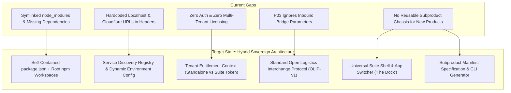
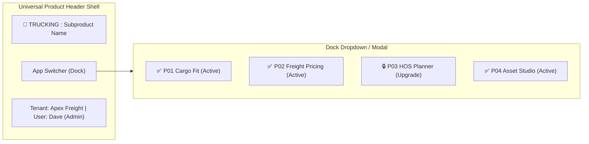

# TRUCKING Architecture Audit: Sovereign Standalone & Unified Suite Architecture

## Executive Summary

The **TRUCKING** platform currently consists of four high-fidelity commercial freight applications:
1. **Product 01 (Cargo Fit)**: 3D heuristic packing, axle weight distribution, and cargo securement.
2. **Product 02 (Freight Pricing HUD)**: Carrier cost waterfall, diesel index escalation, and broker rate confirmations.
3. **Product 03 (HOS Compliance Planner)**: FMCSA Part 395 regulatory hours of service and 24-hr ELD logbooks.
4. **Product 04 (Fleet & Cargo Asset Studio)**: Digital twin vehicle catalog, 3D WebGL, 2.5D Isometric, and 2D CAD blueprints.
*(Product 05 — Fleet Telematics & Sensor Mesh is reserved).*

The business requirement mandates a **Hybrid Sovereign Architecture**:
- **Single-Product Standalone Mode**: A client can sign up for and use **only one product** (e.g., an independent owner-operator purchasing only Product 01 or Product 02). The product must be 100% self-sufficient, deployable on its own domain, with zero reliance on sibling repositories.
- **Mix-and-Match Suite Mode**: A fleet or brokerage client can license **any combination** (e.g., Products 01 + 02, or 01 + 03 + 04, or all four). They must experience a seamless unified suite with Single Sign-On (SSO), shared tenant context, a universal App Switcher ("Dock"), and bi-directional data flow.
- **Pluggable Extensibility**: Any new product (Product 05 Telematics, Product 06 Dispatch, etc.) must plug into this identical model automatically using a standardized Subproduct Chassis.

---

## 1. Current State Technical Audit

| Dimension | Current Implementation | Independence Assessment | Suite / Combination Assessment |
| :--- | :--- | :--- | :--- |
| **Monorepo & Packaging** | Root has `package.json` with scripts (`dev:all`, `test:all`, etc.), but **no `workspaces`** configured. Subproducts 02, 03, and 04 have **symlinked `node_modules`** pointing to `../product-01-cargo-fit/node_modules`. | ❌ **FAIL**: If P02, P03, or P04 is cloned or deployed alone, symlink breaks. P02 and P03 use `three` in 3D views but don't declare `three` in `package.json`. | ⚠️ **PARTIAL**: Works locally only because Product 01 happens to be installed. |
| **Authentication & Tenancy** | Zero authentication or user accounts. All state is local in-memory React state and browser `localStorage`. | ⚠️ **PARTIAL**: Usable as an anonymous tool, but cannot monetize or retain per-client data in a standalone SaaS model. | ❌ **FAIL**: No concept of shared tenant, user profile, or cross-product session. |
| **Product Entitlements** | No licensing or entitlement layer. Every product displays all features and cross-links unconditionally. | ❌ **FAIL**: No ability to gate access, charge subscriptions, or manage feature tiers. | ❌ **FAIL**: No ability to license a subset (e.g., [P01, P02] only). |
| **Cross-Product Bridges** | URL query parameters (e.g., `?source=cargofit&loadedLbs=...`, `?source=asset_studio_p04&...`). | ✅ **GOOD**: Stateless, zero-friction handoffs work across domains. | ⚠️ **FRAGILE**: URLs hit length limits (~2KB); Product 03 completely ignores query params; URLs are hardcoded to `localhost` and `pages.dev`. |
| **Navigation & UI Shell** | Each product has a bespoke header with hardcoded `<a>` links to other products' localhost ports. | ❌ **FAIL**: Standalone users see broken links or external links to localhost. | ⚠️ **CLUNKY**: No unified App Switcher; navigation is fragmented and requires manual link updates in every repo. |
| **Data Schemas** | Product 04 initiated `Open Logistics Asset Schema v1.0` (JSON/CSV). Others use bespoke TypeScript types. | ⚠️ **PARTIAL**: Schema exists for assets, but load plans and rate confirmations lack formalized interop schemas. | ⚠️ **PARTIAL**: Bridges rely on loose URL param parsing rather than a shared, versioned schema contract. |

---

## 2. Gap Analysis: What Must Be Solved



### Gap 1: Package Independence & Dependency Isolation
- `products/product-02-freight-pricing/package.json` and `products/product-03-hos-planner/package.json` both import `three` in `Realtime3DVehicle.tsx` and `Realtime3DCorridor.tsx`, but omit `three` and `@types/three` from their dependencies.
- The symlinks `node_modules -> ../product-01-cargo-fit/node_modules` must be replaced with proper **npm workspaces** (`"workspaces": ["products/*"]`) at the root level, and every subproduct must have its own standalone, complete `package.json`.

### Gap 2: Cross-Product Service Discovery
- Currently, URLs like `http://localhost:5174`, `http://localhost:5175`, `http://localhost:5176`, `https://freightpricing.pages.dev`, and `https://hosdispatch.pages.dev` are hardcoded in source files (`quoteBridge.ts`, `bridges.ts`, `App.tsx`).
- In production, each product might run on:
  - Custom standalone subdomains: `cargo.clientdomain.com`, `pricing.clientdomain.com`, etc.
  - Or a path-based reverse proxy: `app.trucking.io/cargo`, `app.trucking.io/pricing`.
  - A centralized Service Registry / environment configuration must resolve product URLs dynamically.

### Gap 3: Client Entitlement & Subscription Gateway
- **Standalone Client**: Signs up for Product 01. Their token has `entitlements: ['product-01']`.
  - Cross-product bridge buttons (e.g., "Export to Pricing") should offer:
    1. Direct file export (JSON / CSV / PDF) for use in their own external ERP/TMS.
    2. An upgrade preview modal explaining the benefits of Product 02 with a 1-click upgrade / trial request.
- **Mix-and-Match Client**: Signs up for Products 01 + 02. Their token has `entitlements: ['product-01', 'product-02']`.
  - Both products are fully unlocked.
  - The App Switcher displays active shortcuts between them.
  - Products 03 and 04 show a subtle "Add to Plan" badge.

### Gap 4: Product 03 (HOS Planner) Ingestion Blindspot
- Product 04 generates rich bridge URLs for Product 03 (`buildHosPlannerBridgeUrl` with `vehicleName`, `miles`, `speed`, `fuelType`, `rangeMiles`).
- However, `product-03-hos-planner/src/ui/App.tsx` does not check `window.location.search` at all! It defaults to Chicago-Dallas every time. This must be wired up immediately.

---

## 3. The Target Architecture: The "Hybrid Sovereign" Pattern

### A. Subproduct Manifest Specification (`product.manifest.json`)
Every subproduct (current 01–04 and future 05+) contains a standard declarative manifest in its root:

```json
{
  "$schema": "https://trucking.platform.io/schemas/subproduct-manifest-v1.json",
  "id": "product-01-cargo-fit",
  "name": "Cargo Fit & 3D Load Optimization",
  "shortName": "Cargo Fit",
  "code": "P01",
  "version": "1.0.0",
  "port": 5173,
  "icon": "📦",
  "category": "optimization",
  "entitlementKey": "cargo_fit",
  "routes": {
    "standalone": "https://cargofit.trucking.io",
    "suitePath": "/cargo-fit"
  },
  "bridges": {
    "consumes": [
      { "from": "product-04-asset-studio", "protocol": "OLAS-v1", "action": "load_equipment" }
    ],
    "produces": [
      { "to": "product-02-freight-pricing", "protocol": "OLLP-v1", "action": "quote_load" },
      { "to": "product-03-hos-planner", "protocol": "OLRI-v1", "action": "plan_route" }
    ]
  }
}
```

### B. Shared Suite Shell & The "Trucking Dock" Component
Instead of duplicate, hardcoded header bars, each product renders a unified, lightweight navigation shell:



- When running in **Standalone Mode** (single client): The App Switcher collapses into a discrete "Trucking Suite" badge or features button, keeping the app completely clean and focused on its singular tool purpose.
- When running in **Suite Mode** (multi-product client): The App Switcher lets users switch between licensed tools with zero re-login.

### C. Open Logistics Interchange Protocol (OLIP-v1)
To ensure any two products (now or in the future) can exchange complex state without URL overflow:

1. **Tier 1 — Stateless URL Bridge (Quick Launch)**:
   - Encodes essential parameters into compact URL query parameters (or compressed base64 gzip payload `?payload=...` for up to 30 items).
2. **Tier 2 — Universal File Bridge (Air-Gapped Standalone)**:
   - Every product supports 1-click **Export Open Logistics File (`.olf.json`)** and **Import Open Logistics File**.
   - If a client only owns Product 01 and uses a 3rd party TMS or Excel, they export standard JSON/CSV.
3. **Tier 3 — Tenant Cloud Store Bridge (Suite Mode)**:
   - When licensed together, Product 01 saves the load plan to tenant storage: `POST /api/plans -> { id: "plan_8f9a" }`.
   - The bridge simply opens Product 02 with `?planId=plan_8f9a`, and Product 02 fetches the verified 3D load and axle weights directly.

---

## 4. Implementation Roadmap & Decision Plan

### Phase 1: Dependency Self-Sufficiency & Workspace Governance (Immediate)
1. Add `three` and `@types/three` to `products/product-02-freight-pricing/package.json` and `products/product-03-hos-planner/package.json`.
2. Configure root `package.json` with npm workspaces: `"workspaces": ["products/*"]`.
3. Remove ad-hoc symlinked `node_modules` in favor of workspace resolution.
4. Verify that each product builds independently: `cd products/product-XX && npm install && npm run build`.

### Phase 2: Ingestion & Interop Completeness
1. Update `product-03-hos-planner/src/ui/App.tsx` to parse incoming bridge parameters (`vehicleName`, `miles`, `speed`, `fuelType`, `rangeMiles`) from Product 04.
2. Unify service discovery: replace hardcoded localhost strings with a shared `services.ts` configuration reading from `VITE_*` environment variables with graceful localhost fallbacks.

### Phase 3: The Universal Suite Shell & App Switcher ("The Dock")
1. Create a lightweight, zero-dependency React component `<SuiteHeader />` or `<AppSwitcher />`.
2. Integrate into each product's header:
   - Displays product name + current client/tenant badge.
   - Shows licensed apps with 1-click navigation.
   - Shows unlicensed apps with a clean modal preview.

### Phase 4: Subproduct Manifest & Generator CLI
1. Add `product.manifest.json` to all 4 products.
2. Update `scripts/dev-all.mjs`, `scripts/build-all.mjs`, and `scripts/test-all.mjs` to read from the manifests dynamically (retiring hardcoded port maps).
3. Create a scaffolding script `scripts/create-product.mjs` that creates Product N with all boilerplate, manifest, and suite integration pre-configured.

### Phase 5: Auth & Entitlement Gateway (Production SaaS Ready)
1. Implement a pluggable `TenantProvider` in each product:
   - **Local Dev / Standalone Mode**: Mock tenant with full or configurable permissions.
   - **Production SaaS Mode**: JWT / OAuth bearer token with `tenant_id` and `licensed_products` array.
2. Add "Upgrade to Unlock" feature gates when an unpurchased cross-product bridge is clicked.

---

## 5. Decision Points for User Alignment

Before initiating code changes, please decide on the following implementation preferences:

1. **Monorepo Packaging Model**:
   - **Option A (Recommended)**: Official npm workspaces (`workspaces: ["products/*"]`) at root, keeping sovereign repos inside `products/`. Each subproduct has its own complete `package.json` and can be built either from root or inside its own folder.
   - **Option B**: Completely detached subdirectories with no root workspace, running independent `npm install` inside each folder separately.

2. **Cross-Product Data Handoffs**:
   - **Option A (Recommended)**: Hybrid URL Bridge (compact params for quick links + compressed base64 payload for complex manifests) + Local/Cloud Storage fallback.
   - **Option B**: Purely LocalStorage / Shared Domain Cookies (assumes all products are hosted on subdomains of `.trucking.io`).

3. **Suite Shell & Navigation**:
   - **Option A (Recommended)**: Embeddable `<SuiteHeader />` component in each subproduct that can toggle between "Standalone Clean Mode" and "Suite Dock Mode".
   - **Option B**: Standalone products stay 100% visual silos; cross-product navigation is handled via an external portal landing page.

---

## 6. Enacted Architecture & Verification State

### Implementation Highlights
1. **Workspaces & Self-Contained Dependencies (Option A Enacted)**:
   - Root `package.json` now configures `"workspaces": ["products/*", "packages/*"]`.
   - `product-02-freight-pricing` and `product-03-hos-planner` explicitly declare `@types/three` and `three`.
   - Individual subproducts can build and test completely isolated from each other (`cd products/<p> && npm test && npm run build`).
2. **Universal Subproduct Manifests**:
   - Created `product.manifest.json` across all subproducts (Command Center Portal, P01 Cargo Fit, P02 Freight Pricing, P03 HOS Planner, P04 Asset Studio, P05 Fleet Telematics).
   - Root orchestrators (`dev-all.mjs`, `build-all.mjs`, `test-all.mjs`, `typecheck-all.mjs`) dynamically discover and drive all subproducts.
3. **The Universal Suite Dock (`<SuiteDock />`) & Upsell Gateway**:
   - Deployed to all subproducts with a 9-dots App Switcher.
   - Licensed apps launch with 1-click single-sign-on handoffs.
   - Unlicensed apps display an **Upsell Modal** with transparent tier pricing and an instant 14-day free trial simulation.
   - Includes a toggle between "Standalone View" (clean single-tool UX) and "Suite View" (cross-product suite UX).
4. **Product 03 Bridge Ingestion Fixed**:
   - `product-03-hos-planner/src/ui/App.tsx` now inspects inbound query parameters (`source === 'asset_studio_p04'` and `source === 'product-05-telematics'`), automatically populating distance, speed, and driver location, and rendering a prominent Bridge Intake banner.
   - Fixed FMCSA 30-minute break evaluation sequence in `planCorridorItinerary`.
5. **Subproduct Scaffolding CLI**:
   - Added `scripts/create-product.mjs` (`npm run create:product <id> <name> [port] [icon]`) ensuring future subproducts instantly conform to the manifest, test runner, and Suite Dock standard.

### Test & Build Verification Summary
- **Subproduct Numbering & Port Mapping (Canonical Portfolio)**:
  - `command-center-portal` (Port 5170 · P00): Unified Command Center Portal
  - `product-01-cargo-fit` (Port 5173 · P01): Cargo Fit & 3D Load Optimization
  - `product-02-freight-pricing` (Port 5174 · P02): Freight Pricing & Tactical Dispatch HUD
  - `product-03-hos-planner` (Port 5175 · P03): HOS Compliance & Interstate Corridor Legality Planner
  - `product-04-asset-studio` (Port 5176 · P04): Fleet & Cargo Asset Studio
  - `product-05-fleet-telematics` (Port 5177 · P05): Fleet Telematics & Real-Time Tracking HUD
  - `product-06-warehouse-space-flow` (Port 5178 · P06): Warehouse Space & Flow Planner
  - `product-07-yard-dock` (Port 5179 · P07): Yard & Dock Management
  - `product-08-carrier-trust` (Port 5180 · P08): Carrier Trust & Anti-Fraud Shield

> [!NOTE] Numbering Resolution Note
> During an earlier development phase, the Carrier Safety & Compliance module was temporarily scaffolded under the collision name `product-06-carrier-safety` while `product-06-warehouse-space-flow` was also being created. This was resolved by canonizing:
> 1. `product-06-warehouse-space-flow` as **Product 06 (Port 5178)**
> 2. `product-07-yard-dock` as **Product 07 (Port 5179)**
> 3. Carrier Safety/Anti-Fraud as **Product 08 — `product-08-carrier-trust` (Port 5180)**
>
> All port assignments, manifests, cross-product bridges, and `<SuiteDock />` entries are 100% unique and collision-free.

- **Typecheck**: `npm run typecheck:all` -> **0 errors across all 9 sovereign subproducts**.
- **Tests**: **412 passing unit & integration tests** across all 9 subproducts (plus 4 in `@trucking/suite-dock` and 43 in `@trucking/shipment-flow`):
  - `command-center-portal` (Port 5170): 24 passed (24)
  - `product-01-cargo-fit` (Port 5173): 99 passed (99)
  - `product-02-freight-pricing` (Port 5174): 76 passed (76)
  - `product-03-hos-planner` (Port 5175): 35 passed (35)
  - `product-04-asset-studio` (Port 5176): 52 passed (52)
  - `product-05-fleet-telematics` (Port 5177): 26 passed (26)
  - `product-06-warehouse-space-flow` (Port 5178): 45 passed (45)
  - `product-07-yard-dock` (Port 5179): 26 passed (26)
  - `product-08-carrier-trust` (Port 5180): 29 passed (29)
- **Production Builds**: `npm run build:all` -> **All 9 production bundles compiled successfully** into isolated `dist/` directories.

