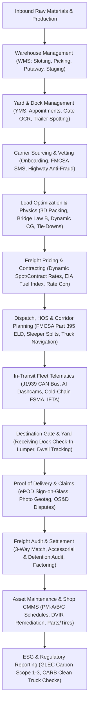
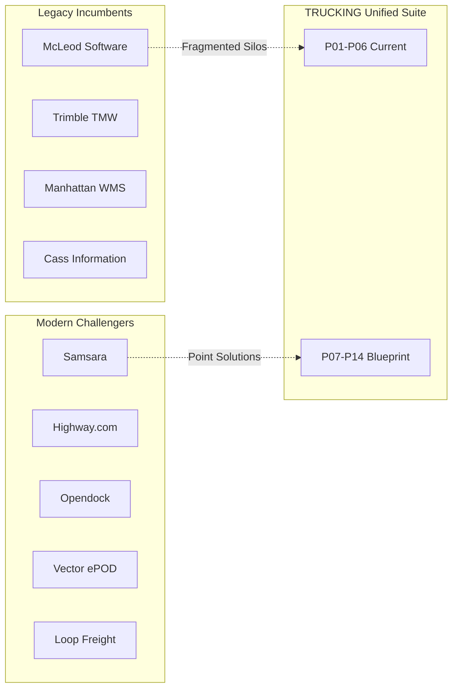

# TRUCKING — Full Industry Product Suite Gap Audit & Strategic Expansion Blueprint
**From Facility & Warehousing to Interstate Freight, Fleets, and Financial Settlement**
*Document Version: 1.0.0 · Date: October 2026 · Author: Systems & Enterprise Logistics Architecture*

---

## 1. Executive Summary: The End-to-End Freight Ecosystem

The commercial freight and supply chain industry in North America and globally is not a collection of isolated point solutions; it is an interconnected, high-velocity physical and financial pipeline. Every pallet manufactured inside a production facility traverses an unbroken operational lifecycle:



### Current Workspace Baseline
The TRUCKING workspace has established sovereign, high-fidelity micro-frontends with deep domain algorithms:
1. **[Product 01: Cargo Fit](file:///Users/pranay/Projects/trucking/products/product-01-cargo-fit)** (`Port 5173`) — 3D heuristic packing, Federal Bridge Formula B axle tare calculations, 49 CFR § 393.102 tie-downs, VICS Bill of Lading, EDI 204/214.
2. **[Product 02: Freight Pricing HUD](file:///Users/pranay/Projects/trucking/products/product-02-freight-pricing)** (`Port 5174`) — Cost waterfalls, diesel escalation, 3D digital vehicle twin, 1-click broker rate confirmations.
3. **[Product 03: HOS Planner](file:///Users/pranay/Projects/trucking/products/product-03-hos-planner)** (`Port 5175`) — FMCSA Part 395 hours of service engine, 24-hr visual ELD chart, corridor waypoints.
4. **[Product 04: Asset Studio](file:///Users/pranay/Projects/trucking/products/product-04-asset-studio)** (`Port 5176`) — 20 vehicles, 23 packaging types, 3D WebGL / 2.5D Isometric / 2D CAD blueprints, dynamic CG axle moment engine, multi-vehicle fleet splitter.
5. **[Product 05: Fleet Telematics](file:///Users/pranay/Projects/trucking/products/product-05-fleet-telematics)** (`Port 5177`) — SAE J1939 CAN bus OBD-II telemetry, cold-chain FSMA thermal logger, I-80 geofence canvas, active DTCs.
6. **[Product 06: Warehouse Space & Flow Planner](file:///Users/pranay/Projects/trucking/products/product-06-warehouse-space-flow)** (`Port 5178`) — SVG axonometric 3D facility twin, ABC slotting, moveable container dual-role tracking, inbound putaway optimizer, GS1 EPCIS scans.
7. **[Product 06 (Branch): Carrier Safety & Compliance HUD](file:///Users/pranay/Projects/trucking/products/product-06-carrier-safety)** (`Port 5178/5179`) — FMCSA SMS 7 BASIC percentiles, COI policy verification, chameleon & double-brokering fraud risk scoring, Do Not Dispatch (DND) rules.
8. **[Command Center Portal](file:///Users/pranay/Projects/trucking/products/command-center-portal)** (`Port 5170`) — 6-stage lifecycle stepper, EDI Hub, Dispatch Manifest, unified `<SuiteDock />`.

While the current suite solves the core mechanical, physical, and planning challenges with remarkable depth, **critical operational, transactional, financial, and edge-device domains remain uncovered**. Below is the exhaustive audit of what is missing within existing subproducts, what major industry modules are absent, and the blueprint to transform the suite into an enterprise-grade platform rivaling Manhattan Associates, Blue Yonder, Samsara, and McLeod Software.

---

## 2. Micro-Audit: What is Missing INSIDE Existing Subproducts

### 2.1 Product 01: Cargo Fit & 3D Load Optimization (Port 5173)
*What it does well:* 3D packing heuristic, Bridge Law Formula B, cargo securement calculations, EDI 204/214 generation, camera barcode scanner.

*Gaps & Missing Capabilities:*
1. **Fifth Wheel & Trailer Tandem Sliding Simulation**:
   - *The Reality:* Drivers and warehouse loaders don't just accept axle overload; they slide the tractor fifth wheel (altering steer vs. drive axle moments) and slide the trailer tandem boggies (moving the pivot point relative to the cargo center of gravity).
   - *Missing Feature:* Interactive pin-slider UI (pins 1 to 12 on trailer tandem rails) calculating dynamic weight transfer ($\sim 250\text{--}500\text{ lbs}$ per pin hole) to clear state-specific kingpin-to-rear-axle (KPRA) limits (e.g., California 40-foot KPRA rule).
2. **Hazardous Materials Segregation Matrix (49 CFR § 177.848)**:
   - *The Reality:* Loading general freight alongside Hazmat requires mandatory spatial segregation. Class 1 Explosives cannot touch Class 5 Oxidizers; Cyanides cannot be loaded above or adjacent to Acids.
   - *Missing Feature:* Automated compliance check validating that hazardous placards on the manifest obey the FMCSA Hazmat Segregation Table, preventing illegal co-loading.
3. **Multi-Temperature Compartment Bulkheads (Dual & Tri-Temp Reefers)**:
   - *The Reality:* Grocery logistics requires dividing a 53-ft reefer into Frozen ($-10^\circ\text{F}$), Chilled ($34^\circ\text{F}$), and Dry Ambient ($65^\circ\text{F}$) zones using moveable insulated bulkheads.
   - *Missing Feature:* Longitudinal bulkhead positioning tool calculating cubic capacity per temperature zone and validating thermal load balance.
4. **NMFC Density-Based Freight Classification**:
   - *The Reality:* LTL freight pricing depends heavily on National Motor Freight Classification (NMFC) classes (50 to 500) determined by packaging density (lbs/cu ft), handling, liability, and stowability.
   - *Missing Feature:* Auto-calculation of shipment cube density and NMFC class recommendation to prevent carrier re-classification penalties.
5. **Dunnage, Void Fill & Airbag Placement Engine**:
   - *The Reality:* Under 49 CFR § 393.106, lateral and longitudinal void space $> 6\text{ inches}$ requires void fillers, friction mats, or inflatable air dunnage bags to prevent load shifting under $0.8g$ forward deceleration.
   - *Missing Feature:* Void space detection alerting loaders where air bags, load locks, or friction rubber pads must be inserted.
6. **Carton Compressive Strength & Stacking Crush Limits**:
   - *The Reality:* Heavy pallets cannot be double-stacked on top of light corrugated boxes without exceeding Box Compression Test (BCT) or Edge Crush Test (ECT) ratings.
   - *Missing Feature:* Maximum static stacking load verification ($kg/m^2$ limit) preventing box collapse during transit.
7. **Interactive 3D Manual Repack & Override Mode**:
   - *The Reality:* Algorithmic placement often needs a human dock supervisor's touch (e.g., swapping two pallets to accommodate a priority stop).
   - *Missing Feature:* Drag-and-drop raycasting in Three.js allowing the operator to lift, rotate, and reposition individual pallets with live collision detection and real-time center-of-gravity updates.

---

### 2.2 Product 02: Freight Pricing & Tactical Dispatch HUD (Port 5174)
*What it does well:* Carrier cost waterfall, EIA weekly diesel index pegging, 3D isometric truck twin, 1-click broker rate confirmation.

*Gaps & Missing Capabilities:*
1. **Dynamic Spot vs. Contract Benchmark Integrations**:
   - *The Reality:* Freight pricing cannot happen in a vacuum. Brokers and shippers benchmark against DAT iQ RateView, FreightWaves SONAR, and Truckstop.com market averages.
   - *Missing Feature:* Lane density indices (Van/Reefer load-to-truck ratio), historical 30-day rolling rate bands, and 7-day spot rate forecasts.
2. **Backhaul & Triangle Lane Margin Optimization**:
   - *The Reality:* A headhaul from Chicago to Atlanta at $\$3.20/\text{mi}$ can become unprofitable if the return backhaul only pays $\$1.30/\text{mi}$ with 250 miles of deadhead.
   - *Missing Feature:* Triangulation route recommender (e.g., Chicago $\to$ Atlanta $\to$ Nashville $\to$ Chicago) maximizing composite revenue per total network mile.
3. **Multi-Tiered Accessorial Rate Schedule**:
   - *The Reality:* Detention, layover, TONU (Truck Order Not Used), hazardous surcharges, inside delivery, lumper fees, and residential liftgate fees represent $15\text{--}25\%$ of total invoice revenue.
   - *Missing Feature:* Configurable accessorial rate card editor with contract clauses (e.g., 2 hours free time, $\$85/\text{hr}$ thereafter in 15-minute increments; TONU flat fee of $\$250$ if cancelled after 12:00 PM).
4. **Broker Margin Split & Internal Agent Commissions**:
   - *The Reality:* Freight brokerages track buy-rate (carrier pay), sell-rate (shipper charge), gross margin percentage, and dispatch agent commission splits ($10\text{--}30\%$ of gross margin).
   - *Missing Feature:* Internal brokerage margin ledger separating customer quote from carrier rate confirmation with margin protection alerts ($< 12\%$ margin warning).
5. **Factoring & QuickPay Discount Calculator**:
   - *The Reality:* Carriers rarely wait Net 30; they accept QuickPay ($1.5\text{--}3.0\%$ discount for 2-day ACH) or submit invoices to factoring companies (Triumph, RTS, OTR Solutions).
   - *Missing Feature:* Payment term selector calculating net payable payouts, factoring Notice of Assignment (NOA) account routing, and working capital cash float.

---

### 2.3 Product 03: HOS Compliance & Interstate Corridor Legality Planner (Port 5175)
*What it does well:* FMCSA Part 395 11-hr driving, 14-hr duty window, 30-min break, 70-hr rolling cycle, solo vs. team simulation, preset interstate corridors, 24-hr visual ELD chart.

*Gaps & Missing Capabilities:*
1. **Split Sleeper Berth Flexibility (8/2 and 7/3 Provisions)**:
   - *The Reality:* Under the 2020 FMCSA Hours of Service Final Rule, drivers can split their mandatory 10-hour off-duty period into an $8/2$ or $7/3$ split without pausing their 14-hour duty clock until the qualifying sleeper period.
   - *Missing Feature:* Split sleeper calculation engine allowing drivers to pause duty clocks during warehouse loading delays.
2. **Statutory HOS Exemptions Engine**:
   - *49 CFR § 395.1(k) Agricultural Exemption:* 150 air-mile radius from source during harvest seasons (completely off-duty/unregulated HOS).
   - *49 CFR § 395.1(o) 16-Hour Short-Haul Exception:* Once per 7 days for drivers returning to their work reporting location.
   - *49 CFR § 395.1(b)(1) Adverse Driving Conditions:* 2-hour driving time extension due to unforeseen blizzards, accidents, or detours.
   - *Personal Conveyance (PC) vs. Yard Move (YM):* Logging bobtail driving to food/motel as PC (off-duty) and terminal repositioning as YM (on-duty not driving).
3. **Turn-by-Turn Truck-Safe Dynamic Routing**:
   - *The Reality:* Trucks cannot take passenger car routes due to 13'6" bridge clearances, 80,000-lb gross weight limits on secondary roads, and Hazmat tunnel restrictions.
   - *Missing Feature:* Integration of truck-specific GIS routing (PC*MILER / HERE Truck API) calculating true commercial routing miles rather than straight-line or passenger highway distances.
4. **Real-Time Truck Parking Reservation & Crowdsourcing**:
   - *The Reality:* Truck parking shortage is the #1 driver safety stressor. Running out of driving hours on the interstate shoulder results in severe FMCSA violations and fatal crashes.
   - *Missing Feature:* Waypoint truck stop parking availability monitor (Love's, Pilot Flying J, TA-Petro, state rest areas) with automated rest-stop reservations along the corridor.
5. **Multi-Day 8-Day Cycle Hours Recap**:
   - *The Reality:* Drivers need to know how many hours they regain at midnight on Day 8 (rolling 70-hour recap).
   - *Missing Feature:* 8-day rolling hours recap table showing daily hours worked, available duty hours tomorrow, and projected 34-hour restart trigger.
6. **Cross-Border HOS Rules (USMCA / Canada & Mexico)**:
   - *Canada (SOR/2005-313):* 13 hours driving, 14 hours on-duty, 16-hour workshift, Cycle 1 (70 hrs/7 days) or Cycle 2 (120 hrs/14 days).
   - *Mexico (NOM-087-SCT-2-2017):* 14 hours maximum driving in 24 hours with mandatory 30-min break every 5 hours.

---

### 2.4 Product 04: Fleet & Cargo Asset Studio (Port 5176)
*What it does well:* 20 vehicle types, 23 packaging twins, 3D WebGL / 2.5D Isometric / 2D CAD blueprints, dynamic CG axle moment calculation across drop sequences, multi-vehicle fleet splitter, GLEC carbon emissions.

*Gaps & Missing Capabilities:*
1. **Zero-Emission Heavy Electric Class 8 Powertrain Profiles**:
   - *The Reality:* Fleets are adopting Tesla Semi, Freightliner eCascadia, and Volvo VNR Electric. These vehicles have unique payload-versus-range curves, charging rates (Megawatt Charging Systems - MCS), and battery weight exemptions ($2,000\text{ lb}$ federal allowance under FAST Act / 23 U.S.C. 127(s)).
   - *Missing Feature:* Battery state-of-charge (SoC) consumption modeling ($1.5\text{--}2.2\text{ kWh/mile}$ loaded), regenerative braking energy recapture on mountain descents, and charging stop duration optimization.
2. **Aerodynamic Fairings & Eco-Equipment Modeler**:
   - *The Reality:* EPA SmartWay verified trailer skirts, tails (rear boat-tails), cab side extenders, and super single tires reduce aerodynamic drag ($C_d$) by $6\text{--}12\%$, directly reducing fuel burn.
   - *Missing Feature:* Toggleable aerodynamic package accessories modifying the temporal fuel burn coefficients in the simulation.
3. **Specialized Commercial Trailer Types**:
   - *Missing Assets:* RGN (Removable Gooseneck) lowboy trailers with well length and ground clearance parameters; Step-deck/drop-deck with beavertails; Bulk pneumatic dry-hopper trailers for cement/flour; B-Train and Rocky Mountain Double combinations (twin 28.5-ft pups and 48-ft + 28-ft combinations).
4. **Trailer IoT Sensor Topology Mapping**:
   - *The Reality:* Smart trailers (Great Dane FleetPulse, Wabash Cargo Connect) have 8 to 15 digital sensors mounted across the chassis.
   - *Missing Feature:* Interactive 3D sensor pin mapping: wheel-end TPMS sensors, ultrasonic cargo volume fullness sensors (estimating % cube filled), door reed switches, solar battery monitors, and air brake stroke sensors.

---

### 2.5 Product 05: Fleet Telematics & Real-Time Tracking HUD (Port 5177)
*What it does well:* SAE J1939 CAN bus OBD-II simulation, cold-chain reefer thermal dissipation and alarms (+0.15°F/s door open), I-80 corridor geofencing canvas, active DTCs (SPN 111, SPN 100), safety counters.

*Gaps & Missing Capabilities:*
1. **Live GPS Breadcrumb Historical Replay**:
   - *The Reality:* Fleet dispatchers investigating accidents or fuel theft need minute-by-minute historical track replay with vehicle speed, heading, and sensor telemetry overlay.
   - *Missing Feature:* Scrubbable time-slider map replay showing exact historical coordinates, speeding events, and rest stops.
2. **AI Video Safety & In-Cab Computer Vision Telemetry**:
   - *The Reality:* Samsara and Motive dominate the market through AI Dashcams detecting distracted driving (mobile phone usage), driver drowsiness/micro-sleep, rolling stop signs, and tailgating.
   - *Missing Feature:* Video safety event queue logging ADAS forward-collision events, in-cab driver monitoring (DMS) alerts, driver safety coaching scores, and video clip request triggers.
3. **18-Wheel End Tire Pressure Monitoring System (TPMS)**:
   - *The Reality:* Commercial tire blowouts are a leading cause of roadside breakdowns and severe accidents. Under-inflated tires increase fuel consumption by $1.5\%$.
   - *Missing Feature:* 18-wheel graphic telemetry displaying individual tire PSI and temperature, alerting to rapid pressure drops or overheating wheel bearings.
4. **Automated IFTA (International Fuel Tax Agreement) Jurisdiction Engine**:
   - *The Reality:* Interstate carriers must file quarterly IFTA tax returns detailing exact miles driven in each state/province and gallons of fuel purchased to reconcile state fuel taxes.
   - *Missing Feature:* Automated GPS state-line crossing logging aggregating mileage by state (e.g., Illinois 214 mi, Iowa 302 mi, Nebraska 455 mi) and computing quarterly tax liability/credit.
5. **Two-Way Remote Reefer Telematics Control**:
   - *The Reality:* Modern telematics allows dispatchers to remotely change reefer setpoints (e.g., from $+34^\circ\text{F}$ to $-10^\circ\text{F}$), trigger defrost cycles, or switch unit mode from Continuous to Start-Stop via API.
   - *Missing Feature:* Bidirectional reefer control panel allowing dispatchers to issue remote commands to Carrier Transicold / Thermo King units.

---

### 2.6 Product 06: Warehouse Space & Flow Planner (Port 5178)
*What it does well:* Axonometric pure-vector SVG 3D facility twin, ABC slotting optimization, dual-role moveable container tracking, inbound putaway allocation, GS1 EPCIS scan verification.

*Gaps & Missing Capabilities:*
1. **Outbound Picking Strategy & Wave/Batch Orchestration**:
   - *The Reality:* Modern distribution centers fulfill hundreds of customer orders simultaneously using Wave Picking (releasing orders based on carrier departure times), Batch Picking (picking multiple orders in one pass), and Zone Picking (pick-and-pass along conveyor zones).
   - *Missing Feature:* Outbound pick-wave builder with traveling salesperson (TSP) pick-path optimization minimizing worker travel distance through aisles.
2. **Cross-Docking Direct Allocation Engine**:
   - *The Reality:* High-efficiency facilities bypass rack storage completely. Inbound pallets are transferred directly from Inbound Door A to Outbound Door B for immediate truck loading.
   - *Missing Feature:* Inbound-to-outbound cross-dock matching engine based on departure schedule and destination hub matching.
3. **Inventory Depth: Lot, Expiration Date (FEFO/FIFO) & Serial Tracking**:
   - *The Reality:* Food, beverage, and pharmaceuticals mandate First-Expired, First-Out (FEFO) picking, lot recall quarantine, and unit-level serial number traceability (DSCSA compliance for pharma).
   - *Missing Feature:* Lot traceability ledger with 1-click quarantine hold locking specific pallet locations from being picked.
4. **Returns & Reverse Logistics (RMA) Processing**:
   - *The Reality:* E-commerce and retail logistics see $15\text{--}30\%$ return rates requiring receiving inspection, grade classification (A/B/C/scrap), refurbishment routing, or liquidation staging.
   - *Missing Feature:* Reverse logistics triage workflow assigning returned assets to restock, repack, or disposal locations.

---

### 2.7 Product 06 / 07: Carrier Safety, Vetting & Anti-Fraud HUD (Port 5178/5179)
*What it does well:* FMCSA SMS 7 BASIC percentiles, insurance COI policy verification, chameleon carrier & double brokering risk scoring, Do Not Dispatch (DND) rules.

*Gaps & Missing Capabilities:*
1. **FMCSA SAFER / QCMobile Real-Time API Scraper**:
   - *The Reality:* Safety percentiles and operating authority status change daily. Fraudulent carriers get revoked overnight.
   - *Missing Feature:* Live or cached API sync pulling DOT inspection records, out-of-service (OOS) percentages, fatal crash counts, and active operating authority from FMCSA SAFER / L&I databases.
2. **Automated Certificate of Insurance (COI) OCR Extraction**:
   - *The Reality:* Carriers upload ACORD-25 insurance certificates. Brokers manually verify policy limits, effective dates, and ensure the broker/shipper is named as Additional Insured with Certificate Holder status.
   - *Missing Feature:* Vision OCR parser extracting policy numbers, AM Best rating of underwriter, expiration dates, and sending automated 30-day renewal requests.
3. **FreightGuard Incident Exchange & Double-Brokering Blacklist**:
   - *The Reality:* Brokers rely on Carrier411 FreightGuard reports and Highway.com crowd-sourced reports of unauthorized re-brokering, hostage loads, and missed pickups.
   - *Missing Feature:* User-generated incident reporting engine and carrier network reputation score.
4. **Driver Qualification File (DQF) & FMCSA Clearinghouse Compliance**:
   - *The Reality:* 49 CFR Part 391 requires carriers to maintain complete DQF packets for every driver: Commercial Driver's License (CDL) verification, Medical Examiner's Certificate (DOT physical), 3-year prior employment history, annual Motor Vehicle Record (MVR) pull, and annual FMCSA Drug & Alcohol Clearinghouse query.
   - *Missing Feature:* DQF audit compliance dashboard alerting when medical cards or CDLs expire.

---

### 2.8 Command Center Portal (Port 5170)
*What it does well:* 6-stage lifecycle stepper, EDI Hub (204, 214, 990, 210), Dispatch Manifest, unified `<SuiteDock />`.

*Gaps & Missing Capabilities:*
1. **Persona-Based Specialized Control Towers**:
   - *The Reality:* A Shipper, a 3PL Broker, a Fleet Carrier Dispatcher, a Warehouse Operations Director, and a Safety Officer need fundamentally different cockpit views.
   - *Missing Feature:* Role switcher configuring the dashboard widgets (e.g., Shipper sees Freight Spend & Delivery OTD; Safety Director sees BASIC scores & DND alerts; Warehouse Ops sees Dock Congestion & Putaway Queues).
2. **Unified Real-Time Event Bus & Webhook Mesh**:
   - *The Reality:* Currently, products exchange data via `platformBus.ts` over `localStorage` and `BroadcastChannel`. In multi-user commercial SaaS, state updates must be synchronized via WebSockets, Server-Sent Events (SSE), or webhooks.
   - *Missing Feature:* Cloud-ready event streaming architecture linking subproducts across different browser tabs, devices, or remote API clients.
3. **Centralized Exception Management Control Tower**:
   - *The Reality:* Logistics operations manage by exception. Operators don't watch smooth loads; they respond to red flags.
   - *Missing Feature:* High-priority exception feed aggregating:
     - Temperature excursion on active Reefer Load #4192 (P05).
     - Driver approaching 11-hour driving cap with 90 miles remaining (P03).
     - Overweight steer axle ($12,450\text{ lbs}$) on Manifest #8821 (P01).
     - Carrier insurance expired 2 days ago on booked load (Carrier Safety).
     - Dock Door #4 unloading delay exceeding 2-hour free time (Warehouse).

---

## 3. The Macro Industry Gaps: What Entire Products are Missing?

When evaluating TRUCKING as a full enterprise product suite from manufacturing dock to retail delivery, **several fundamental industry product categories are currently vacant**.

Below are the **8 Missing Sovereign Subproducts** required to complete the end-to-end industry portfolio:

| Product ID | Subproduct Name | Port | Core Domain | Direct Competitor Comps |
|---|---|---|---|---|
| **Product 07** | **Yard & Dock Management System (YMS)** | `5179` | Facility Logistics | *Opendock, C3 Solutions, Kaleris (Pinc), FourKites* |
| **Product 08** | **Carrier Trust, Vetting & Anti-Fraud** | `5180` | Risk & Governance | *Highway.com, Carrier411, RMIS (Truckstop)* |
| **Product 09** | **In-Cab Driver Companion & Truck Nav** | `5181` | Mobile Execution | *Trimble CoPilot Truck, Motive Driver, Samsara Driver* |
| **Product 10** | **Electronic Proof of Delivery (ePOD) & OS&D** | `5182` | Claims & Custody | *Vector, Transflo, Descartes MobileLink, Locus* |
| **Product 11** | **Freight Audit, 3-Way Match & Payables** | `5183` | Logistics Fintech | *Cass Information, TriumphPay, Loop Freight* |
| **Product 12** | **Fleet Maintenance & Shop CMMS** | `5184` | Equipment Assets | *Trimble TMT Fleet Maintenance, Cetaris, Dossier* |
| **Product 13** | **Port Drayage, Intermodal & USMCA Border** | `5185` | Global & Drayage | *PortPro, Envio 360, Descartes Customs* |
| **Product 14** | **Decarbonization & Clean Truck Mandates** | `5186` | ESG & Clean Energy | *SmartWay, Watershed, Einride Mesh* |

---

### Detailed Architecture of the 8 Missing Subproducts

#### Product 07: Yard & Dock Management System (YMS & Appointment Kiosk)
- **Port:** `5179` · **Category:** Facility Logistics
- **Problem Solved:** Bridges the gap between warehouse slotting (P06) and highway road transport. Eliminates gate dwell times, truck congestion, and unnecessary detention penalties.
- **Key Modules:**
  1. *Self-Service Carrier Appointment Booking:* Inbound/outbound calendar slots based on dock door constraints.
  2. *Digital Guard Shack Kiosk & Gate OCR:* Automatic license plate recognition (ALPR) and trailer container OCR.
  3. *Visual 2D/3D Interactive Yard Map:* Drop-lot tracking, dock door status (empty, spotted, loading, released).
  4. *Yard Jockey Dispatching:* Mobile work-order queue for hostler drivers moving trailers.
  5. *Detention Prevention Clock:* Live countdown alert when carrier free time has 15 minutes remaining.

#### Product 08: Carrier Trust, Vetting & Anti-Fraud Shield
- **Port:** `5180` · **Category:** Risk & Compliance
- **Problem Solved:** Neutralizes double-brokering scams, stolen MC identities, chameleon carriers, and cargo theft rings before freight is dispatched.
- **Key Modules:**
  1. *Chameleon Carrier Risk Score:* Pattern analysis matching revoked carriers' addresses, phone numbers, and officers.
  2. *VOIP & Email Domain Scrutiny:* Flags free email addresses, disposable VOIP lines, and unauthorized domains.
  3. *Continuous FMCSA SAFER / SMS Sync:* Automatic Do Not Dispatch (DND) lockout when authority is revoked.
  4. *ACORD-25 Insurance COI Vault:* Automated OCR validation of $\$1\text{M}$ auto liability and $\$100\text{k}$ cargo minimums.
  5. *Driver Qualification File (DQF) Compliance:* CDL, DOT medical card, and Clearinghouse query expiration alerts.

#### Product 09: In-Cab Driver Companion & Truck-Safe Navigation
- **Port:** `5181` · **Category:** Mobile Execution
- **Problem Solved:** Provides the mobile driver interface for turn-by-turn truck navigation, preventing bridge strikes and Hazmat tunnel violations.
- **Key Modules:**
  1. *Commercial Vehicle Restricted GPS:* Routes based on 13'6" height, 102" width, 80,000 lbs gross weight, and Hazmat classes.
  2. *Digital Dispatch Trip Sheet:* 1-tap accept/reject loads, waypoint appointments, and live ETAs.
  3. *Geofenced Automated Arrivals/Departures:* Background GPS triggering timestamps upon entering facility gates.
  4. *Digital 49 CFR § 396.11 DVIR:* Pre-trip and post-trip digital vehicle inspections with defect photo upload.
  5. *Mobile In-Cab Document Scanner:* Perspective-corrected camera capture of paper BOLs and toll receipts.

#### Product 10: Electronic Proof of Delivery (ePOD) & OS&D Claims Resolution
- **Port:** `5182` · **Category:** Claims & Custody
- **Problem Solved:** Digitizes final delivery handoff, eliminating paper loss and automating cargo damage disputes under the Carmack Amendment.
- **Key Modules:**
  1. *Sign-on-Glass eBOL / ePOD:* Cryptographic timestamp and GPS geotagging on delivery signature.
  2. *OS&D Exception Triage:* Classification of Over, Short, or Damaged shipments with required photo evidence.
  3. *Carmack Claim Package Generator:* Auto-assembles BOL, signed delivery receipt, photo evidence, and commercial invoice.
  4. *Instant Shipper Exception Notification:* Real-time alert allowing immediate replacement order fulfillment.

#### Product 11: Freight Audit, 3-Way Match & Payables Settlement Hub
- **Port:** `5183` · **Category:** Logistics Fintech
- **Problem Solved:** Eliminates $15\text{--}25\%$ error rates in carrier invoices; audits accessorials and detention against telematics GPS ground truth.
- **Key Modules:**
  1. *Automated 3-Way Freight Audit:* Cross-references Contract Rate Con vs. Telematics/ePOD vs. Carrier EDI 210 Invoice.
  2. *Detention Dispute Engine:* Reconciles claimed detention hours against geofence dwell times.
  3. *QuickPay & Factoring Gateway:* Handles 2% 2-day QuickPay discounts and Factoring Notice of Assignment (NOA) accounts.
  4. *Accessorial & Fuel Surcharge Audit:* Re-calculates weekly EIA fuel surcharge tables and verifies lumper receipts.
  5. *ERP Accounting Integration:* Exports approved vouchers to QuickBooks, NetSuite, SAP, and Dynamics 365.

#### Product 12: Fleet Maintenance & Shop Management (CMMS)
- **Port:** `5184` · **Category:** Equipment Assets
- **Problem Solved:** Converts telematics DTC fault codes (P05) and digital DVIR defects into scheduled shop work orders and DOT compliance records.
- **Key Modules:**
  1. *Preventative Maintenance Intervals:* PM-A (15k mi), PM-B (30k mi), PM-C (100k mi), and 49 CFR § 396.17 Annual DOT Inspection.
  2. *Telematics DTC-to-Work-Order Converter:* Inbound fault codes automatically generate repair orders with OEM troubleshooting.
  3. *DVIR Out-of-Service Lockout:* Locks dispatch until a certified mechanic signs off on critical safety repairs.
  4. *Parts Inventory & Warranty Tracker:* Tracks barcode parts stock and recovers OEM warranty reimbursements.
  5. *18-Wheel Tire Asset Lifecycle:* Serial number tracking, tread wear depth (in 32nds), retread cycles, and scrap analysis.

#### Product 13: Port Drayage, Intermodal & USMCA Cross-Border e-Manifest
- **Port:** `5185` · **Category:** Global & Drayage
- **Problem Solved:** Manages maritime container drayage, port demurrage fees, chassis pools, and USMCA (Mexico/Canada) border customs filings.
- **Key Modules:**
  1. *Marine Terminal & Rail Appointments:* Dual-transaction appointment booking at ocean terminals and rail ramps.
  2. *Demurrage & Per-Diem Last Free Day (LFD) Tracker:* Countdown clock preventing $\$150\text{--}\$350/\text{day}$ detention charges.
  3. *Intermodal Chassis Pool Management:* Daily rental logging and pre-trip roadability inspections for chassis.
  4. *USMCA ACE & ACI e-Manifest:* Automated filing of US CBP ACE Truck e-Manifest and Canadian CBSA ACI e-Manifest.
  5. *Border Transfer Shunt Management:* Manages Mexican transfer tractors crossing the Laredo World Trade Bridge.

#### Product 14: Decarbonization, ESG & CARB Clean Truck Compliance Hub
- **Port:** `5186` · **Category:** Clean Energy & ESG
- **Problem Solved:** Meets corporate Scope 3 emissions reporting mandates and ensures compliance with California CARB Clean Truck Check regulations.
- **Key Modules:**
  1. *GLEC Accredited Carbon Calculator:* Computes Scope 1, 2, and 3 $\text{CO}_2\text{e}$ per ton-mile across fuel types.
  2. *CARB Clean Truck Check Vault:* Manages California Heavy-Duty I/M periodic testing certificates and registration clearances.
  3. *Fleet Powertrain TCO Simulator:* Comparative financial scenarios: Diesel vs. CNG vs. BEV vs. Hydrogen Fuel Cell.
  4. *EV Depot Smart Charging Optimizer:* Schedules electric truck charging during off-peak utility hours to mitigate peak demand fees.

---

## 4. Architectural & Protocol Standard Evolution

To maintain sovereign micro-frontend independence while providing seamless enterprise execution across all 14 subproducts, the underlying platform architecture must evolve beyond browser-local mechanisms.

### Unified Open Freight Protocols
- **OLAS-v1** (*Open Logistics Asset Schema*): Standardized vehicle and packaging digital twin JSON representations.
- **OLLP-v1** (*Open Load & Loading Plan*): 3D coordinate layout, center-of-gravity, and axle tare moment distributions.
- **OWSP-v1** (*Open Warehouse Space Protocol*): Facility coordinates, rack locations, ABC velocity slotting, and putaway allocations.
- **OYMS-v1** (*Open Yard & Gate Protocol*): Dock appointments, gate check-in timestamps, trailer drop-lot coordinates, and jockey moves.
- **OCFP-v1** (*Open Carrier & Fraud Protocol*): FMCSA SMS BASIC percentiles, insurance COI policies, and anti-fraud trust scores.
- **OFAP-v1** (*Open Freight Audit & Pay*): 3-way match reconciliations, accessorial disputes, and factoring payment instructions.
- **ONET-v1** (*Open Telematics & Sensor Stream*): J1939 CAN bus frames, temperature excursion streams, and GPS breadcrumbs.

### Event Mesh: Moving from `localStorage` to Cloud Pub/Sub
- **Current State:** `platformBus.ts` operates over `localStorage` and `BroadcastChannel`. This works well across tabs on a single device, but cannot support real-time multi-user operations.
- **Target Architecture:** Cloud-native Server-Sent Events (SSE) or WebSockets powered by Cloudflare Durable Objects or Supabase Realtime, propagating events across warehouse clerks, highway drivers, and central dispatch in $<100\text{ ms}$.

---

## 5. Competitive Market Positioning Matrix



The unique competitive differentiator of the **TRUCKING** architecture is **Sovereign Composability**: each product can be sold as an independent standalone SaaS product ($49–$299/mo) or deployed together as an integrated end-to-end command center.

---

## 6. Actionable Implementation Roadmap

```
PHASE 1: Existing Product Hardening (Near-Term)
├── P01: Add trailer tandem / fifth wheel slider simulation & 49 CFR Hazmat segregation table
├── P02: Add dynamic accessorial rate cards (detention, TONU) & margin protection warnings
├── P03: Add 2020 FMCSA Split Sleeper Berth (8/2 & 7/3) rules & rolling 8-day recap
├── P04: Add Class 8 Heavy BEV profiles (Tesla Semi/eCascadia) with FAST Act weight allowances
├── P05: Add 18-wheel TPMS visual pressure/temp map & automated IFTA state mileage tracker
└── P06: Complete outbound pick-path optimizer & lot/expiration quarantine holds

PHASE 2: Immediate High-Leverage New Products (Mid-Term)
├── Product 07 (Port 5179): Yard & Dock Management System (Opendock/C3 rival)
│   ├── Carrier self-service appointment booking engine
│   ├── Interactive visual yard map with drop lot & dock door statuses
│   └── Real-time detention clock countdown preventing carrier detention charges
├── Product 08 (Port 5180): Carrier Trust, Vetting & Anti-Fraud Shield (Highway rival)
│   ├── Promotion and formalization of Carrier Safety into sovereign Product 08
│   ├── Automated chameleon carrier and VOIP/email domain fraud detection
│   └── Real-time Do Not Dispatch (DND) automated lockout engine
└── Product 10 (Port 5182): Electronic Proof of Delivery (ePOD) & OS&D Claims (Vector rival)
    ├── Mobile-responsive sign-on-glass digital signature capture
    ├── Photographic damage recording with GPS geotagging
    └── Automated Carmack Amendment claim package generator

PHASE 3: Enterprise Supply Chain & Financial Settlement (Long-Term)
├── Product 11 (Port 5183): Freight Audit, 3-Way Match & Payables Hub (TriumphPay/Loop rival)
│   ├── 3-way match: Rate Con vs. Telematics/ePOD vs. EDI 210 Freight Invoice
│   ├── Automated detention claim disputer using geofence dwell timestamps
│   └── Factoring Notice of Assignment (NOA) payment routing & QuickPay discounts
├── Product 12 (Port 5184): Fleet Maintenance & Shop CMMS (Trimble TMT rival)
│   ├── Inbound DTC-to-repair work order converter
│   ├── PM-A/B/C preventative maintenance schedules & DOT inspection stickers
│   └── 49 CFR § 396.11 DVIR defect sign-off workflow
├── Product 09 (Port 5181): Driver Mobile Companion & Turn-by-Turn Truck GPS
├── Product 13 (Port 5185): Port Drayage, Intermodal & USMCA Border e-Manifest
└── Product 14 (Port 5186): Decarbonization, ESG & CARB Clean Truck Compliance Hub
```

---

## 7. Conclusion & Architectural Recommendation

The TRUCKING suite currently stands as one of the most mathematically rigorous and visually sophisticated open freight engineering platforms in existence, featuring real physics, statutory legal calculations, and WebGL/SVG graphics. 

By systematically addressing the **micro-gaps inside existing products** (sliding tandems, Hazmat segregation, split sleeper berths, accessorial auditing) and expanding into the **macro industry frontiers** (Yard & Dock Management, Fraud Prevention, ePOD/OS&D, and 3-Way Freight Audit), the platform bridges the historical chasm between the warehouse floor and the open highway. This creates an end-to-end, commercially unstoppable operating suite that governs every foot, every pound, every mile, and every dollar in commercial freight.
