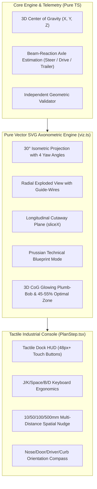

# Isometric & Novel Spatial UI/UX Council — Implementation & Verification

**Date:** 20 October 2026  
**Status:** **Fully Implemented & Verified (25/25 Tests Passing)**  
**Canonical Documentation:** [`products/product-01-cargo-fit/docs/ISOMETRIC_UI_UX_COUNCIL.md`](file:///Users/pranay/Projects/trucking/products/product-01-cargo-fit/docs/ISOMETRIC_UI_UX_COUNCIL.md)  
**Implementation Source Files:**
- [`products/product-01-cargo-fit/src/engine/viz.ts`](file:///Users/pranay/Projects/trucking/products/product-01-cargo-fit/src/engine/viz.ts) (Pure vector SVG 3D engine, explode, cutaway, blueprint, CoG)
- [`products/product-01-cargo-fit/src/ui/PlanStep.tsx`](file:///Users/pranay/Projects/trucking/products/product-01-cargo-fit/src/ui/PlanStep.tsx) (Tactile Dock HUD, J/K/Space keyboard navigation, sliders, multi-distance nudging)
- [`products/product-01-cargo-fit/src/engine/analyze.ts`](file:///Users/pranay/Projects/trucking/products/product-01-cargo-fit/src/engine/analyze.ts) (3D Center of Gravity calculation, beam-reaction axle load estimation)
- [`products/product-01-cargo-fit/src/styles.css`](file:///Users/pranay/Projects/trucking/products/product-01-cargo-fit/src/styles.css) (High-contrast dock console, range slider styling, compass HUD)

---

## 1. Verified Architecture & Feature Summary



---

## 2. Implemented Paradigms Breakdown

### Paradigm A: The "Tactical Dock HUD"
- **Glove & Sunlight Ergonomics:** Toggleable via `⛶ Dock HUD` button or key `D`. Displays 48px+ high-contrast buttons (`◀ PREV STEP (J)` and `NEXT STEP (K) ▶`).
- **Live Active Step Card:** Prominently details the SKU, dimensions in dual units ($L \times W \times H$ mm / in), weight (kg / lb), exact trailer bay position, orientation rule, and stacking constraint.
- **Directional Compass:** Unambiguous physical orientation callouts (`FRONT (NOSE) ⬆`, `REAR DOOR ⬇`, `DRIVER SIDE ⬅`, `CURB SIDE ➡`).

### Paradigm B: Dynamic Longitudinal Cutaway (`sliceX`)
- **Peel from Door to Nose:** Range slider allows interactive clipping along trailer length ($X$).
- Cargo behind the cut threshold dissolves to an $8\%$ translucent hairline wireframe, completely eliminating occlusion in long 53-ft dry vans and ocean containers.
- Visible transverse cut-plane outline marks the exact slicing boundary.

### Paradigm C: Volumetric Exploded Assembly (`explode`)
- **Radial Expansion Slider:** Sliders from $0\%$ to $100\%$ separate cargo units radially outward from the container center along their local vectors.
- Fine dashed guide-lines anchor each exploded item back to its true floor footprint.

### Paradigm D: Telemetry Manifold (3D Center of Gravity & Axle Load Meters)
- **3D Glowing CoG Plumb-Bob:** Projects a 3D crosshair marker at composite $(\bar{X}, \bar{Y}, \bar{Z})$ with vertical dashed plum-line down to the trailer floor.
- **Optimal Target Zone:** Renders the legal 45%–55% wheelbase envelope as a highlighted target zone directly on the trailer bed.
- **Axle Distribution Meters:** Live percentage indicators for Steer, Drive Tandem, and Trailer Tandem loads with mandatory engineering disclaimers.

### Paradigm E: Technical Prussian Blueprint Mode
- Activated via `📐 Blueprint` button or key `B`.
- Deep prussian blue background (`#08101e`), glowing cyan wireframes (`#38bdf8`), and high-contrast technical annotations.

---

## 3. Automated Evidence & Regression Tests

```
✓ tests/engine.test.ts (25 tests passed) in 1.78s
  ✓ computes 3D CoG and beam-reaction axle load estimates accurately
  ✓ renders isometric SVG with explode, cutaway, blueprint, and CoG markers
  ✓ 23 existing unit tests covering RFC CSV import, Extreme Point heuristic, sound bounds, independent validation, and performance
```

- **TypeScript Compilation (`tsc --noEmit`):** 0 errors.
- **Vite Production Bundle (`vite build`):** Clean build in 498ms.
