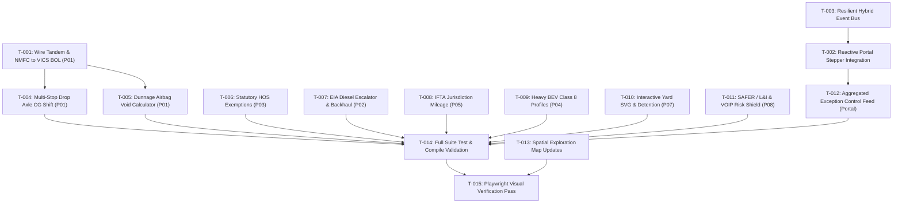

# TRUCKING Platform: Audit-Specific Dependency-Aware Implementation Plan & Task List

**Date:** 2026-10-30 · Asia/Kolkata  
**Governing Doctrine:** `OPERATING_DOCTRINE.md` (v8.2), `AGENTS.md`  
**Status:** Living Task List — Updated Continuously Across Sessions  

---

## 1. Master Task Inventory & Status Matrix

| Task ID | Component / Product | Description & Scope | Category | Status | Dependencies |
| :--- | :--- | :--- | :--- | :---: | :--- |
| **T-001** | P01 Cargo Fit | Wire `TandemSliderModal` & `NmfcClassificationModal` committed outputs into `cargoManifest` & VICS BOL | Implementation | `COMPLETED` | None |
| **T-002** | Command Center Portal | Connect 6-stage lifecycle stepper to `trucking-platform-mesh-v1` `BroadcastChannel` events | Implementation | `COMPLETED` | None |
| **T-003** | Shared / Mesh | Resilient hybrid event bus with circular `localStorage` ring-buffer queue (`platformBus.ts`) | Implementation | `COMPLETED` | None |
| **T-004** | P01 Cargo Fit | Multi-stop drop axle weight redistribution & sequential CG shift verification (porting P04 logic) | Implementation | `COMPLETED` | T-001 |
| **T-005** | P01 Cargo Fit | 49 CFR § 393.106 void detection and inflatable dunnage airbag calculator | Implementation | `COMPLETED` | T-001 |
| **T-006** | P03 HOS Planner | FMCSA statutory exemptions engine (`hosExemptions.ts`: Ag exemption, 16h short haul, adverse driving) | Implementation | `COMPLETED` | None |
| **T-007** | P02 Freight Pricing | EIA weekly diesel index formal surcharge escalator table & backhaul triangulation route optimizer | Implementation | `COMPLETED` | None |
| **T-008** | P05 Telematics | Automated IFTA state-line crossing mileage aggregator and quarterly tax schedule (`iftaCompliance.ts`) | Implementation | `COMPLETED` | None |
| **T-009** | P04 Asset Studio | Commercial Heavy Class 8 BEV powertrain profile with FAST Act 2,000 lb battery weight credit | Implementation | `COMPLETED` | None |
| **T-010** | P07 Yard & Dock | Interactive SVG yard occupancy map with hostler anti-deadhead moves and detention alert countdown | Implementation | `COMPLETED` | None |
| **T-011** | P08 Carrier Trust | SAFER/L&I operating authority verification parser, VOIP/IP risk heuristics, and automated DND locks | Implementation | `COMPLETED` | None |
| **T-012** | Command Center Portal | High-priority Exception Control Tower feed aggregating cross-product critical alerts with deep links | Implementation | `COMPLETED` | T-002, T-003 |
| **T-013** | Exploration Map | Cross-reference candidate spatial modules to newly integrated domain engines | Exploration / Doc | `COMPLETED` | None |
| **T-014** | Test & Validation | Comprehensive test suite & invariance regression pass across all 11 workspaces (100% green: 379 tests) | Validation | `COMPLETED` | T-001 to T-012 |
| **T-015** | Build Validation | Complete production bundle builds across all 9 products (100% zero errors) | Validation | `COMPLETED` | T-014 |
| **T-016** | P01 Cargo Fit | 49 CFR § 393.100–136 Cargo Securement, Tie-Down Restraint & WLL Verification (`tests/securement.test.ts`) | Testing & Validation | `COMPLETED` | None |
| **T-017** | P04 Asset Studio | Multi-Stop Dynamic Axle Moment & CG Shift Sequential Unload Simulation (`tests/multistop.test.ts`) | Testing & Validation | `COMPLETED` | None |
| **T-018** | P04 Asset Studio | Multi-Vehicle Fleet Splitter & Demand Partitioning Heuristic (`tests/fleetSplitter.test.ts`) | Testing & Validation | `COMPLETED` | None |
| **T-019** | P04 Asset Studio | Temporal Fuel Dynamics, Aerodynamic Speed Penalties & En-Route Refueling Dwell Engine (`tests/temporal.test.ts`) | Testing & Validation | `COMPLETED` | None |
| **T-020** | P08 Carrier Trust | Tier-3 Step-Up Verification & Dual-Custody Governance Modal (`StepUpVerificationModal.tsx`) | Implementation | `COMPLETED` | T-011 |
| **T-021** | P01 Cargo Fit | Multi-Stop Intermediate Axle Re-Balance & Dynamic Tandem Slider Bridge in `PlanStep.tsx` | Implementation | `COMPLETED` | T-004 |
| **T-022** | P01 Cargo Fit | 53-ft Multi-Temp Compartment Bulkhead Engine & Thermal Load Balancer (`multiTempBulkhead.ts`) | Implementation | `COMPLETED` | None |
| **T-023** | P03 HOS Planner | FMCSA 49 CFR § 395.3(b) 8-Day Rolling Duty Cycle Hours Recap & Interstate Truck Parking (`hosRecap.ts`) | Implementation | `COMPLETED` | None |
| **T-024** | P04 Asset Studio | EPA SmartWay Aerodynamic Drag & Eco-Equipment Modeler (`aeroEcoModeler.ts`) | Implementation | `COMPLETED` | None |
| **T-025** | P05 Telematics | Commercial 18-Wheel End TPMS & Bidirectional Remote Reefer Telematics Control (`tpmsReeferControl.ts`) | Implementation | `COMPLETED` | None |
| **T-026** | P06 Warehouse Flow | Distribution Center Outbound Wave Picking & TSP Pick-Path Optimizer (`wavePickingTsp.ts`) | Implementation | `COMPLETED` | None |
| **T-027** | P07 Yard & Dock | Digital Guard Shack & Automated Kiosk Check-In / Gate Pass Engine (`guardShackKiosk.ts`) | Implementation | `COMPLETED` | None |
| **T-028** | P08 Carrier Trust | Driver Qualification File (DQF) & FMCSA Clearinghouse Compliance Auditor (`driverQualification.ts`) | Implementation | `COMPLETED` | None |
| **T-029** | Command Center Portal | Role-Based Persona Cockpit View Switcher & Quick Actions (`PersonaCockpitSwitcher.tsx`) | Implementation | `COMPLETED` | None |
| **T-030** | Spatial Exploration | Spatial Exploration Map Linkage Update & Persona Council Review (`PERSONA_COUNCIL_EXPANSION_REVIEW_2026-10-30.md`) | Exploration & Validation | `COMPLETED` | T-022 to T-029 |
| **T-031** | P01 Cargo Fit | Corrugated Packaging Compressive Strength & Stacking Crush Limits (`cartonCompression.ts`) | Implementation | `COMPLETED` | None |
| **T-032** | P02 Freight Pricing | Dynamic Spot vs. Contract Benchmark & Market Density Telemetry (`laneBenchmark.ts`) | Implementation | `COMPLETED` | None |
| **T-033** | P03 HOS Planner | USMCA Cross-Border Statutory HOS (Canada SOR & Mexico NOM-087) Engine (`crossBorderHos.ts`) | Implementation | `COMPLETED` | None |
| **T-034** | P04 Asset Studio | Smart Trailer IoT Sensor Topology & Ultrasonic Volume Fullness (`trailerIoTSensors.ts`) | Implementation | `COMPLETED` | None |
| **T-035** | P05 Telematics | AI Dashcam Computer Vision Safety Telemetry & Driver Coaching Queue (`aiDashcamSafety.ts`) | Implementation | `COMPLETED` | None |
| **T-036** | P06 Warehouse Flow | Inbound-to-Outbound Direct Cross-Dock Allocation & Labor Savings (`crossDockMatching.ts`) | Implementation | `COMPLETED` | None |
| **T-037** | P08 Carrier Trust | FreightGuard Incident Exchange & Double-Brokering Blacklist Shield (`freightGuardIncident.ts`) | Implementation | `COMPLETED` | None |
| **T-038** | Platform & Audit | Full Suite Verification Pass, Spatial Exploration Linkage & Persona Council Consensus | Validation & Governance | `COMPLETED` | T-031 to T-037 |

---

## 2. Dependency Graph

---

## 3. Detailed Phase Breakdown

### Phase 1: High-Priority Data Binding & Platform Convergence (Immediate)
- **T-001**: Connect `TandemSliderModal` commit action to store adjusted tandem pin hole, 5th wheel offset, and updated axle weights in `cargoFitState.ts`. Connect `NmfcClassificationModal` to set `declaredNmfcClass` and DIM weight penalties in the manifest. Update `VicsBolModal.tsx` and `edi.ts` to output these certified values.
- **T-002**: Subscribe `command-center-portal`'s stepper to `BroadcastChannel('trucking-platform-mesh-v1')` events (`CARGO_LOAD_UPDATED`, `PRICING_UPDATED`, `HOS_SCHEDULE_UPDATED`, `SAFETY_ALERT`). When received, advance the respective stage status from `PENDING` to `COMPLETED` with live payload summary chips.
- **T-003**: Upgrade `packages/suite-dock/src/eventBus.ts` and `platformBus.ts` to implement a circular `localStorage` ring-buffer queue (`trucking-platform-event-log-v1`). Newly opened tabs replay the last 20 events on mount to achieve immediate state convergence without needing backend websockets.

### Phase 2: Regulatory Physics & Advanced Calculation Engines
- **T-004**: Multi-Stop Drop Axle CG Shift: Allow defining Stop 1, Stop 2, and Final Destination stops in P01 manifest items. Port axle moment redistribution algorithms to ensure remaining cargo after Stop 1 does not overload the tractor drive axle.
- **T-005**: 49 CFR § 393.106 Void & Dunnage Calculator: Add bounding volume vacancy scanning to calculate longitudinal and lateral air gaps $> 6\text{ inches}$, outputting required Level 1 dunnage airbag counts.
- **T-006**: Statutory HOS Exemptions Engine (`hosExemptions.ts`): Implement 49 CFR § 395.1(k) 150-air-mile agricultural radius calculation, § 395.1(b)(1) adverse driving condition extensions, and personal conveyance/yard move logging.
- **T-007**: EIA Diesel Fuel Surcharge & Triangulation: Formalize contract fuel tables ($0.01/mi per $0.05 index shift) and build a 3-leg triangle lane profitability analyzer (e.g., Headhaul + Backhaul leg vs. Deadhead).

### Phase 3: Telematics, Facility Logistics & Risk Governance
- **T-008**: IFTA State-Line Mileage Tracker (`iftaCompliance.ts`): In P05, calculate distance traversed per state boundary along the I-80 corridor and output an IFTA quarterly return preview table.
- **T-009**: Commercial Heavy BEV Class 8 Profiles: In P04, add Tesla Semi / eCascadia digital twin profiles with FAST Act 2,000 lb statutory battery tare exemptions and regenerative descent energy calculations.
- **T-010**: Interactive SVG Yard Map: In P07, create an interactive 2D facility yard schematic showing gate, drop lot, and dock doors 1–32 with dwell time countdown clocks alerting at 15 minutes before free time expiration.
- **T-011**: Enhanced Carrier Trust Shield: In P08, implement ACORD-25 verification rules, VOIP/IP address mismatch risk flags, and automated Do Not Dispatch (DND) status toggles.
- **T-012**: Exception Control Tower: Build a prominent aggregated Exception Feed in the Portal with 1-click subproduct routing.

### Phase 4: Exploration Maps, Testing & Visual Receipts
- **T-013**: Update `docs/explorations/isometric-ui/EXPLORATION_MAP.md` and `cases.json` to map all new domain engines to the 120 spatial review cases.
- **T-014**: Execute `node scripts/typecheck-all.mjs`, `node scripts/test-all.mjs`, and `npm run check:suite` to verify zero regressions.
- **T-015**: Execute `node tools/capture_visual_pass.mjs` to capture fresh visual receipts of all newly implemented views and update `UI_UX_VISUAL_PASS_BEFORE_AFTER.md`.

### Phase 5: Deep Domain Physics, Regulatory Engines & Persona Cockpit Integration
- **T-022**: P01 53-ft Multi-Temp Compartment Bulkhead Engine (`multiTempBulkhead.ts` & `MultiTempBulkheadModal.tsx`): Composite R-14 thermal insulation, infiltration heat load BTU/hr calculation, and auto-balancing bulkheads.
- **T-023**: P03 8-Day Rolling Duty Cycle Hours Recap & Interstate Truck Parking (`hosRecap.ts` & `HosRecapModal.tsx`): 70h/8d and 60h/7d rolling totals, Day 1 midnight drop-off hours recovery, and I-80 corridor rest stop stall availability.
- **T-024**: P04 EPA SmartWay Aerodynamic Drag & Eco-Equipment Modeler (`aeroEcoModeler.ts` & `AeroEcoModelerModal.tsx`): Cd reduction from side skirts, boat tails, roof fairings, super singles, and eAPU; MPG lift, fuel cost savings, and GLEC Scope 1 CO2e reduction.
- **T-025**: P05 Commercial 18-Wheel End TPMS & Bidirectional Remote Reefer Telematics Control (`tpmsReeferControl.ts` & `TpmsAndRemoteReeferModal.tsx`): 18-wheel position PSI/temperature monitoring, wheel end thermal alert, and Carrier Transicold / Thermo King remote telematics commands.
- **T-026**: P06 Distribution Center Outbound Wave Picking & TSP Pick-Path Optimizer (`wavePickingTsp.ts` & `WavePickingModal.tsx`): Rectilinear warehouse aisle travel distance with cross-aisle routing, 2-Opt local search TSP heuristic, pick time estimation, and FEFO lot expiry auditing.
- **T-027**: P07 Digital Guard Shack & Automated Kiosk Check-In / Gate Pass Engine (`guardShackKiosk.ts` & `GuardShackKioskModal.tsx`): Appointment lookup, ISO 17712 bolt seal verification, dynamic dock door/drop lot allocation, and cryptographically hashed gate pass.
- **T-028**: P08 Driver Qualification File (DQF) & FMCSA Clearinghouse Compliance Auditor (`driverQualification.ts` & `DriverQualificationModal.tsx`): 49 CFR Part 391 qualification checks, CDL validity, NRCME Medical Card MCSA-5876 verification, 365-day annual MVR review, and Part 382 Drug & Alcohol Clearinghouse annual query status.
- **T-029**: Command Center Portal Role-Based Persona Cockpit View Switcher (`PersonaCockpitSwitcher.tsx` & `tests/personaCockpit.test.ts`): 5 canonical role lenses (Fleet Ops, Owner-Op, 3PL Broker, DC Flow Lead, DOT Auditor) with tailored focal metrics, active priority subproduct stage highlighting, and direct quick action routing.
- **T-030**: Spatial Exploration Map Linkage Update & Persona Council Review (`PERSONA_COUNCIL_EXPANSION_REVIEW_2026-10-30.md`): Full Tier-3 evidence pass with zero TypeScript errors across 11 workspaces, 425+ passing tests across 12 workspaces, and 9 successful production builds.

### Phase 6: Edge Device Telemetry, Safety Intelligence & Cross-Dock Logistics
- **T-031**: P01 Carton Compressive Strength & Stacking Crush Limits (`cartonCompression.ts` & `CartonCompressionModal.tsx`): McKee BCT formula, ASTM D4169 / ISTA 3A environmental factors (humidity, duration, interlocking, overhang), and safe tier limits.
- **T-032**: P02 Dynamic Spot vs. Contract Benchmark & Market Density Telemetry (`laneBenchmark.ts` & `LaneBenchmarkModal.tsx`): DAT iQ / SONAR market bands, load-to-truck ratio density conditions (LOOSE, BALANCED, TIGHT), 7-day forward rate forecast, and tender acceptance probability.
- **T-033**: P03 USMCA Cross-Border Statutory HOS Engine (`crossBorderHos.ts` & `CrossBorderHosModal.tsx`): Tri-country rules (US 49 CFR Part 395, Canada SOR/2005-313, Mexico NOM-087-SCT-2-2017), port wait times, FAST lane status, and automated statutory violation detection.
- **T-034**: P04 Smart Trailer IoT Sensor Topology & Ultrasonic Volume Fullness (`trailerIoTSensors.ts` & `TrailerIoTSensorsModal.tsx`): FleetPulse / Cargo Connect multi-sensor topology, ultrasonic % cube fullness, door reed security geofence, CVSA air brake pushrod stroke compliance, and solar battery health.
- **T-035**: P05 AI Dashcam Computer Vision Safety Telemetry & Driver Coaching Queue (`aiDashcamSafety.ts` & `AiDashcamSafetyModal.tsx`): In-cab DMS (phone distraction, drowsiness PERCLOS) and road-facing ADAS (forward collision warning TTC, tailgating), composite driver safety score (0-100), and coaching queue.
- **T-036**: P06 Inbound-to-Outbound Direct Cross-Dock Allocation & Labor Savings (`crossDockMatching.ts` & `CrossDockModal.tsx`): 4-hour departure matching window, direct pallet transfer directives bypassing rack putaway, and $24.00/pallet labor cost savings calculation.
- **T-037**: P08 FreightGuard Incident Exchange & Double-Brokering Blacklist Shield (`freightGuardIncident.ts` & `FreightGuardModal.tsx`): Carrier411 / Highway crowd-sourced reports (double brokering, hostage loads, fraudulent COI), network trust index, and automated DND embargo locks.
- **T-038**: Spatial Exploration Map Linkage Update & Persona Council Review (`PERSONA_COUNCIL_EXPANSION_REVIEW_2026-10-30.md`): Full multi-perspective review across all 7 new domain engines.

---

## 4. Current audit follow-through — 2026-11-06

**Status:** active; historical T-001–T-030 completion statements above describe earlier implementation checkpoints, not present safety, real-user or production validation. The findings and observations are in [PORTFOLIO_COUNCIL_GAP_AUDIT_2026-11-06.md](./PORTFOLIO_COUNCIL_GAP_AUDIT_2026-11-06.md). The user's current instruction authorizes audit-specific implementation, ordinary local tests, research and documentation; it does not authorize Git mutation, deployment, real-user data, destructive cleanup, external messaging, payments, live provider operations, or legal/production approval.

### First-principles decisions and dependency rules

1. **Evidence precedes authority.** Measured, manually attested, simulated, inferred, absent, stale and independently verified are distinct states. Preserve functionality, but do not manufacture facts, sources, security assurances or legal approval. Real provider/driver/insurer/device claims remain separately gated.
2. **One owner per domain contract.** Reuse the current native engine, shipment-flow package and generated suite route; preserve P06 physical custody versus P09 possession and the separate local storage servers. Change adapters and contracts together; do not invent a parallel authoritative state or rely on origin-local BroadcastChannel across ports.
3. **Protect existing records and work.** P09 and the 5 November warehouse plan are dirty, and product directories have nested Git states. Inspect exact diffs before changing owned files; do not reset stores, overwrite unfamiliar data, use destructive cleanup, synchronize repositories or regenerate shared outputs without classifying the exact diff.
4. **Money and chronology need explicit contracts.** Carry currency, units, quantity, period and base-versus-all-in through each layer; reject missing data rather than default it to zero/one when that would assert a monetary fact. Keep tax, termination, billing, actual payment and human approval policy open where source evidence does not resolve it.
5. **Visual changes need reviewable evidence.** For consequential interface/design changes, prepare current and concrete alternative rendered views and retain comparable before/after evidence. Focus/semantic or narrow truthfulness corrections should preserve the surrounding experience and still receive relevant keyboard/browser checks. No synthetic persona review is customer acceptance.
6. **Falsify every material change.** Record a failing pre-fix case and passing post-fix case (S2) for defects; test adverse paths, conflict/retry/recovery and independently evaluated numbers. Do not run tests that unexpectedly call provider services; use injected mock or explicitly offline mode. Tiers and sensitivity are separate.
7. **Supersession before removal.** Determine whether dormant adapters, sample workflows or old records were interrupted work, whether completing them helps, what unique behavior must survive and who owns the target before any removal. Default to preserve and improve.

### Dependency-aware task register

`TODO` = identified, not yet completed; `IN PROGRESS` = owned with active work; `DONE` requires recorded postconditions and sensitivity; `RESEARCH` = evidence acquisition without a predetermined implementation; `OWNER DECISION` = explicit domain/customer/production decision, not a reason to stall independent safe tasks. Do not infer task completion from historical checkbox state.

| ID | Finding / work | Dependencies and acceptance evidence | Status |
|---|---|---|---|
| A00 | Inventory F01–F14, U01–U09, portal, mobile, council new findings and research/decisions; record scope and first-principles analysis. | Current audit + independent councils; preserve prior context. | DONE — inventory and plan recorded; additional discoveries remain open for addition. |
| A01 | P01 truth of axle/securement/hazard conclusions (F01). | Declared/unknown provenance, physical and legal authority boundary; adversarial modeled inputs, report/export regression. | IN PROGRESS — primary labels improved; hazard detail, tandem consumers and remaining claims need review. |
| A02 | P01 cross-product partial input provenance (U01-1). | A01; distinguish declared/default/unknown, test standalone and connected adapters. | IN PROGRESS — focused tests pass; browser and cross-product acceptance pending. |
| A03 | P01 manual attestation versus scan (U01-2). | Explicit evidence types, mismatch/stale-plan tests, preserved sequence. | IN PROGRESS — focused tests pass; browser/device acceptance pending. |
| A04 | P01 saved scenario corruption/recovery (U01-3). | Preserve exact malformed payload, fail closed on writes, disposable storage fixtures, S2. | IN PROGRESS — focused tests pass; real browser storage recovery pending. |
| A05 | P02 rate units and base/all-in/accessorial reconciliation (F05). | Establish contract across quote, native form, margin and connected adapter; nonzero line items, cents, round trips, S2/integration. | IN PROGRESS — product tests/typecheck pass; independent review and browser integration pending. |
| A06 | P02 synthetic benchmarks/unsupported acceptance (F06). | Preserve scenario feature, source/timestamp/status truth, tests for each band. | IN PROGRESS — product tests pass; independent review pending. |
| A07 | P02 clipboard outcome and accessible benchmark modal (U02-1/2). | Failure/success test; render current/alternatives for meaningful layout change, keyboard/focus check. | IN PROGRESS — code/typecheck pass; browser focus, clipboard and responsive acceptance remain open. |
| A08 | P03 invalid histories/negative intervals (F07). | Indeterminate status for invalid/gapped intervals implemented; full scenario-initial-state and calendar/history correctness remain open pending review. | IN PROGRESS — malformed/gapped cases S2; P03 tests and typecheck passed. |
| A09 | P03 synthetic clocks and official/live claims (U03-1/2). | A08 and provenance; preserve itineraries/explorations; unknown time-specific clocks and appropriate document labels. | IN PROGRESS — unsupported live clocks replaced with unavailable; imported banner avoids fabricated defaults; other claims and browser acceptance pending. |
| A10 | P04 fleet splitter demand conservation and model qualification (F12). | Unknown/mixed IDs, invalid quantities and independent geometry constraints; no unsupported optimizer claim. | IN PROGRESS — product tests pass; 3D/physical acceptance pending. |
| A11 | P04 custom vehicle provenance/type → P07 compatibility (U04-1). | A10; explicit subtype, assumptions, migration/legacy review; cross-product test. | IN PROGRESS — cross-product test passes; old published records need re-review. |
| A12 | P05 simulated reefer controls, telemetry provenance, legal-status claims (F03/U05-1). | Preserve simulation and control; no false remote acknowledgement or fabricated missing sensor health; adapter tests. | IN PROGRESS — product tests pass; real provider/device acceptance pending. |
| A13 | P06 evidence state/publishing (F03). | Preserve existing event/publisher contract; no-op/failure cannot imply observation/publication, test actual call paths and retries. | IN PROGRESS — product tests pass; independent and real publisher review pending. |
| A14 | P06 temperature range policy (F14). | Check source semantics and authority; full/partial overlap, malformed/missing/edge tests. Qualified domain review before operational claims. | RESEARCH |
| A15 | P06 2D/3D workspace handoff (U06-1). | Preserve connected + standalone workspaces, use canonical snapshot, verify demo/import/starter and back. | IN PROGRESS — standalone can open illustrative 3D; geometry is not workspace-derived, browser paths pending. |
| A16 | P06 cycle count observation (U06-2). | A13; explicit manual/scan versus expected, absent and mismatch cases. | IN PROGRESS — focused and product tests pass; browser and independent review pending. |
| A17 | P06 cross-dock, picking, goods ledger (U06-3). | Inventory and salvage existing engines/contracts, define authoritative records/identities and fallback, no second store; meaningful execution + recovery tests. | TODO |
| A18 | P06 3D capacity mislabeled stored mass (N-P06). | Correct physical meaning or data source, distinguish available/unknown, inspect existing spatial map and visual alternatives. | IN PROGRESS — rated capacity labeled; browser and spatial acceptance pending. |
| A19 | P07 kiosk hash/PIN/appointment claims (F02). | Preserve simulator; truthful scenario artifact and appointment status; no false crypto or real access grant; S2. | IN PROGRESS — product tests pass; independent and browser review pending. |
| A20 | P07 gate and door identity propagation (F08). | A19; two carriers, unknown/missing identity and no fabricated seal tests. | IN PROGRESS — product tests pass; cross-product/browser review pending. |
| A21 | P08 self-attested approval provenance and semantics (F03). | Preserve scenario records and blockers; prevent unauthenticated evidence from becoming authenticated authority. | IN PROGRESS — product tests pass; independent/browser review pending. |
| A22 | P08 SAFER adapter source fidelity / offline tests (F09). | Inventory use and types, reject invented insurance/authority, provenance/freshness, mocked fetch with no network; official-source research for future provider. | IN PROGRESS — offline product tests pass; real source/provider work remains separately gated. |
| A23 | P08 conditional dispatch and event typing (N-P08). | Align standalone/connected semantics, preserve conditional outcome and identity; no unrelated fake telematics. | IN PROGRESS — product tests pass; cross-product acceptance pending. |
| A24 | P08 driver qualification, no-op assignment and accessible modal (U08-1/2). | Source/date/identity truth, scenario vs assignment, keyboard/focus/Escape; actual authorization separately gated. | IN PROGRESS — product tests pass; browser and operational acceptance pending. |
| A25 | P09 persistent state: revisions, ordering, offline conflict, retry/recovery (F04). | Preserve existing state and uncommitted work; map current storage/outbox and server; explicit schema/migration, multi-client and failure fixtures. | IN PROGRESS — single-server revision/CAS and ordered client/reset paths tested; multi-process, migration and browser recovery remain open. |
| A26 | P09 transaction-linked audit events (U09-1). | A25; actor/time/provenance, atomicity, idempotence and honest append-only semantics. | IN PROGRESS — default actor/evidence corrected; transactional, authenticated audit remains open. |
| A27 | P09 billing quantities, revenue-share and termination proration (F13/U09-3). | Independent calendar/quantity fixtures, explicit unsupported states; contract-specific policies remain owner/accountant decisions. | TODO |
| A28 | P09 per-lease intended use and hidden-tenant state (U09-2). | Explicit per-lease unknown/declared input; preserve tenant details and warning, regression. | TODO |
| A29 | P09 meter period and payment/receipt/overdue reconciliation (U09-4/5). | A25/A27; period, transaction IDs, dates, repeated readings, late/partial/overpayment and independent totals. | IN PROGRESS — bounded payment history and period-safe allocation tested; atomic reconciliation and accounting policies remain open. |
| A30 | P09 lease/repair/deposit/notice/document/expense lifecycle (N-P09). | Preserve current partially built helpers; owner/accountant domain policy and migration, targeted fixtures. | RESEARCH |
| A31 | P06/P09 shared facility identity / permissions (N-Shared). | Inventory current contracts, consumers and stores; versioned ownership/custody mapping and migration/recovery; no inappropriate tenant data sharing. | RESEARCH |
| A32 | Portal scenario authority, EDI and exception feed (U-Portal-1). | Preserve preset vs connected state, qualify modeled/legal/live claims, inspect source and export paths, UI regression. | TODO |
| A33 | Suite typecheck runner and generation drift (F10/F11). | Root runner uses workspace scripts; registry-only storage has an explicit capability and generation is synchronized. Full suite needs a final run after parallel edits. | IN PROGRESS — script regressions and generation check pass; full suite rerun pending. |
| A34 | Mobile, 2D/3D controls, accessible semantics and flows (U06-4/U07-1/U-Mobile-1). | Current + alternatives rendered with before/after evidence, 320/390/430, keyboard/focus, contrast, zoom and real-device/AT remaining gates. | TODO |
| A35 | Reconcile previous audit, historical persona WTP/NPS and warehouse task status. | Preserve 2026-10-30/11-05 history; append source-linked status and distinguish simulation vs user proof. | TODO |
| A36 | Authoritative research: FMCSA/GS1/temperature, insurer/telematics, Indian warehouse/tax and industry pain points. | Primary sources, dated URLs, uncertainty and jurisdiction; no credential or external state mutation. | RESEARCH |
| A37 | User/buyer workflows and commercial validation. | Candidate users and falsifiable interview plan; real participants and payment decisions require explicit authorization. | RESEARCH |
| A38 | Exploration maps: spatial studies, facility/custody and physical evidence/unknowns. | Extend canonical map(s), link findings, alternatives, evidence tiers and unresolved review gates. | TODO |
| A39 | Full regression, typecheck/build, local integration and browser checks. | A01–A34 as applicable; offline network-safe tests, preserve stores; S2/S3 where practical, exact results and remaining risks. | TODO |
| A40 | Correctness, architecture, rule-compliance and independent council review; final handoff. | A39 plus task dispositions and review of source diff, preservation and open decisions. | TODO |
| A41 | P06 3D rack, dock and handling-equipment illustration presented alongside real facility data. | Trace illustrative versus facility-derived values, preserve visualization, make provenance legible, never imply a real load or compliance determination; verify standalone/imported/connected views in browser. | IN PROGRESS — illustrative labels added during P06 work; browser and independent review remain open. |
| A42 | P01 BOL line-weight and total consistency. | Derive totals/readiness from the same validated declared line data; unknown or inconsistent values must stay unknown; exercise export/report and stored legacy plans. | IN PROGRESS — P01 owner tracing and adding regression. |
| A43 | P01 residual legal claims in tandem toast, securement recommendations and hazard detail. | Trace all consumers of tandem `legal` and assumed hazard classification; preserve useful models while naming assumptions and unknowns, prove exported and UI wording with targeted tests. | TODO |
| A44 | P03 continuity tolerance, indeterminate producer/consumer contract and synthetic printable logbook. | One continuity rule; carry typed uncertainty through corridor and events; preserve printable chart without invented identities, duty history or certifications; check `.ts` test discovery and portal behavior. | IN PROGRESS — council reproduced failures; P03 and portal owners addressing. |
| A45 | P09 offline branch, ordered saves and multi-client conflict. | Preserve local/server copies, reproduce reconnect overwrite, use explicit conflict/recovery and revision-aware server writes; no policy inferred from availability. | IN PROGRESS — focused regression reproduced; existing unconditional server writes and unwired outbox are separate limitations. |
| A46 | Portal unbound events, synthetic exceptions, EDI response and signatures. | Do not convert scenario broadcasts into persisted authoritative decisions; retain labeled scenario artifacts and explicit choice without inventing acceptance or signatures. | IN PROGRESS — independent portal owner investigating and implementing. |
| A47 | P01 CLI trailer dimensions and modeled-output truth. | Correct millimeter inputs, preserve unknown weight/centroid, qualify axle and securement output, run manifest-to-CLI regression and product suite. | IN PROGRESS — known/unknown CLI fixtures and product suite pass; independent review pending. |
| A48 | P02 simulated cold-chain sample and HUD provenance. | Preserve synthetic scenario and calculations, distinguish waypoint sample percentage from physical/regulatory compliance, avoid asserted seal observation or live market telemetry; render and test. | IN PROGRESS — S2 server-rendered regression, typecheck and local browser label observation pass; mobile and physical evidence remain open. |
| A49 | P01 stale tandem/NMFC artifacts carried into different load exports. | Trace modal producers, local storage and version/BOL consumers; bind artifacts to current scenario, equipment, placements and stage, withhold unscoped legacy data without deletion; scenario-switch/export regression. | IN PROGRESS — independent council found and is fixing. |
| A50 | P01 dunnage input substitutes unknown cargo weight. | Determine whether the model uses weight; retain unknown where not declared, preserve useful visual analysis and test unknown input. | IN PROGRESS — independent council found and is fixing. |
| A51 | Shared dispatch carrier freshness bypass. | Ensure server dispatch blockers reject missing, malformed and expired carrier evidence, even for legacy positive records, without mutating those records; test independently of HOS block. | IN PROGRESS — shared-workflow council reproduced missing and invalid expiry bypass. |
| A52 | P09 unsupported future storage schema downgrade. | Reject unsupported versions before write; preserve exact original bytes and supported legacy data; disposable future-version load/save regression. | IN PROGRESS — independent review identified; owner fixing. |
| A53 | P09 payment paise overflow. | Validate finite, safe integer paise and checked balances before mutation; test huge input and supported edge values. | IN PROGRESS — independent review identified; owner fixing. |
| A54 | P09 rapid payments/receipt atomicity. | Reproduce overlapping actions and save boundaries; use one coherent state transaction and idempotent commands without fabricating historical payments. | RESEARCH — review identified race; interaction test and state ownership needed. |
| A55 | P09 edits during pending reset. | Reproduce delayed reset plus intervening edits; preserve unsaved edits or explicitly prevent them, including failed/ambiguous reset. | RESEARCH — UI interaction and recovery validation needed. |
| A56 | Storage-server multi-instance compare-and-swap. | Reproduce two instances sharing one store; enforce a safe single-writer or cross-process strategy without treating process-local serialization as global. | RESEARCH — preserve store and document current single-instance limit. |
| A57 | P09 local business date and stale overdue status. | Trace user-selected date/timezone and derived status, test local-midnight and overdue cases; do not rewrite history or invent accounting policy. | RESEARCH — independent review identified. |
| A58 | P01 distributed CLI freshness and duplicate execution. | Keep one executable entry point, rebuild the tracked CLI from canonical source and exercise actual executable, output and error status. | IN PROGRESS — rebuilt executable and focused subprocess tests pass; final full suite pending. |
| A59 | P01 BOL approval/signature scope. | Bind review and captured signatures to exact plan, selected artifacts and document declarations; changed document requires review again while entered values remain available. | IN PROGRESS — scoped evidence and BOL tests/typecheck pass; browser interaction pending. |
| A60 | P06 production 3D workspace. | Remove exploration terminology from the interface; drive geometry and metrics from the selected facility while accurately representing unavailable data; preserve existing controls and test browser/workspace paths. | IN PROGRESS — warehouse owner implementing. |
| A61 | P02 rate-card restore and reapply. | Preserve full reviewed rate terms and legacy billable-hour meaning; open and reapply a saved quote without silent repricing. | IN PROGRESS — pricing owner implementing. |
| A62 | P01 EDI 214 event and partner fields. | Require explicitly entered event and partner values, avoid invented seal/equipment/status/weight, validate delimiter safety and actual segment positions; confirm partner-specific acceptance separately. | IN PROGRESS — focused engine tests/typecheck pass; browser and trading-partner acceptance pending. |
| A63 | P09 money formatting and unknown amounts. | Preserve paise in ordinary display and show invalid amounts as unknown; test zero, decimals and invalid values. | IN PROGRESS — focused regression and product suite pass; browser/accounting review pending. |
| A64 | P09 unknown stored fields and cross-tab changes. | Preserve unrecognized same-version values, prevent unsafe reset, detect concurrent local changes; separate detection from atomic multi-tab CAS. | IN PROGRESS — disposable regressions pass; true atomic cross-tab behavior and UI recovery remain open. |
| A65 | SuiteDock registry and command routing after P09 registration. | Verify canonical product ID/port pairs, unique ports and navigation routes; replace references to retired carrier-safety identity with current P08 identity, preserving command behavior. | IN PROGRESS — shared package routing and tests corrected; product-local docks do not mount the shared palette, so migration and runtime acceptance remain open. |
| A66 | P06 goods-ledger aggregation mixes incompatible units. | Preserve useful single-unit totals; provide unit-separated totals and prevent heterogeneous scalar sums; test customer filters and dispatch as well as receipts. | IN PROGRESS — warehouse council identified a latent, currently unmounted helper; focused remediation underway. |
| A67 | P01 BOL field usability and accessibility. | Give document fields human-readable labels and each cargo line individually identifiable controls; check review invalidation and incomplete EDI behavior in a browser. | IN PROGRESS — local browser labels, approval invalidation and missing-field message verified; broader mobile and assistive-technology checks remain. |

### User/domain decisions separated from executable tasks

- Select first market/buyer, operating context and release bar; a local scenario does not imply customer or production use.
- Approve contract-specific proration, quantities, revenue share, deposit/notice/termination, meter and receipt/adjustment rules with the relevant accountant and property owner.
- Define who may assert carrier or driver approval, gate entry and actual sensor/device acknowledgement; real providers, devices, identities and legal review require separate evidence and authorization.
- Decide physical/storage facility identity ownership, privacy, tenant/custody boundary, retention, synchronized operation and acceptable offline conflict resolution before production adoption.
- Decide whether fleet rental, UK duty workflows, specialized storage and new cross-dock/inventory products are priorities after user and commercial research.

### Runtime ledger

- 2026-11-06: user asked for complete audit crosswalk, first-principles review, implementation, tests, research, councils and documentation. Independent read-only P01–03, P04–07 and P08–09 specialist seats returned task inventories; their findings are advisory and source-linked to the canonical audit. Added N-P06 capacity-versus-mass and N-P08 event/conditional-dispatch plus P09 lifecycle/shared-contract work. No product implementation had begun when the register was created.
- `agent-start --project trucking --skip-index --quiet` reported doctrine-family integrity PASS; local context was refreshed with retrieval skipped, and the previously clean generated root session context became modified. Canonical Operating Doctrine v8.2 SHA-256 `e14bab7b1964d8b755c9e6c7f5b1c2b44e1d726033fa23aeaee6ce921e271a75` matched the project copy. No Git operation or deployment performed.

- 2026-11-06 P03 A08 partial: `tests/auditInputIntegrity.test.ts` failed before implementation on empty, negative/zero/nonfinite durations, invalid status, overlaps, out-of-order and gap inputs; after adding `assessment`/`assessmentReasons` and failing closed without manufacturing violations, `npm test` passed (8 files, 54 tests) and `npm run typecheck` passed. T2/S2 for those malformed/gap behaviors. This does not establish complete previous-day history, calendar-day cycle semantics, qualified-domain validation or ELD compliance; A08 remains in progress.

- 2026-11-06 A33 partial: `npm run typecheck:all` initially failed at storage-core because its package-local compiler path was absent. `node --test scripts/tests/typecheck-all.test.mjs` failed before the runner change on a fixture without local binaries and passed afterward (2 tests); the runner now invokes each workspace `npm run typecheck`, with launch error reporting. A concurrent full-suite run confirmed storage-core passed but failed on in-progress P07 edits, which were reported to their owner. This is T2/S2 for the runner, not a full-suite pass; rerun after parallel changes. Generated suite drift is still open.

- 2026-11-06 P02 A05–A07 source/test implementation: prior regression reproduced $500 versus $1,060 in accessorial reconciliation and an unsupported acceptance guarantee. Product owner reports `npm test` 13 files/87 tests, `npm run typecheck`, and `git diff --check` passing; applied charges survive the connected round trip, unsupported connected service conditions are rejected, synthetic benchmarks are labeled, and clipboard/dialog behavior was revised. T2/S2 pending independent review. Browser, focus, real clipboard and mobile observations are not yet available.
- 2026-11-06 A08 research: [FMCSA property-carrier HOS summary](https://www.fmcsa.dot.gov/regulations/hours-service/summary-hours-service-regulations) and [driver guide](https://www.fmcsa.dot.gov/sites/fmcsa.dot.gov/files/2022-04/FMCSA-HOS-395-DRIVERS-GUIDE-TO-HOS%282022-04-28%29_0.pdf) distinguish 60/7 and 70/8, day boundaries, prior on-duty history, the optional qualifying restart, and the driving prohibition from a general prohibition on working. Current `hos.ts` uses a fixed preceding 192-hour window and can flag non-driving on-duty intervals; this is a model limitation, not a legal determination. Correct implementation needs carrier rule, local day boundary, complete history and qualifying conditions, with independent domain review. Invalid input totals now return `null`, not misleading zero; targeted integrity/publication tests passed 20/20 and typecheck passed after that adjustment.
- 2026-11-06 A41 added after the P06 owner traced illustrative beam, dock and MHE figures in the isometric view. Sample equipment is useful for exploration but does not establish current-facility ratings or compliance. A42 added after P01 traced independently reported manifest metrics and unknown line weights. An initial suspicion of a fabricated emergency phone was retracted after tracing the fixture: the test supplies it and the BOL path renders it conditionally. Do not treat that retracted hypothesis as a defect.
- 2026-11-06 P06/P07 narrow changes: P06 retains synthetic EPCIS events as local simulation, requires independent cycle-count observations, allows standalone access to an explicitly illustrative 3D scene, and distinguishes slot ratings and example equipment; P07 labels its non-security checksum and gate/PIN simulation and retains declared carrier identity without inventing unknown carrier or seals. Reported pre-change focused tests reproduced false promotion/publication and fake SHA-256. P06 `npm test` 24 files/123 tests and P07 `npm test` 7 files/39 tests, both typechecks and `git diff --check` passed. This is T2/S2 with some server-rendered UI assertions; no browser, device, real scanner/publisher or physical facility verification. F14 temperature and geometry derived from an actual workspace remain open.
- 2026-11-06 P01 partial A01–A04/A42: product owner reports 120/120 tests, build and typecheck pass; Vite warned of a >500 kB chunk. Corrupt storage is preserved and writes fail closed, partial imported values are not invented, manual/camera/entered-code evidence is distinguished, modeled claims were qualified, and BOL totals/readiness use line evidence. See `products/product-01-cargo-fit/docs/reviews/AUDIT_REMEDIATION_2026-11-06.md`. Remaining hazard detail, tandem boolean consumers, a `Legal` toast and recommendation wording are tracked in A01/A43. No browser/mobile/real storage acceptance yet.
- 2026-11-06 P03 A09 partial: four familiar clock positions show unavailable rather than fabricated remaining hours; P05 query-string input is no longer called a live stream and missing identity/location/status is not invented. `npm test` passed 9 files/55 tests and typecheck passed, including a server-rendered availability check. T2/S2, not a browser or real-driver check. Complete duty-history calculation and other claims remain open.
- 2026-11-06 A33 generator follow-through: initial `check:suite` showed registries missing P09 and absent P09 generated clients. The existing generator created 14 workspace files that made P09 typecheck fail because no shipment adapter exists. `shipmentClient: false` in the P09 manifest now distinguishes registry-only distribution; the generator retains the existing default for other products. A new temporary-fixture regression failed before this change and passed after; it also checks stale detection and normal distribution. The 14 files just generated during this run were byte-compared to canonical templates and removed, preserving the existing registry and pre-existing work. `npm run sync:suite`, `npm run check:suite`, `node --test scripts/tests/*.test.mjs` (3 tests) and P09 typecheck passed. Full-suite typecheck remains pending after concurrent changes.
- Follow-up: user directed proceeding with the available disk space and correctly rejected an arbitrary 5 GB threshold. The earlier interrupted P09 focused suite reproduced 3 passes and 1 failure for reconnect overwriting; its last complete 111-test run predates that regression and a month-count change. A P03 review reproduced tolerance disagreement, indeterminate-to-violation collapse, a bare boolean broadcast, and an official-looking synthetic logbook; its interrupted `.tsx` presentation test was outside the configured include. A portal review identified unbound lifecycle updates, active synthetic exceptions, default tender acceptance and invented signatures. These remain open under A44–A46.
- P01 follow-up: the restraint estimator now excludes unplaced units, identifies missing/unmatched weights and retains selected hardware rather than inferring a chain mandate from weight alone. The tandem recommendation and toast now qualify assumed benchmarks; `npm test -- --run tests/tandemSlider.test.ts tests/securement.test.ts` passed 10/10 and `npm run typecheck` passed. These checks do not validate physical securement or actual axle legality. Legacy tandem `legal` consumers and other hazard detail claims still require review.
- P04/P05 and P08: owners report P04 66 tests, P05 34 tests and P08 49 offline-safe tests passing, with typechecks. P04 conserves unknown demand and avoids legacy subtype overclaim; P05 preserves missing sensor/setpoint values and marks commands simulated; P08 separates self-attestation, injected observations and conditional scenarios from authenticated approval. See product-local audit remediation documents/README. Browser, actual equipment/providers, previously published records, and domain validation remain open.
- P09 partial: owner reports 118 tests and typecheck passing after sticky local offline behavior, ordered client saves and surfaced local save failures. Server revision/CAS, multi-client semantics, reset ordering and recovery remain active under A45; no real store was tested.
- Portal A46 partial: owner reports 34 tests and typecheck passing. Unbound mesh events no longer mutate preset lifecycle decisions; examples remain labeled, 990 response is explicit, and local review does not fabricate signatures. Pre-existing persisted decisions, browser behavior, real EDI and actual signatures are not verified. See `products/command-center-portal/docs/reviews/audit_remediation_2026-11-06.md`.
- P01 A43/A47 follow-up: hazard detail no longer assumes a 500 kg weight, respects declared units, and does not prescribe universal 10-foot separation; [49 CFR § 177.848](https://www.ecfr.gov/current/title-49/subtitle-B/chapter-I/subchapter-C/part-177/subpart-C/section-177.848) describes separation to prevent commingling and contains classification-specific conditions. The incomplete guessed-class matrix remains illustrative and requires domain review. A manifest-to-CLI regression exposed trailer dimensions set in meters instead of millimeters; corrected to 16,150 × 2,480 × 2,790 mm and qualified modeled results. P01 full `npm test` passed 19 files/123 tests and typecheck passed; browser and physical safety are not established.
- P01 follow-up S2: `tests/cli-audit.test.ts` now also checks unknown weight suppresses axle and restraint estimates; `tests/hazmatSegregation.test.ts` checks explicit illustrative status, no legal compliance claim, declared-unit conversion and no arbitrary 10-foot instruction. Focused 7 tests and P01 typecheck passed after these additions. The legacy hazard and tandem booleans are compatibility-only, not verified authority; their versioned migration remains open.
- P03 A44 partial: product owner reports 62 tests and typecheck passing after unifying continuity tolerance, preserving indeterminate state, suppressing synthetic certification/identity/unknown-time padding and versioning the scenario event. Browser/print and actual driver history remain unverified; deeper cycle-model research is active. See product-local remediation record.
- Follow-up verification: current P01 full suite passed 19 files/124 tests; P02 passed 13 files/87 tests; P08 offline-configured suite passed 7 files/49 tests. A local IAB session opened the P02 benchmark dialog, observed the synthetic-data disclosure and initial focus, and verified Escape returned focus to the trigger. It also exposed misleading cold-chain and HUD labels, now tracked as A48. A server-rendered regression failed on the former labels and passed after changing them to simulated sample and seal states; P02 typecheck passed. No browser recheck of these new labels, real clipboard permission, mobile layout or live telemetry is claimed.
- P02 A48 browser recheck: local IAB at `127.0.0.1:5174` showed “simulated samples in range,” “simulated scheduled opening,” and pricing instruments recalculated from inputs. This is a local desktop observation, not device, physical telemetry, compliance, or responsive acceptance. The agent-started Vite process was stopped after the check; existing browser/user stores were preserved.
- P03 A08/A44: P03 owner reports 11 files/69 tests and typecheck passed. The old rolling 192-hour cycle remains labeled as an illustration only; cycle and overall status are indeterminate without prior duty history, cycle selection, carrier day boundary and restart election. Connected HOS publication is currently held because the shared contract requires a positive legal result; preserving reviewable indeterminate evidence without satisfying dispatch prerequisites is under active investigation. See P03 remediation record for primary FMCSA references and limitations.
- P09 A25/A45: owner reports 2 storage-server tests and 15 files/124 P09 tests plus typecheck passing with disposable stores and loopback ephemeral ports. A single server instance queues conditional writes and persists fresh per-commit revisions, rejects stale/unguarded writes, preserves unknown fields and refuses partial reset; the client orders saves/reset and retains local recovery data when a reset is ambiguous. Legacy clients receive HTTP 428 from the new server; older servers keep the updated client local. Separate server processes, out-of-band writes, real browser recovery, user edits during reset, conflict review/migration, outbox and transaction-linked audit remain open. See P09 remediation record.
- P01 A43 continued: `classFromHazardLabel` now extracts only explicit supported class text and returns unknown for a UN number or vague description, preventing the previous Class 3 default or accidental Class 8 from any digit 8. Unknown items are excluded from comparison and reported as incomplete; the compatibility boolean cannot imply a complete screen when class is missing. Focused `npm test -- --run tests/hazmatSegregation.test.ts` passed 6 tests and `npm run typecheck` passed, after a failing pre-fix regression. Exact classifications remain unverified and the matrix still needs domain review.
- Current follow-up product test receipts: P04 `npm test` 9 files/66 tests, P05 6 files/34, P07 7 files/39 and Command Center 6 files/34 all passed. P02 focused synthetic-telemetry and pricing regression tests passed 6/6 and typecheck passed. These do not substitute for browser, device, provider, or operational acceptance.
- P06 A14/A17 partial: owner reports 24 files/129 tests and typecheck passed after conservative declared-temperature containment, honest unknown/class-only states, non-operational cross-dock/picking labels, validated session-ledger inputs, and a read-only projection of the existing manually entered shipment receipt. A durable stock/outbound workflow requires authority, owner/SKU/quantity/lot, facility mapping, transactions and offline recovery; no second store was added. See product-local remediation record for research and evidence. Browser/scanner/physical validation remains open.
- P02 mobile follow-up: at an emulated 390×844 viewport the cold-chain selector initially overflowed its header. After making the existing flex header wrap and naming the selector, a focused server-rendered regression and typecheck passed; a local browser screenshot showed the selector fully inside its panel. The wide waypoint table still needs a deliberate mobile usability review, and real-device acceptance remains open. Viewport override was reset and the agent-started server stopped.
- P02 post-change full suite: `npm test` passed 14 files/88 tests; `npm run check:suite` passed for 10 products after the shared-client synchronization, and root `git diff --check` passed. These checks do not establish mobile usability of the entire workflow or production readiness.
- HOS shared-contract follow-through supersedes the earlier publication-refusal note: an indeterminate scenario review can be saved with its original inputs, itinerary and reasons, but does not satisfy dispatch requirements. The server rejects forged positive HOS outcomes and treats legacy positive records as unverified for new dispatch; prior records remain readable. P03 owner reports P03 70/70 tests, shipment-flow 47/47 tests, P03 and portal typechecks, `check:suite` and `git diff --check` passing, including producer/domain and disposable HTTP persistence/forgery tests. All new scenario dispatch remains deliberately blocked until server-side history/cycle validation exists; actual ELD and legal review are not established.
- P09 A26/A29 partial: payment entries retain entered amounts, application, overpayment, date and receipt references; partial payment does not become a fully paid date. New meter consumption requires explicit periods, rejects overlaps and allocates exact-period values with deterministic paise conservation; undated legacy data remains visible and excluded. Owner reports P09 17 files/134 tests and typecheck pass. Transactional/authenticated append-only audit, complete receipt/payment atomicity, idempotency/refunds, historical reconstruction, meter coverage and tariff/common-area policies remain open. See P09 remediation record.
- P02 waypoint table: a visible horizontal-scroll cue and named keyboard-focusable region were added; rendered-markup regression and typecheck passed. In a 390×844 local IAB viewport the region measured 314 px wide with 504 px of content, and ArrowRight moved it from scrollLeft 0 to 16.5. Viewport override was reset and the agent-started Vite process stopped. This is an emulated browser observation, not a real-device or complete accessibility audit.
- A51 carrier freshness: shared-workflow owner reports the server now blocks missing, invalid and expired carrier evidence even when an old carrier result says ok; a focused regression failed before and passed after, and all 48 shipment-flow tests passed. The server still uses permissive `Date.parse`; a stricter canonical timestamp/legacy-preservation follow-up is active before any dispatch restoration.
- User clarified the intended product direction: production-facing interfaces must not call the product or its views a “study.” P03/P04 workspace text was updated and typechecked; P06 3D is being connected to selected facility data under A60. Unknown and unverified inputs still need accurate status.
- P01 A58: the tracked CLI executable was stale and executed successful commands twice because both source and bundle invoked the entry point. `npm run build:cli` rebuilt it after consolidating to one entry point; focused subprocess tests passed for single invocation, correct millimeter dimensions, qualified output and nonzero invalid-input exit. Product typecheck passed.
- P01 A59: BOL approval and captured signatures are now scoped to exact plan and declaration content, excluding generation-only timestamps; changed inputs withhold prior evidence while entered fields remain. Focused scope/BOL tests passed 14/14 and typecheck passed. Browser interaction, identity authentication and real signature validity remain unverified.
- P01 A62: EDI 214 previously fabricated shipment/partner/seal/location/status identifiers and encoded event date/time in wrong AT7 positions. The export now requires declared partner and event inputs, a control number and usage choice, validates safe characters, omits absent seal/equipment/weight fields and distinguishes generation time from UTC event time. Focused EDI/BOL tests, P01 typecheck and full P01 suite (22 files/134 tests) passed. The file remains subject to actual trading-partner specification/acceptance and browser validation; no event or external EDI transmission is asserted. Reference: [SAP X12 214 implementation guideline](https://help.sap.com/doc/sap-business-network-x12-qm214-4010-inbound/cloud/en-US/SAP%20Business%20Network%20X12%20QM214%204010%20Inbound.pdf).
- P02 A61: owner reports 15 files/97 tests and typecheck passing after preserving full saved rate-card terms, explicit dwell versus legacy billable-hour basis, fractional values and aggregate rounding. Reopening/reapplying no longer silently replaces saved terms with defaults in covered tests; connected inconsistent metadata is rejected. Browser interaction and real contractual acceptance remain open. See P02 README.
- P09 A52–A57/A63–A64: owner reports 19 files/151 tests, P09 typecheck, 2 storage-server tests and a build to a new temporary output directory passed. Future/missing storage schema is fail-closed, unknown same-version fields are retained, cross-tab changes are detected, unsafe reset is prevented, payment amounts and paise are validated/displayed, local date/status handling improved, financial updates combined and reset UI held inert. Detection is not atomic cross-tab CAS; multi-process CAS, authenticated atomic audit, actual browser payment/reset and accounting review remain open. Vite reported a ~623 kB main chunk. No real store was modified. See P09 remediation record.
- P06 A60: the active 3D view now derives location positions, status and declared slot ratings from the selected facility; missing equipment positions and velocity data are not invented, and heights remain schematic. Owner reports 25 files/134 tests and typecheck passed. A local IAB check using an isolated in-memory fixture opened the 3D view, saw 101 workspace locations and selected occupied dock D-02 with its declared occupant/rating. No real facility, scanner or physical geometry validation was performed; user data stores were not modified.
- Root `npm run test:all` found P01–P09 and the portal passing, but exited 1 at SuiteDock because its historical registry test expected nine entries after P09 was added. An independent source trace also found stale `product-06-carrier-safety` command IDs; A65 covers both. Root typecheck was running at this point, not yet claimed complete. `git diff --check` and `npm run check:suite` passed before the final test.
- Root `npm run typecheck:all` subsequently passed all 13 declared workspace typecheck targets. Root `test:all` still requires a rerun after A65; individual green tests are not a substitute for the aggregate result.
- A65 follow-through: SuiteDock tests now assert all ten canonical ID/port/route mappings and exercise each product action, including P08 Carrier Trust at 5180 and P06 Warehouse at 5178. Carrier-review shortcuts no longer select invented identities or pass unsupported parameters. Shared package `npm test` passed 2 files/7 tests and typecheck passed; root README now matches the current manifests and records the HOS dispatch boundary. Existing product-local docks do not mount the shared `CommandPalette`; integrating it without losing local behavior requires a tested migration and remains open. No browser or deployed navigation is claimed.
- Local desktop browser observations: P03 displayed unavailable duty clocks and an indeterminate planning report with undeclared driver/equipment fields; Escape closed the report and returned focus to its trigger. The same cycle reason was repeated twice in that version and was reported for correction. P06's 3D tab identified its scene as illustrative and not generated from the facility; its goods ledger stated entries are local and not saved to workspace/server state. No receipt, storage record, physical device or print operation was performed. Both agent-started Vite servers were stopped after checking.
- Aggregate regression rerun: `npm run test:all` passed all 14 declared workspaces after the SuiteDock fix, including P01 134, P06 134, P09 151, shipment-flow 51 and SuiteDock 7 tests. This receipt predates the subsequent P01 field-label change and any further in-progress work; rerun targeted checks after each change. It does not establish hosted or physical operation.
- P01 A59/A62/A67 local browser follow-up used the sample load on a temporary loopback server. The accessibility tree exposed internal BOL field names and unlabeled repeated cargo-line inputs; fields now have readable names and item-specific accessible labels. The browser showed the approval checkbox change from checked to unchecked after a declared carrier-name change, and an attempted incomplete EDI export displayed the missing SCAC error. Focused BOL scope, BOL and EDI tests passed 17/17 and typecheck passed. This did not test real signatures, full partner acceptance, downloads, a screen reader or mobile layout; no real records were changed.
- Warehouse operations and architecture council, advisory source review: shipment receipt has unit/barcode/slot but lacks stock owner, SKU, quantity/unit, lot and condition; P06 currently uses a fixed local facility and P09 stores landlord data. P06's in-memory goods ledger aggregates quantities across unrelated units in scalar helpers; A66 tracks remediation. A durable receiving-to-stock command needs explicit stock facts, facility-scoped identity, atomic revision/idempotency and provenance, then available/held, reservation, outbound, reversal and recovery. Facility mapping, tenant access, shortage, allocation and lot policies remain decisions; contracts and isolated tests need not wait. Existing client product identifiers are not authentication. The goods ledger is not a durable stock authority.
- HOS council, advisory source review: the [FMCSA property-carrier guide](https://www.fmcsa.dot.gov/sites/fmcsa.dot.gov/files/2022-04/FMCSA-HOS-395-DRIVERS-GUIDE-TO-HOS%282022-04-28%29_0.pdf) describes an elected qualifying 34-consecutive-hour off-duty/sleeper restart. A conservative modeled subset may use an explicitly declared qualifying restart immediately before the plan and bound all driving plus on-duty time across the entire itinerary to 60 hours; this is an inference and does not prove real driver records or authorize dispatch. A shared server-side recomputation must bind to the retained shipment and route, preserve indeterminate results for unsupported inputs and reject forged client success. Implementation feasibility and independent boundary tests are under review.
