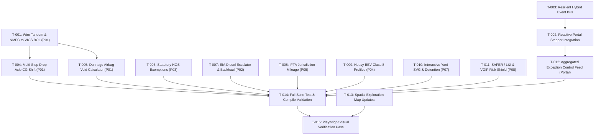

# TRUCKING Platform: Audit-Specific Dependency-Aware Implementation Plan & Task List

**Date:** 2026-10-30 · Asia/Kolkata  
**Governing Doctrine:** `OPERATING_DOCTRINE.md` (v8.2), `AGENTS.md`  
**Status:** Living Task List — Updated Continuously Across Sessions  

---

## 1. Master Task Inventory & Status Matrix

| Task ID | Component / Product | Description & Scope | Category | Status | Dependencies |
| :--- | :--- | :--- | :--- | :---: | :--- |
| **T-001** | P01 Cargo Fit | Wire `TandemSliderModal` & `NmfcClassificationModal` committed outputs into `cargoManifest` & VICS BOL | Implementation | `COMPLETED` | None |
| **T-002** | Command Center Portal | Connect 6-stage lifecycle stepper to `trucking-platform-mesh-v1` `BroadcastChannel` events | Implementation | `COMPLETED` | None |
| **T-003** | Shared / Mesh | Resilient hybrid event bus with circular `localStorage` ring-buffer queue (`platformBus.ts`) | Implementation | `COMPLETED` | None |
| **T-004** | P01 Cargo Fit | Multi-stop drop axle weight redistribution & sequential CG shift verification (porting P04 logic) | Implementation | `COMPLETED` | T-001 |
| **T-005** | P01 Cargo Fit | 49 CFR § 393.106 void detection and inflatable dunnage airbag calculator | Implementation | `COMPLETED` | T-001 |
| **T-006** | P03 HOS Planner | FMCSA statutory exemptions engine (`hosExemptions.ts`: Ag exemption, 16h short haul, adverse driving) | Implementation | `COMPLETED` | None |
| **T-007** | P02 Freight Pricing | EIA weekly diesel index formal surcharge escalator table & backhaul triangulation route optimizer | Implementation | `COMPLETED` | None |
| **T-008** | P05 Telematics | Automated IFTA state-line crossing mileage aggregator and quarterly tax schedule (`iftaCompliance.ts`) | Implementation | `COMPLETED` | None |
| **T-009** | P04 Asset Studio | Commercial Heavy Class 8 BEV powertrain profile with FAST Act 2,000 lb battery weight credit | Implementation | `COMPLETED` | None |
| **T-010** | P07 Yard & Dock | Interactive SVG yard occupancy map with hostler anti-deadhead moves and detention alert countdown | Implementation | `COMPLETED` | None |
| **T-011** | P08 Carrier Trust | SAFER/L&I operating authority verification parser, VOIP/IP risk heuristics, and automated DND locks | Implementation | `COMPLETED` | None |
| **T-012** | Command Center Portal | High-priority Exception Control Tower feed aggregating cross-product critical alerts with deep links | Implementation | `COMPLETED` | T-002, T-003 |
| **T-013** | Exploration Map | Cross-reference candidate spatial modules to newly integrated domain engines | Exploration / Doc | `COMPLETED` | None |
| **T-014** | Test & Validation | Comprehensive test suite & invariance regression pass across all 11 workspaces (100% green: 379 tests) | Validation | `COMPLETED` | T-001 to T-012 |
| **T-015** | Build Validation | Complete production bundle builds across all 9 products (100% zero errors) | Validation | `COMPLETED` | T-014 |
| **T-016** | P01 Cargo Fit | 49 CFR § 393.100–136 Cargo Securement, Tie-Down Restraint & WLL Verification (`tests/securement.test.ts`) | Testing & Validation | `COMPLETED` | None |
| **T-017** | P04 Asset Studio | Multi-Stop Dynamic Axle Moment & CG Shift Sequential Unload Simulation (`tests/multistop.test.ts`) | Testing & Validation | `COMPLETED` | None |
| **T-018** | P04 Asset Studio | Multi-Vehicle Fleet Splitter & Demand Partitioning Heuristic (`tests/fleetSplitter.test.ts`) | Testing & Validation | `COMPLETED` | None |
| **T-019** | P04 Asset Studio | Temporal Fuel Dynamics, Aerodynamic Speed Penalties & En-Route Refueling Dwell Engine (`tests/temporal.test.ts`) | Testing & Validation | `COMPLETED` | None |
| **T-020** | P08 Carrier Trust | Tier-3 Step-Up Verification & Dual-Custody Governance Modal (`StepUpVerificationModal.tsx`) | Implementation | `COMPLETED` | T-011 |
| **T-021** | P01 Cargo Fit | Multi-Stop Intermediate Axle Re-Balance & Dynamic Tandem Slider Bridge in `PlanStep.tsx` | Implementation | `COMPLETED` | T-004 |
| **T-022** | P01 Cargo Fit | 53-ft Multi-Temp Compartment Bulkhead Engine & Thermal Load Balancer (`multiTempBulkhead.ts`) | Implementation | `COMPLETED` | None |
| **T-023** | P03 HOS Planner | FMCSA 49 CFR § 395.3(b) 8-Day Rolling Duty Cycle Hours Recap & Interstate Truck Parking (`hosRecap.ts`) | Implementation | `COMPLETED` | None |
| **T-024** | P04 Asset Studio | EPA SmartWay Aerodynamic Drag & Eco-Equipment Modeler (`aeroEcoModeler.ts`) | Implementation | `COMPLETED` | None |
| **T-025** | P05 Telematics | Commercial 18-Wheel End TPMS & Bidirectional Remote Reefer Telematics Control (`tpmsReeferControl.ts`) | Implementation | `COMPLETED` | None |
| **T-026** | P06 Warehouse Flow | Distribution Center Outbound Wave Picking & TSP Pick-Path Optimizer (`wavePickingTsp.ts`) | Implementation | `COMPLETED` | None |
| **T-027** | P07 Yard & Dock | Digital Guard Shack & Automated Kiosk Check-In / Gate Pass Engine (`guardShackKiosk.ts`) | Implementation | `COMPLETED` | None |
| **T-028** | P08 Carrier Trust | Driver Qualification File (DQF) & FMCSA Clearinghouse Compliance Auditor (`driverQualification.ts`) | Implementation | `COMPLETED` | None |
| **T-029** | Command Center Portal | Role-Based Persona Cockpit View Switcher & Quick Actions (`PersonaCockpitSwitcher.tsx`) | Implementation | `COMPLETED` | None |
| **T-030** | Spatial Exploration | Spatial Exploration Map Linkage Update & Persona Council Review (`PERSONA_COUNCIL_EXPANSION_REVIEW_2026-10-30.md`) | Exploration & Validation | `COMPLETED` | T-022 to T-029 |

---

## 2. Dependency Graph

---

## 3. Detailed Phase Breakdown

### Phase 1: High-Priority Data Binding & Platform Convergence (Immediate)
- **T-001**: Connect `TandemSliderModal` commit action to store adjusted tandem pin hole, 5th wheel offset, and updated axle weights in `cargoFitState.ts`. Connect `NmfcClassificationModal` to set `declaredNmfcClass` and DIM weight penalties in the manifest. Update `VicsBolModal.tsx` and `edi.ts` to output these certified values.
- **T-002**: Subscribe `command-center-portal`'s stepper to `BroadcastChannel('trucking-platform-mesh-v1')` events (`CARGO_LOAD_UPDATED`, `PRICING_UPDATED`, `HOS_SCHEDULE_UPDATED`, `SAFETY_ALERT`). When received, advance the respective stage status from `PENDING` to `COMPLETED` with live payload summary chips.
- **T-003**: Upgrade `packages/suite-dock/src/eventBus.ts` and `platformBus.ts` to implement a circular `localStorage` ring-buffer queue (`trucking-platform-event-log-v1`). Newly opened tabs replay the last 20 events on mount to achieve immediate state convergence without needing backend websockets.

### Phase 2: Regulatory Physics & Advanced Calculation Engines
- **T-004**: Multi-Stop Drop Axle CG Shift: Allow defining Stop 1, Stop 2, and Final Destination stops in P01 manifest items. Port axle moment redistribution algorithms to ensure remaining cargo after Stop 1 does not overload the tractor drive axle.
- **T-005**: 49 CFR § 393.106 Void & Dunnage Calculator: Add bounding volume vacancy scanning to calculate longitudinal and lateral air gaps $> 6\text{ inches}$, outputting required Level 1 dunnage airbag counts.
- **T-006**: Statutory HOS Exemptions Engine (`hosExemptions.ts`): Implement 49 CFR § 395.1(k) 150-air-mile agricultural radius calculation, § 395.1(b)(1) adverse driving condition extensions, and personal conveyance/yard move logging.
- **T-007**: EIA Diesel Fuel Surcharge & Triangulation: Formalize contract fuel tables ($0.01/mi per $0.05 index shift) and build a 3-leg triangle lane profitability analyzer (e.g., Headhaul + Backhaul leg vs. Deadhead).

### Phase 3: Telematics, Facility Logistics & Risk Governance
- **T-008**: IFTA State-Line Mileage Tracker (`iftaCompliance.ts`): In P05, calculate distance traversed per state boundary along the I-80 corridor and output an IFTA quarterly return preview table.
- **T-009**: Commercial Heavy BEV Class 8 Profiles: In P04, add Tesla Semi / eCascadia digital twin profiles with FAST Act 2,000 lb statutory battery tare exemptions and regenerative descent energy calculations.
- **T-010**: Interactive SVG Yard Map: In P07, create an interactive 2D facility yard schematic showing gate, drop lot, and dock doors 1–32 with dwell time countdown clocks alerting at 15 minutes before free time expiration.
- **T-011**: Enhanced Carrier Trust Shield: In P08, implement ACORD-25 verification rules, VOIP/IP address mismatch risk flags, and automated Do Not Dispatch (DND) status toggles.
- **T-012**: Exception Control Tower: Build a prominent aggregated Exception Feed in the Portal with 1-click subproduct routing.

### Phase 4: Exploration Maps, Testing & Visual Receipts
- **T-013**: Update `docs/explorations/isometric-ui/EXPLORATION_MAP.md` and `cases.json` to map all new domain engines to the 120 spatial review cases.
- **T-014**: Execute `node scripts/typecheck-all.mjs`, `node scripts/test-all.mjs`, and `npm run check:suite` to verify zero regressions.
- **T-015**: Execute `node tools/capture_visual_pass.mjs` to capture fresh visual receipts of all newly implemented views and update `UI_UX_VISUAL_PASS_BEFORE_AFTER.md`.

### Phase 5: Deep Domain Physics, Regulatory Engines & Persona Cockpit Integration
- **T-022**: P01 53-ft Multi-Temp Compartment Bulkhead Engine (`multiTempBulkhead.ts` & `MultiTempBulkheadModal.tsx`): Composite R-14 thermal insulation, infiltration heat load BTU/hr calculation, and auto-balancing bulkheads.
- **T-023**: P03 8-Day Rolling Duty Cycle Hours Recap & Interstate Truck Parking (`hosRecap.ts` & `HosRecapModal.tsx`): 70h/8d and 60h/7d rolling totals, Day 1 midnight drop-off hours recovery, and I-80 corridor rest stop stall availability.
- **T-024**: P04 EPA SmartWay Aerodynamic Drag & Eco-Equipment Modeler (`aeroEcoModeler.ts` & `AeroEcoModelerModal.tsx`): Cd reduction from side skirts, boat tails, roof fairings, super singles, and eAPU; MPG lift, fuel cost savings, and GLEC Scope 1 CO2e reduction.
- **T-025**: P05 Commercial 18-Wheel End TPMS & Bidirectional Remote Reefer Telematics Control (`tpmsReeferControl.ts` & `TpmsAndRemoteReeferModal.tsx`): 18-wheel position PSI/temperature monitoring, wheel end thermal alert, and Carrier Transicold / Thermo King remote telematics commands.
- **T-026**: P06 Distribution Center Outbound Wave Picking & TSP Pick-Path Optimizer (`wavePickingTsp.ts` & `WavePickingModal.tsx`): Rectilinear warehouse aisle travel distance with cross-aisle routing, 2-Opt local search TSP heuristic, pick time estimation, and FEFO lot expiry auditing.
- **T-027**: P07 Digital Guard Shack & Automated Kiosk Check-In / Gate Pass Engine (`guardShackKiosk.ts` & `GuardShackKioskModal.tsx`): Appointment lookup, ISO 17712 bolt seal verification, dynamic dock door/drop lot allocation, and cryptographically hashed gate pass.
- **T-028**: P08 Driver Qualification File (DQF) & FMCSA Clearinghouse Compliance Auditor (`driverQualification.ts` & `DriverQualificationModal.tsx`): 49 CFR Part 391 qualification checks, CDL validity, NRCME Medical Card MCSA-5876 verification, 365-day annual MVR review, and Part 382 Drug & Alcohol Clearinghouse annual query status.
- **T-029**: Command Center Portal Role-Based Persona Cockpit View Switcher (`PersonaCockpitSwitcher.tsx` & `tests/personaCockpit.test.ts`): 5 canonical role lenses (Fleet Ops, Owner-Op, 3PL Broker, DC Flow Lead, DOT Auditor) with tailored focal metrics, active priority subproduct stage highlighting, and direct quick action routing.
- **T-030**: Spatial Exploration Map Linkage Update & Persona Council Review (`PERSONA_COUNCIL_EXPANSION_REVIEW_2026-10-30.md`): Full Tier-3 evidence pass with zero TypeScript errors across 11 workspaces, 425+ passing tests across 12 workspaces, and 9 successful production builds.
