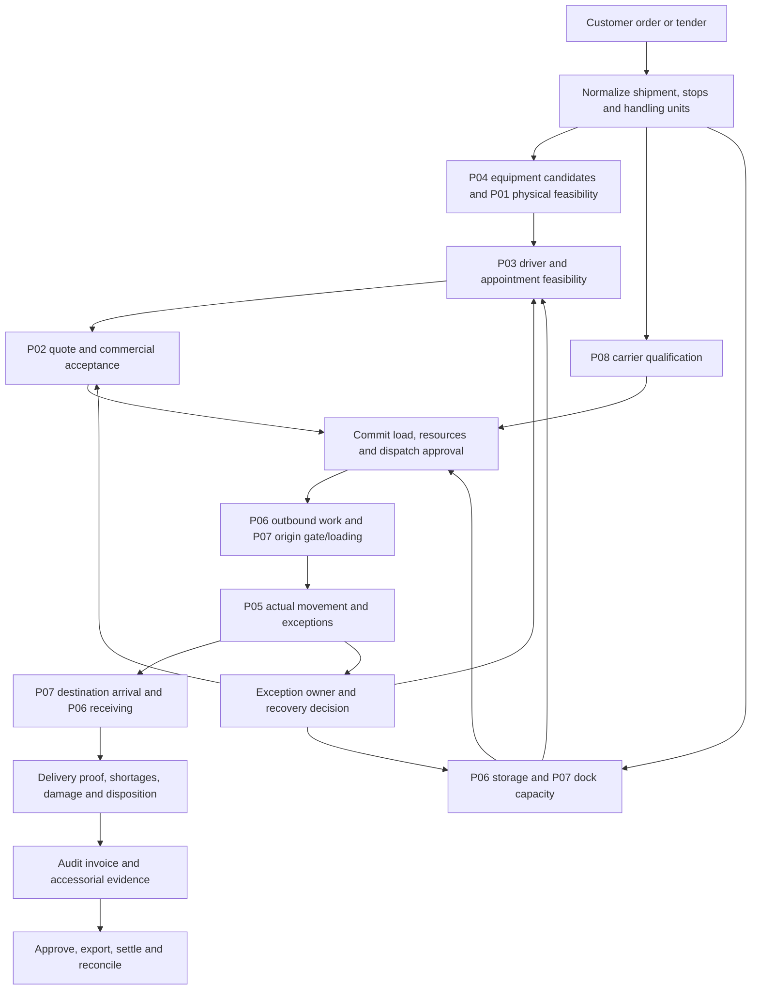

# TRUCKING — Full Industry Product Suite Gap Audit & Strategic Expansion Blueprint
**From Facility & Warehousing to Interstate Freight, Fleets, and Financial Settlement**
*Document Version: 1.0.0 · Date: October 2026 · Author: Systems & Enterprise Logistics Architecture*

> **Current implementation checkpoint: 22 October 2026.** Read [Section 9](#9-critical-remediation-and-connected-shipment-checkpoint-22-october-2026) and the [shipment flow runbook](../runbooks/SHIPMENT_FLOW.md) for the implemented, browser-verified local scenario. [Section 8](#8-current-industry-use-case-assessment-22-october-2026) records the pre-remediation source review and its finding register. Sections 1 through 7 remain the earlier expansion hypothesis. Their readiness claims, product numbering, ports, feature-gap labels, and competitive claims are historical. Later dated evidence supersedes earlier claims without deleting that history. No commercial demand, production deployment, physical delivery, or legal certification is established by this document.

---

## 1. Executive Summary: The End-to-End Freight Ecosystem

The commercial freight and supply chain industry in North America and globally is not a collection of isolated point solutions; it is an interconnected, high-velocity physical and financial pipeline. Every pallet manufactured inside a production facility traverses an unbroken operational lifecycle:

```
[Inbound Raw Materials & Production]
               │
               ▼
   [Warehouse / DC Management] ─── (WMS: Slotting, Picking, Putaway, Staging)
               │
               ▼
   [Yard & Dock Management]   ─── (YMS: Carrier Appointments, Gate OCR, Trailer Spotting)
               │
               ▼
 [Carrier Sourcing & Vetting] ─── (Carrier Onboarding, FMCSA SMS, Highway Anti-Fraud)
               │
               ▼
 [Load Optimization & Physics] ─── (3D Packing, Bridge Law B, Dynamic CG, Tie-Downs)
               │
               ▼
[Freight Pricing & Contract]   ─── (Dynamic Spot/Contract Rates, EIA Fuel Index, Rate Con)
               │
               ▼
[Dispatch, HOS & Corridor]    ─── (FMCSA Part 395 ELD, Sleeper Splits, Truck Navigation)
               │
               ▼
  [In-Transit Fleet Telematics] ─── (J1939 CAN Bus, AI Dashcams, Cold-Chain FSMA, IFTA)
               │
               ▼
   [Destination Gate & Yard]   ─── (Receiving Dock Check-In, Lumper, Dwell Tracking)
               │
               ▼
  [Proof of Delivery & Claims] ─── (ePOD Sign-on-Glass, Photo Geotag, OS&D Disputes)
               │
               ▼
[Freight Audit & Settlement]   ─── (3-Way Match, Accessorial & Detention Audit, Factoring)
               │
               ▼
[Asset Maintenance & Shop]     ─── (PM-A/B/C Schedules, DVIR Remediation, Parts/Tires)
               │
               ▼
[ESG & Regulatory Reporting]   ─── (GLEC Carbon Scope 1-3, CARB Clean Truck Checks)
```

### Current Workspace Baseline
The TRUCKING workspace has established sovereign, high-fidelity micro-frontends with deep domain algorithms:
1. **Product 01: Cargo Fit** (`Port 5173`) — 3D heuristic packing, Federal Bridge Formula B axle tare calculations, 49 CFR § 393.102 tie-downs, VICS Bill of Lading, EDI 204/214.
2. **Product 02: Freight Pricing HUD** (`Port 5174`) — Cost waterfalls, diesel escalation, 3D digital vehicle twin, 1-click broker rate confirmations.
3. **Product 03: HOS Planner** (`Port 5175`) — FMCSA Part 395 hours of service engine, 24-hr visual ELD chart, corridor waypoints.
4. **Product 04: Asset Studio** (`Port 5176`) — 20 vehicles, 23 packaging types, 3D WebGL / 2.5D Isometric / 2D CAD blueprints, dynamic CG axle moment engine, multi-vehicle fleet splitter.
5. **Product 05: Fleet Telematics** (`Port 5177`) — SAE J1939 CAN bus OBD-II telemetry, cold-chain FSMA thermal logger, I-80 geofence canvas, active DTCs.
6. **Product 06: Warehouse Space & Flow Planner** (`Port 5178`) — SVG axonometric 3D facility twin, ABC slotting, moveable container dual-role tracking, inbound putaway optimizer, GS1 EPCIS scans.
7. **Product 06 (Branch): Carrier Safety & Compliance HUD** (`Port 5178 / 5179`) — FMCSA SMS 7 BASIC percentiles, COI policy verification, chameleon & double-brokering fraud risk scoring, Do Not Dispatch (DND) rules.
8. **Command Center Portal** (`Port 5170`) — 6-stage lifecycle stepper, EDI Hub, Dispatch Manifest, unified `<SuiteDock />`.

While the current suite solves the core mechanical, physical, and planning challenges with remarkable depth, **critical operational, transactional, financial, and edge-device domains remain uncovered**. Below is the exhaustive audit of what is missing within existing subproducts, what major industry modules are absent, and the blueprint to transform the suite into an enterprise-grade platform rivaling Manhattan Associates, Blue Yonder, Samsara, and McLeod Software.

---

## 2. Micro-Audit: What is Missing INSIDE Existing Subproducts

### 2.1 Product 01: Cargo Fit & 3D Load Optimization (Port 5173)
*What it does well:* 3D packing heuristic, Bridge Law Formula B, cargo securement calculations, EDI 204/214 generation, camera barcode scanner.

*Gaps & Missing Capabilities:*
1. **Fifth Wheel & Trailer Tandem Sliding Simulation**:
   - *The Reality:* Drivers and warehouse loaders don't just accept axle overload; they slide the tractor fifth wheel (altering steer vs. drive axle moments) and slide the trailer tandem boggies (moving the pivot point relative to the cargo center of gravity).
   - *Missing Feature:* Interactive pin-slider UI (pins 1 to 12 on trailer tandem rails) calculating dynamic weight transfer ($\sim 250\text{--}500\text{ lbs}$ per pin hole) to clear state-specific kingpin-to-rear-axle (KPRA) limits (e.g., California 40-foot KPRA rule).
2. **Hazardous Materials Segregation Matrix (49 CFR § 177.848)**:
   - *The Reality:* Loading general freight alongside Hazmat requires mandatory spatial segregation. Class 1 Explosives cannot touch Class 5 Oxidizers; Cyanides cannot be loaded above or adjacent to Acids.
   - *Missing Feature:* Automated compliance check validating that hazardous placards on the manifest obey the FMCSA Hazmat Segregation Table, preventing illegal co-loading.
3. **Multi-Temperature Compartment Bulkheads (Dual & Tri-Temp Reefers)**:
   - *The Reality:* Grocery logistics requires dividing a 53-ft reefer into Frozen ($-10^\circ\text{F}$), Chilled ($34^\circ\text{F}$), and Dry Ambient ($65^\circ\text{F}$) zones using moveable insulated bulkheads.
   - *Missing Feature:* Longitudinal bulkhead positioning tool calculating cubic capacity per temperature zone and validating thermal load balance.
4. **NMFC Density-Based Freight Classification**:
   - *The Reality:* LTL freight pricing depends heavily on National Motor Freight Classification (NMFC) classes (50 to 500) determined by packaging density (lbs/cu ft), handling, liability, and stowability.
   - *Missing Feature:* Auto-calculation of shipment cube density and NMFC class recommendation to prevent carrier re-classification penalties.
5. **Dunnage, Void Fill & Airbag Placement Engine**:
   - *The Reality:* Under 49 CFR § 393.106, lateral and longitudinal void space $> 6\text{ inches}$ requires void fillers, friction mats, or inflatable air dunnage bags to prevent load shifting under $0.8g$ forward deceleration.
   - *Missing Feature:* Void space detection alerting loaders where air bags, load locks, or friction rubber pads must be inserted.
6. **Carton Compressive Strength & Stacking Crush Limits**:
   - *The Reality:* Heavy pallets cannot be double-stacked on top of light corrugated boxes without exceeding Box Compression Test (BCT) or Edge Crush Test (ECT) ratings.
   - *Missing Feature:* Maximum static stacking load verification ($kg/m^2$ limit) preventing box collapse during transit.
7. **Interactive 3D Manual Repack & Override Mode**:
   - *The Reality:* Algorithmic placement often needs a human dock supervisor's touch (e.g., swapping two pallets to accommodate a priority stop).
   - *Missing Feature:* Drag-and-drop raycasting in Three.js allowing the operator to lift, rotate, and reposition individual pallets with live collision detection and real-time center-of-gravity updates.

---

### 2.2 Product 02: Freight Pricing & Tactical Dispatch HUD (Port 5174)
*What it does well:* Carrier cost waterfall, EIA weekly diesel index pegging, 3D isometric truck twin, 1-click broker rate confirmation.

*Gaps & Missing Capabilities:*
1. **Dynamic Spot vs. Contract Benchmark Integrations**:
   - *The Reality:* Freight pricing cannot happen in a vacuum. Brokers and shippers benchmark against DAT iQ RateView, FreightWaves SONAR, and Truckstop.com market averages.
   - *Missing Feature:* Lane density indices (Van/Reefer load-to-truck ratio), historical 30-day rolling rate bands, and 7-day spot rate forecasts.
2. **Backhaul & Triangle Lane Margin Optimization**:
   - *The Reality:* A headhaul from Chicago to Atlanta at $\$3.20/\text{mi}$ can become unprofitable if the return backhaul only pays $\$1.30/\text{mi}$ with 250 miles of deadhead.
   - *Missing Feature:* Triangulation route recommender (e.g., Chicago $\to$ Atlanta $\to$ Nashville $\to$ Chicago) maximizing composite revenue per total network mile.
3. **Multi-Tiered Accessorial Rate Schedule**:
   - *The Reality:* Detention, layover, TONU (Truck Order Not Used), hazardous surcharges, inside delivery, lumper fees, and residential liftgate fees represent $15\text{--}25\%$ of total invoice revenue.
   - *Missing Feature:* Configurable accessorial rate card editor with contract clauses (e.g., 2 hours free time, $\$85/\text{hr}$ thereafter in 15-minute increments; TONU flat fee of $\$250$ if cancelled after 12:00 PM).
4. **Broker Margin Split & Internal Agent Commissions**:
   - *The Reality:* Freight brokerages track buy-rate (carrier pay), sell-rate (shipper charge), gross margin percentage, and dispatch agent commission splits ($10\text{--}30\%$ of gross margin).
   - *Missing Feature:* Internal brokerage margin ledger separating customer quote from carrier rate confirmation with margin protection alerts ($< 12\%$ margin warning).
5. **Factoring & QuickPay Discount Calculator**:
   - *The Reality:* Carriers rarely wait Net 30; they accept QuickPay ($1.5\text{--}3.0\%$ discount for 2-day ACH) or submit invoices to factoring companies (Triumph, RTS, OTR Solutions).
   - *Missing Feature:* Payment term selector calculating net payable payouts, factoring Notice of Assignment (NOA) account routing, and working capital cash float.

---

### 2.3 Product 03: HOS Compliance & Interstate Corridor Legality Planner (Port 5175)
*What it does well:* FMCSA Part 395 11-hr driving, 14-hr duty window, 30-min break, 70-hr rolling cycle, solo vs. team simulation, preset interstate corridors, 24-hr visual ELD chart.

*Gaps & Missing Capabilities:*
1. **Split Sleeper Berth Flexibility (8/2 and 7/3 Provisions)**:
   - *The Reality:* Under the 2020 FMCSA Hours of Service Final Rule, drivers can split their mandatory 10-hour off-duty period into an $8/2$ or $7/3$ split without pausing their 14-hour duty clock until the qualifying sleeper period.
   - *Missing Feature:* Split sleeper calculation engine allowing drivers to pause duty clocks during warehouse loading delays.
2. **Statutory HOS Exemptions Engine**:
   - *49 CFR § 395.1(k) Agricultural Exemption:* 150 air-mile radius from source during harvest seasons (completely off-duty/unregulated HOS).
   - *49 CFR § 395.1(o) 16-Hour Short-Haul Exception:* Once per 7 days for drivers returning to their work reporting location.
   - *49 CFR § 395.1(b)(1) Adverse Driving Conditions:* 2-hour driving time extension due to unforeseen blizzards, accidents, or detours.
   - *Personal Conveyance (PC) vs. Yard Move (YM):* Logging bobtail driving to food/motel as PC (off-duty) and terminal repositioning as YM (on-duty not driving).
3. **Turn-by-Turn Truck-Safe Dynamic Routing**:
   - *The Reality:* Trucks cannot take passenger car routes due to 13'6" bridge clearances, 80,000-lb gross weight limits on secondary roads, and Hazmat tunnel restrictions.
   - *Missing Feature:* Integration of truck-specific GIS routing (PC*MILER / HERE Truck API) calculating true commercial routing miles rather than straight-line or passenger highway distances.
4. **Real-Time Truck Parking Reservation & Crowdsourcing**:
   - *The Reality:* Truck parking shortage is the #1 driver safety stressor. Running out of driving hours on the interstate shoulder results in severe FMCSA violations and fatal crashes.
   - *Missing Feature:* Waypoint truck stop parking availability monitor (Love's, Pilot Flying J, TA-Petro, state rest areas) with automated rest-stop reservations along the corridor.
5. **Multi-Day 8-Day Cycle Hours Recap**:
   - *The Reality:* Drivers need to know how many hours they regain at midnight on Day 8 (rolling 70-hour recap).
   - *Missing Feature:* 8-day rolling hours recap table showing daily hours worked, available duty hours tomorrow, and projected 34-hour restart trigger.
6. **Cross-Border HOS Rules (USMCA / Canada & Mexico)**:
   - *Canada (SOR/2005-313):* 13 hours driving, 14 hours on-duty, 16-hour workshift, Cycle 1 (70 hrs/7 days) or Cycle 2 (120 hrs/14 days).
   - *Mexico (NOM-087-SCT-2-2017):* 14 hours maximum driving in 24 hours with mandatory 30-min break every 5 hours.

---

### 2.4 Product 04: Fleet & Cargo Asset Studio (Port 5176)
*What it does well:* 20 vehicle types, 23 packaging twins, 3D WebGL / 2.5D Isometric / 2D CAD blueprints, dynamic CG axle moment calculation across drop sequences, multi-vehicle fleet splitter, GLEC carbon emissions.

*Gaps & Missing Capabilities:*
1. **Zero-Emission Heavy Electric Class 8 Powertrain Profiles**:
   - *The Reality:* Fleets are adopting Tesla Semi, Freightliner eCascadia, and Volvo VNR Electric. These vehicles have unique payload-versus-range curves, charging rates (Megawatt Charging Systems - MCS), and battery weight exemptions ($2,000\text{ lb}$ federal allowance under FAST Act / 23 U.S.C. 127(s)).
   - *Missing Feature:* Battery state-of-charge (SoC) consumption modeling ($1.5\text{--}2.2\text{ kWh/mile}$ loaded), regenerative braking energy recapture on mountain descents, and charging stop duration optimization.
2. **Aerodynamic Fairings & Eco-Equipment Modeler**:
   - *The Reality:* EPA SmartWay verified trailer skirts, tails (rear boat-tails), cab side extenders, and super single tires reduce aerodynamic drag ($C_d$) by $6\text{--}12\%$, directly reducing fuel burn.
   - *Missing Feature:* Toggleable aerodynamic package accessories modifying the temporal fuel burn coefficients in the simulation.
3. **Specialized Commercial Trailer Types**:
   - *Missing Assets:* RGN (Removable Gooseneck) lowboy trailers with well length and ground clearance parameters; Step-deck/drop-deck with beavertails; Bulk pneumatic dry-hopper trailers for cement/flour; B-Train and Rocky Mountain Double combinations (twin 28.5-ft pups and 48-ft + 28-ft combinations).
4. **Trailer IoT Sensor Topology Mapping**:
   - *The Reality:* Smart trailers (Great Dane FleetPulse, Wabash Cargo Connect) have 8 to 15 digital sensors mounted across the chassis.
   - *Missing Feature:* Interactive 3D sensor pin mapping: wheel-end TPMS sensors, ultrasonic cargo volume fullness sensors (estimating % cube filled), door reed switches, solar battery monitors, and air brake stroke sensors.

---

### 2.5 Product 05: Fleet Telematics & Real-Time Tracking HUD (Port 5177)
*What it does well:* SAE J1939 CAN bus OBD-II simulation, cold-chain reefer thermal dissipation and alarms (+0.15°F/s door open), I-80 corridor geofencing canvas, active DTCs (SPN 111, SPN 100), safety counters.

*Gaps & Missing Capabilities:*
1. **Live GPS Breadcrumb Historical Replay**:
   - *The Reality:* Fleet dispatchers investigating accidents or fuel theft need minute-by-minute historical track replay with vehicle speed, heading, and sensor telemetry overlay.
   - *Missing Feature:* Scrubbable time-slider map replay showing exact historical coordinates, speeding events, and rest stops.
2. **AI Video Safety & In-Cab Computer Vision Telemetry**:
   - *The Reality:* Samsara and Motive dominate the market through AI Dashcams detecting distracted driving (mobile phone usage), driver drowsiness/micro-sleep, rolling stop signs, and tailgating.
   - *Missing Feature:* Video safety event queue logging ADAS forward-collision events, in-cab driver monitoring (DMS) alerts, driver safety coaching scores, and video clip request triggers.
3. **18-Wheel End Tire Pressure Monitoring System (TPMS)**:
   - *The Reality:* Commercial tire blowouts are a leading cause of roadside breakdowns and severe accidents. Under-inflated tires increase fuel consumption by $1.5\%$.
   - *Missing Feature:* 18-wheel graphic telemetry displaying individual tire PSI and temperature, alerting to rapid pressure drops or overheating wheel bearings.
4. **Automated IFTA (International Fuel Tax Agreement) Jurisdiction Engine**:
   - *The Reality:* Interstate carriers must file quarterly IFTA tax returns detailing exact miles driven in each state/province and gallons of fuel purchased to reconcile state fuel taxes.
   - *Missing Feature:* Automated GPS state-line crossing logging aggregating mileage by state (e.g., Illinois 214 mi, Iowa 302 mi, Nebraska 455 mi) and computing quarterly tax liability/credit.
5. **Two-Way Remote Reefer Telematics Control**:
   - *The Reality:* Modern telematics allows dispatchers to remotely change reefer setpoints (e.g., from $+34^\circ\text{F}$ to $-10^\circ\text{F}$), trigger defrost cycles, or switch unit mode from Continuous to Start-Stop via API.
   - *Missing Feature:* Bidirectional reefer control panel allowing dispatchers to issue remote commands to Carrier Transicold / Thermo King units.

---

### 2.6 Product 06: Warehouse Space & Flow Planner (Port 5178)
*What it does well:* Axonometric pure-vector SVG 3D facility twin, ABC slotting optimization, dual-role moveable container tracking, inbound putaway allocation, GS1 EPCIS scan verification.

*Gaps & Missing Capabilities:*
1. **Outbound Picking Strategy & Wave/Batch Orchestration**:
   - *The Reality:* Modern distribution centers fulfill hundreds of customer orders simultaneously using Wave Picking (releasing orders based on carrier departure times), Batch Picking (picking multiple orders in one pass), and Zone Picking (pick-and-pass along conveyor zones).
   - *Missing Feature:* Outbound pick-wave builder with traveling salesperson (TSP) pick-path optimization minimizing worker travel distance through aisles.
2. **Cross-Docking Direct Allocation Engine**:
   - *The Reality:* High-efficiency facilities bypass rack storage completely. Inbound pallets are transferred directly from Inbound Door A to Outbound Door B for immediate truck loading.
   - *Missing Feature:* Inbound-to-outbound cross-dock matching engine based on departure schedule and destination hub matching.
3. **Inventory Depth: Lot, Expiration Date (FEFO/FIFO) & Serial Tracking**:
   - *The Reality:* Food, beverage, and pharmaceuticals mandate First-Expired, First-Out (FEFO) picking, lot recall quarantine, and unit-level serial number traceability (DSCSA compliance for pharma).
   - *Missing Feature:* Lot traceability ledger with 1-click quarantine hold locking specific pallet locations from being picked.
4. **Returns & Reverse Logistics (RMA) Processing**:
   - *The Reality:* E-commerce and retail logistics see $15\text{--}30\%$ return rates requiring receiving inspection, grade classification (A/B/C/scrap), refurbishment routing, or liquidation staging.
   - *Missing Feature:* Reverse logistics triage workflow assigning returned assets to restock, repack, or disposal locations.

---

### 2.7 Product 06 / 07: Carrier Safety, Vetting & Anti-Fraud HUD (Port 5178/5179)
*What it does well:* FMCSA SMS 7 BASIC percentiles, insurance COI policy verification, chameleon carrier & double brokering risk scoring, Do Not Dispatch (DND) rules.

*Gaps & Missing Capabilities:*
1. **FMCSA SAFER / QCMobile Real-Time API Scraper**:
   - *The Reality:* Safety percentiles and operating authority status change daily. Fraudulent carriers get revoked overnight.
   - *Missing Feature:* Live or cached API sync pulling DOT inspection records, out-of-service (OOS) percentages, fatal crash counts, and active operating authority from FMCSA SAFER / L&I databases.
2. **Automated Certificate of Insurance (COI) OCR Extraction**:
   - *The Reality:* Carriers upload ACORD-25 insurance certificates. Brokers manually verify policy limits, effective dates, and ensure the broker/shipper is named as Additional Insured with Certificate Holder status.
   - *Missing Feature:* Vision OCR parser extracting policy numbers, AM Best rating of underwriter, expiration dates, and sending automated 30-day renewal requests.
3. **FreightGuard Incident Exchange & Double-Brokering Blacklist**:
   - *The Reality:* Brokers rely on Carrier411 FreightGuard reports and Highway.com crowd-sourced reports of unauthorized re-brokering, hostage loads, and missed pickups.
   - *Missing Feature:* User-generated incident reporting engine and carrier network reputation score.
4. **Driver Qualification File (DQF) & FMCSA Clearinghouse Compliance**:
   - *The Reality:* 49 CFR Part 391 requires carriers to maintain complete DQF packets for every driver: Commercial Driver's License (CDL) verification, Medical Examiner's Certificate (DOT physical), 3-year prior employment history, annual Motor Vehicle Record (MVR) pull, and annual FMCSA Drug & Alcohol Clearinghouse query.
   - *Missing Feature:* DQF audit compliance dashboard alerting when medical cards or CDLs expire.

---

### 2.8 Command Center Portal (Port 5170)
*What it does well:* 6-stage lifecycle stepper, EDI Hub (204, 214, 990, 210), Dispatch Manifest, unified `<SuiteDock />`.

*Gaps & Missing Capabilities:*
1. **Persona-Based Specialized Control Towers**:
   - *The Reality:* A Shipper, a 3PL Broker, a Fleet Carrier Dispatcher, a Warehouse Operations Director, and a Safety Officer need fundamentally different cockpit views.
   - *Missing Feature:* Role switcher configuring the dashboard widgets (e.g., Shipper sees Freight Spend & Delivery OTD; Safety Director sees BASIC scores & DND alerts; Warehouse Ops sees Dock Congestion & Putaway Queues).
2. **Unified Real-Time Event Bus & Webhook Mesh**:
   - *The Reality:* Currently, products exchange data via `platformBus.ts` over `localStorage` and `BroadcastChannel`. In multi-user commercial SaaS, state updates must be synchronized via WebSockets, Server-Sent Events (SSE), or webhooks.
   - *Missing Feature:* Cloud-ready event streaming architecture linking subproducts across different browser tabs, devices, or remote API clients.
3. **Centralized Exception Management Control Tower**:
   - *The Reality:* Logistics operations manage by exception. Operators don't watch smooth loads; they respond to red flags.
   - *Missing Feature:* High-priority exception feed aggregating:
     - Temperature excursion on active Reefer Load #4192 (P05).
     - Driver approaching 11-hour driving cap with 90 miles remaining (P03).
     - Overweight steer axle ($12,450\text{ lbs}$) on Manifest #8821 (P01).
     - Carrier insurance expired 2 days ago on booked load (Carrier Safety).
     - Dock Door #4 unloading delay exceeding 2-hour free time (Warehouse).

---

## 3. The Macro Industry Gaps: What Entire Products are Missing?

When evaluating TRUCKING as a full enterprise product suite from manufacturing dock to retail delivery, **several fundamental industry product categories are currently vacant**.

Below are the **8 Missing Sovereign Subproducts** required to complete the end-to-end industry portfolio:

```
┌──────────────────────────────────────────────────────────────────────────────────┐
│                             PORTFOLIO EXPANSION MATRIX                           │
├────────────┬──────────────────────────────────────────┬──────┬───────────────────┤
│ Product ID │ Subproduct Name                          │ Port │ Core Domain       │
├────────────┼──────────────────────────────────────────┼──────┼───────────────────┤
│ Product 07 │ Yard & Dock Management System (YMS)      │ 5179 │ Facility Logistics│
│ Product 08 │ Carrier Trust, Vetting & Anti-Fraud      │ 5180 │ Risk & Governance │
│ Product 09 │ In-Cab Driver Companion & Truck Nav      │ 5181 │ Mobile Execution  │
│ Product 10 │ Electronic Proof of Delivery (ePOD) & OS&D 5182 │ Claims & Custody  │
│ Product 11 │ Freight Audit, 3-Way Match & Payables    │ 5183 │ Logistics Fintech │
│ Product 12 │ Fleet Maintenance & Shop CMMS            │ 5184 │ Equipment Assets  │
│ Product 13 │ Port Drayage, Intermodal & USMCA Border  │ 5185 │ Global & Drayage  │
│ Product 14 │ Decarbonization & Clean Truck Mandates   │ 5186 │ ESG & Clean Energy│
└────────────┴──────────────────────────────────────────┴──────┴───────────────────┘
```

---

### Product 07: Yard & Dock Management System (YMS & Appointment Kiosk)
**Port:** `5179` · **Category:** Facility Logistics · **Market Comps:** *Opendock, C3 Solutions, Kaleris (Pinc), FourKites Yard Manager*

*The Industry Problem:*
The physical yard between the highway gate and the warehouse dock is the #1 black hole in supply chain logistics. Trailers get lost in drop lots; drivers queue outside gates causing traffic jams; detention fees rack up while dock doors sit empty. P06 manages inside the warehouse, but not the yard outside.

*Key Product Capabilities:*
1. **Self-Service Carrier Appointment Scheduling Portal**:
   - Shippers configure facility receiving capacity (e.g., 4 trucks per hour, specialized door rules for dry vs. refrigerated vs. flatbed).
   - Carriers book dock appointments online with automated confirmation numbers and calendar invites.
2. **Digital Guard Shack & Gate Management**:
   - Driver check-in kiosk (touchscreen or mobile QR code scan from cab).
   - Optical Character Recognition (OCR) / Automatic License Plate Recognition (ALPR) capturing tractor plate, trailer number, and container ISO code upon arrival.
   - Automated electronic gate-pass issuance with security seal verification.
3. **Visual 2D/3D Interactive Yard Map**:
   - Real-time map of all yard slots: Gate, Drop Lot, Dock Doors 1–32, Staging Lanes, Inspection Bay, Wash Bay, and Outbound Ready.
   - Status indicators per trailer: Empty, Loaded Inbound, Loaded Outbound, Bad Order (Damaged), Reefer Active, Detained $>2\text{ hrs}$.
4. **Yard Jockey / Hostler Task Dispatching**:
   - Automated work order dispatch to yard spotter truck operators: *"Move Trailer #53819 from Drop Lot Spot 44 to Dock Door 12."*
   - Mobile driver app with task confirmation, preventing double-moves and reducing jockey travel time.
5. **Automated Detention Clock & Carrier Scorecarding**:
   - Live detention countdown per carrier starting the second the truck enters the gate.
   - Alerts dispatch when free time (e.g., 120 minutes) has 15 minutes remaining, preventing $\$85\text{--}\$150/\text{hr}$ detention penalties.

---

### Product 08: Carrier Trust, Vetting & Anti-Fraud Shield
**Port:** `5180` · **Category:** Risk & Compliance · **Market Comps:** *Highway.com, Carrier411, RMIS (Truckstop), MyCarrierPackets*

*The Industry Problem:*
North American logistics is experiencing an unprecedented epidemic of freight fraud: double brokering, stolen identity loads, chameleon carriers (operators whose authority was shut down for safety violations who restart under a relative's name), and cargo theft rings. P06-carrier-safety began addressing this, but it requires a dedicated, sovereign product identity with live fraud intelligence.

*Key Product Capabilities:*
1. **Digital Identity & Anti-Double-Brokering Verification**:
   - IP address geolocation and VOIP phone number risk detection during carrier onboarding.
   - Comparison of carrier dispatch email domain against official FMCSA registration records (flagging free Gmail/Yahoo addresses or lookalike domains).
2. **Chameleon Carrier & Re-Incarnation Risk Scoring**:
   - Cross-referencing physical addresses, phone numbers, corporate officers, and VIN records against revoked motor carriers to identify reincarnated identities.
3. **Automated Continuous Monitoring & Lockout (Do Not Dispatch)**:
   - Automated nightly sync with FMCSA SAFER / SMS databases.
   - Instant automated DND lock if a carrier's operating authority is revoked, insurance policy cancelled, or SMS BASIC scores exceed intervention thresholds.
4. **Certificate of Insurance (COI) Vault & Compliance Tracking**:
   - Automated ACORD-25 verification: Auto Liability ($\ge \$1,000,000$), Motor Truck Cargo ($\ge \$100,000\text{--}\$250,000$), General Liability, and Workers' Comp.
   - Verification of underwriter financial strength (AM Best rating $\ge \text{A-}$).
5. **Driver Qualification File (DQF) Compliance Manager**:
   - Complete digital repository for driver CDLs, medical cards (MEC), 3-year safety performance history, MVR driving records, and annual FMCSA Drug & Alcohol Clearinghouse queries.

---

### Product 09: In-Cab Driver Companion & Truck-Safe Navigation
**Port:** `5181` · **Category:** Mobile & Execution · **Market Comps:** *Trimble CoPilot Truck, Garmin dēzl, Motive Driver App, Samsara Driver*

*The Industry Problem:*
Dispatchers, planners, and brokers operate on desktop browsers, but the physical freight is executed by commercial truck drivers on mobile devices. Standard Google Maps or Apple Maps routes trucks under low-clearance railroad bridges, onto weight-prohibited parkways, or through Hazmat-restricted tunnels, causing catastrophic bridge strikes and fines.

*Key Product Capabilities:*
1. **Commercial Vehicle Restricted Turn-by-Turn GPS Navigation**:
   - Custom vehicle profile entry: Height (e.g., 13'6"), Width (102"), Total Length (72 ft), Gross Weight (80,000 lbs), Axle Count (5), and Hazmat Placards (e.g., Class 3 Flammable).
   - Dynamic routing avoiding low bridges, weight-limited bridges, sharp switchbacks, and hazardous material tunnels.
2. **Digital Dispatch & Trip Manifest Sheet**:
   - 1-tap load acceptance from dispatcher.
   - Step-by-step waypoint itinerary: Shipper pickup appointment, intermediate fuel stops, weigh stations, and receiver delivery window.
3. **Automated Geofenced Arrived & Departed Status**:
   - Background GPS geofencing triggering automatic arrival notifications to shippers and dispatchers upon entering the facility perimeter, eliminating manual check-in phone calls.
4. **Digital DVIR (Driver Vehicle Inspection Report)**:
   - 49 CFR § 396.11 compliant pre-trip and post-trip digital inspection checklists with photo upload for defective components (tires, brakes, lights, coupling devices).
5. **Mobile Document Scanner**:
   - High-contrast edge detection and perspective correction allowing drivers to photograph signed paper BOLs and receipts in the cab, converting them into crystal-clear PDF documents for instant invoicing.

---

### Product 10: Electronic Proof of Delivery (ePOD) & OS&D Claims Resolution
**Port:** `5182` · **Category:** Claims & Custody · **Market Comps:** *Vector, Transflo, Descartes MobileLink, Locus ePOD*

*The Industry Problem:*
Disputes over missing, delayed, or damaged goods (Over, Short & Damaged - OS&D) tie up billions of dollars in freight receivables. When a receiver marks a paper BOL "5 cartons damaged", the paper document often takes weeks to reach corporate accounting, delaying freight invoices and sparking contentious insurance claims.

*Key Product Capabilities:*
1. **Tamper-Proof Sign-on-Glass Electronic Bill of Lading (eBOL/ePOD)**:
   - Receiver signs directly on the driver's tablet/phone upon delivery.
   - Cryptographic timestamping and GPS geotagging recording exact coordinates of signature capture.
2. **OS&D Discrepancy Classification & Photographic Evidence**:
   - Structured triage when delivery doesn't match manifest:
     - **Over:** Extra pallets received (cross-dock error).
     - **Short:** Missing pallets/cases (theft or misload).
     - **Damaged:** Crushed boxes, wet cargo, tipped pallets, broken seal.
   - Mandatory high-resolution photo capture with damage annotations.
3. **Automated Insurance Cargo Claim Package Assembler**:
   - 1-click generation of the formal freight claim package complying with the Carmack Amendment (49 U.S.C. § 14706): original BOL, delivery receipt with damage notation, commercial invoice proving item value, repair/salvage estimates, and photo evidence.
4. **Real-Time Notification to Shipper & Claims Adjuster**:
   - Instant alert sent to the shipper when an exception is recorded, allowing immediate replacement inventory dispatch before customer lines shut down.

---

### Product 11: Freight Audit, 3-Way Match & Payables Settlement Hub
**Port:** `5183` · **Category:** Logistics Fintech · **Market Comps:** *Cass Information Systems, Trax Technologies, Umpqua/TriumphPay, Loop Returns/Freight*

*The Industry Problem:*
Freight bills have an error rate of $15\text{--}25\%$. Carriers bill for accessorials that were never approved, apply incorrect fuel surcharge peg rates, duplicate invoices, or miscalculate mileage. Shippers waste millions overpaying invoices, while carriers suffer 60-day cash flow delays due to manual paper auditing.

*Key Product Capabilities:*
1. **Automated 3-Way Freight Audit Match**:
   - Cross-references three digital sources:
     1. *Rate Confirmation / Contract:* Contracted linehaul rate, fuel surcharge table, agreed accessorial rules.
     2. *Operational Telematics & ePOD:* Verified GPS arrival/departure timestamps, signed clean delivery receipt.
     3. *Carrier Invoice (EDI 210 / PDF):* Final billed line items.
2. **Algorithmic Accessorial & Detention Verifier**:
   - Detention claims are cross-checked against actual telematics geofence dwell time. If the carrier bills 3.5 hours of detention, but GPS proves they were in the geofence for only 1.8 hours, the fee is automatically disputed with attached timestamp evidence.
3. **QuickPay & Factoring Clearinghouse Gateway**:
   - Automated discount payment options for carriers:
     - *QuickPay:* 2% discount paid in 48 hours via ACH.
     - *Standard Terms:* Net 30 days.
   - Integration with carrier factoring Notice of Assignment (NOA) accounts, preventing misdirected payments.
4. **Lumper Fee & Fuel Surcharge Verification**:
   - Re-calculates fuel surcharge based on the exact EIA National or Regional Diesel Average on the day of dispatch.
   - Validates third-party lumper unload receipts (Capstone Logistics, etc.).
5. **ERP & Accounting Export**:
   - Native integration with QuickBooks, SAP S/4HANA, NetSuite, and Microsoft Dynamics 365 for accounts payable voucher entry.

---

### Product 12: Fleet Maintenance & Shop Management (CMMS)
**Port:** `5184` · **Category:** Equipment Assets · **Market Comps:** *Trimble TMT Fleet Maintenance, Samsara Fleet Maintenance, Cetaris, Dossier Systems*

*The Industry Problem:*
P04 models the digital twin and P05 reads the Diagnostic Trouble Codes (DTCs), but when a truck throws SPN 111 (Low Engine Coolant) or needs an oil change, there is no system to manage the maintenance work order, assign technicians, track parts inventory, or record DOT inspection compliance.

*Key Product Capabilities:*
1. **Preventive Maintenance (PM) Schedule Engine**:
   - Configurable maintenance intervals:
     - *PM-A (Inspection & Lube):* Every 15,000 miles or 30 days.
     - *PM-B (Oil, Filters & Safety):* Every 30,000 miles.
     - *PM-C (Drivetrain & Overhead Valve Adjustments):* Every 100,000 miles.
     - *Annual DOT Periodic Inspection (49 CFR Part 396.17):* Mandatory 12-month inspection sticker.
2. **Telematics DTC-to-Work-Order Automation**:
   - Inbound fault codes from P05 (e.g., SPN 100 Oil Pressure, SPN 3251 DPF Differential Pressure) automatically open a shop repair work order with OEM diagnostic troubleshooting steps.
3. **Digital DVIR Defect Resolution Workflow**:
   - When a driver flags a pre-trip defect (e.g., cracked mirror, air leak in brake line), the vehicle is automatically locked into "Out of Service" status in dispatch until a certified mechanic signs off on the repair.
4. **Parts Inventory, Purchase Orders & Warranty Tracking**:
   - Barcode scanning for filters, brake pads, oil drums, and sensors.
   - Automatic OEM warranty claim tracking (identifying when a failed alternator is still covered by Freightliner/Cummins warranty).
5. **Tire Asset Management & Retread Lifecycle**:
   - Individual tire serial number tracking across all wheel positions.
   - Tracking original tread depth (e.g., 32/32"), wear rate per 10,000 miles, retread history (Casing Cap 1, Cap 2), and scrap tire analysis.

---

### Product 13: Port Drayage, Intermodal & USMCA Cross-Border e-Manifest
**Port:** `5185` · **Category:** Global & Drayage · **Market Comps:** *PortPro, Envio 360, Descartes Customs, Tideworks*

*The Industry Problem:*
Over $35\%$ of North American freight involves maritime shipping containers moving from ports to inland rail hubs (intermodal drayage) or crossing US-Mexico (Laredo, Otay Mesa) and US-Canada (Detroit, Port Huron) borders. Drayage and border crossings operate on entirely distinct rules: demurrage, per-diem detention on ocean containers, chassis pools, and customs e-manifests.

*Key Product Capabilities:*
1. **Marine Terminal & Rail Ramp Appointment Management**:
   - Integration with terminal operating systems (e.g., Port of LA/Long Beach, NY/NJ, BNSF/UP rail ramps) for dual-transaction appointments (drop off empty, pick up loaded import).
2. **Container Demurrage & Per-Diem Clock**:
   - Last Free Day (LFD) calculation tracking free time on ocean containers before steamship lines (Maersk, MSC, COSCO) charge $\$150\text{--}\$350/\text{day}$ demurrage fees.
3. **Intermodal Chassis Pool & Roadability Tracking**:
   - Chassis pool management (DCLI, TRAC, Milestone) tracking daily rental rates and pre-trip roadability inspections (lights, twist locks, brakes).
4. **USMCA Cross-Border ACE & ACI e-Manifest Generator**:
   - Automated filing of US Customs and Border Protection (CBP) **ACE Truck e-Manifest** and Canada Border Services Agency (CBSA) **ACI e-Manifest**.
   - FAST lane driver credentialing, PAPS / PARS barcode generation, and customs broker document packet exchange.
5. **Border Transfer & Drayage Transfer Coordination**:
   - Management of Mexican transfer tractors ("transfers") hauling trailers across the World Trade Bridge into Laredo yards for pickup by US linehaul carriers.

---

### Product 14: Decarbonization, ESG & CARB Clean Truck Compliance Hub
**Port:** `5186` · **Category:** Clean Energy & ESG · **Market Comps:** *SmartWay, Watershed, Sinai Technologies, Einride Mesh*

*The Industry Problem:*
Corporate shippers (Walmart, Amazon, Target) now mandate that transport providers report Scope 3 greenhouse gas emissions. Simultaneously, California's Air Resources Board (CARB) has enacted the Clean Truck Check (Heavy-Duty Inspection and Maintenance), Advanced Clean Trucks (ACT), and Advanced Clean Fleets (ACF) regulations, levying massive fines or vehicle registration holds on non-compliant trucks.

*Key Product Capabilities:*
1. **GLEC Framework Scope 1, 2, and 3 Carbon Calculator**:
   - Accredited Global Logistics Emissions Council (GLEC) standard emissions modeling per shipment:
     $$\text{CO}_2\text{e} = \text{Distance (ton-miles)} \times \text{Emission Factor (g CO}_2\text{e/ton-mile)}$$
   - Breakdown by fuel type (Ultra-Low Sulfur Diesel, Renewable Diesel R99, Biodiesel B20, CNG, Battery Electric).
2. **CARB Clean Truck Check Compliance Vault**:
   - Tracking compliance certificates for California's Heavy-Duty I/M regulation (periodic OBD-II emissions testing twice annually).
   - Validation that vehicles operating in California corridors possess active CARB compliance status to avoid roadside inspection shutdowns.
3. **Fleet Decarbonization TCO Scenario Simulator**:
   - Comparative financial and operational modeling: Diesel vs. Compressed Natural Gas (CNG) vs. Battery Electric (BEV) vs. Hydrogen Fuel Cell (FCEV).
   - Analysis of capital expenditure, federal clean vehicle tax credits (IRA Section 45W), utility demand charges, and operating cost per mile.
4. **EV Depot Smart Charging & Peak Shaving Orchestrator**:
   - Depot charging schedule optimizer ensuring heavy electric tractors charge during off-peak utility hours to avoid expensive peak demand charges ($\$/\text{kW}$).

---

## 4. Architectural & Protocol Standard Evolution

To maintain sovereign micro-frontend independence while providing seamless enterprise execution across all 14 subproducts, the underlying platform architecture must evolve beyond browser-local mechanisms.

```
┌────────────────────────────────────────────────────────────────────────┐
│                        UNIFIED OPEN FREIGHT PROTOCOLS                  │
├───────────┬──────────────────────────────────┬─────────────────────────┤
│ Protocol  │ Name                             │ Exchange Description    │
├───────────┼──────────────────────────────────┼─────────────────────────┤
│ OLAS-v1   │ Open Logistics Asset Schema      │ Vehicle/Cargo 3D Twins  │
│ OLLP-v1   │ Open Load & Loading Plan         │ Axle Loads & 3D Packing │
│ OWSP-v1   │ Open Warehouse Space Protocol    │ Storage, Slots & Bays   │
│ OYMS-v1   │ Open Yard & Gate Protocol        │ Appointments & Spots    │
│ OCFP-v1   │ Open Carrier & Fraud Protocol    │ Safety, COI & Trust     │
│ OFAP-v1   │ Open Freight Audit & Pay         │ Invoices, Rates & Match │
│ ONET-v1   │ Open Telematics & Sensor Stream  │ J1939 CAN & Cold Chain  │
└───────────┴──────────────────────────────────┴─────────────────────────┘
```

### 4.1 Event Mesh: Moving from `localStorage` to Enterprise Pub/Sub
- **Current State:** `platformBus.ts` uses browser `localStorage` and `BroadcastChannel`. This works well across tabs on a single computer, but breaks down when a warehouse clerk, a remote dispatcher, and a highway driver interact.
- **Enterprise Target:** Cloud-native Server-Sent Events (SSE) or WebSocket Event Mesh powered by Cloudflare Durable Objects, Supabase Realtime, or AWS EventBridge. When a driver signs an ePOD on mobile, the Command Center Portal, Freight Audit engine, and Warehouse receiving dock update in under 100 milliseconds.

### 4.2 Unified Persona Cockpits (Role-Based Views)
Instead of a single uniform dashboard, the Command Center Portal should offer **tailored cockpit lenses**:
1. **Shipper Logistics Director:** Freight spend waterfall, carrier on-time delivery (OTD) scorecards, carbon emissions dashboard, and automated RFQ tenders.
2. **Freight Broker / 3PL Dispatcher:** Live load boards, carrier fraud vetting status (Highway/Carrier411), margin spread calculator, and digital rate confirmation dispatch.
3. **Carrier Fleet Manager:** Driver HOS availability clocks, tractor telematics health, fuel card expense monitoring, and preventive maintenance alerts.
4. **Warehouse / DC Operations Manager:** Inbound trailer arrival schedule, dock door utilization, ABC putaway queues, and yard jockey task lists.
5. **Safety & Compliance Director:** FMCSA SMS BASIC percentiles, DQF document expiration calendar, and AI dashcam video coaching queues.

---

## 5. Competitive Market Positioning Matrix

| Functional Module | TRUCKING Current | TRUCKING Expanded (Blueprint) | Legacy Incumbents | Modern Challengers |
|---|---|---|---|---|
| **3D Cargo Packing & Bridge Law** | **P01** (High algorithmic depth) | P01 + Tandem sliders, Hazmat matrix, Airbag dunnage | MagicLogic, Cape Systems | EasyCargo, Cube-IQ |
| **Freight Costing & Rate Con** | **P02** (Diesel pegging, Waterfall) | P02 + Spot market indices, Triangulation backhauls | McLeod PowerBroker, Trimble TMW | Greenscreens.ai, FreightWaves |
| **HOS Compliance & ELD** | **P03** (FMCSA Part 395, 24-hr ELD) | P03 + Split sleeper, Ag exemption, Truck GPS | Omnitracs, Trimble | Samsara, Motive, KeepTruckin |
| **Asset 3D Twins & Fleet Splitter**| **P04** (20 vehicles, CG solver) | P04 + Heavy BEVs, Aerodynamic fairings, IoT map | OEM CAD systems | Platform Exclusive |
| **Telematics & Cold Chain** | **P05** (J1939 CAN bus, FSMA log) | P05 + AI dashcam, 18-tire TPMS, IFTA state miles | Trimble, Geotab | Samsara, Motive, Powerfleet |
| **Warehouse Space & Slotting** | **P06** (SVG twin, ABC slotting) | P06 + Outbound wave pick, Cross-docking, FEFO | Manhattan WMS, Blue Yonder | ShipBob, Deposco |
| **Yard & Dock Management** | *Gap* | **P07** (Carrier appt, Gate OCR, Jockey dispatch) | C3 Solutions, Kaleris | Opendock, Peripass |
| **Carrier Vetting & Anti-Fraud** | *P06 Branch* | **P08** (Chameleon scoring, COI OCR, DND lock) | Carrier411, RMIS | Highway.com, VeriFreight |
| **Driver Mobile Navigation** | *Gap* | **P09** (Hazmat/bridge GPS, Digital DVIR, Scanner) | ALK CoPilot, Garmin | Motive Driver, Transflo |
| **Proof of Delivery & Claims** | *Gap* | **P10** (ePOD sign-on-glass, OS&D photo evidence) | Paper BOLs, Transflo | Vector, Locus, Tilt |
| **Freight Audit & 3-Way Match** | *Gap* | **P11** (EDI 210 match, Detention audit, QuickPay)| Cass Information, Trax | Loop Freight, TriumphPay |
| **Fleet Shop CMMS** | *Gap* | **P12** (PM schedules, DTC work orders, Parts/Tires)| Trimble TMT, Dossier | Samsara Maintenance, Cetaris |
| **Port Drayage & USMCA Border** | *Gap* | **P13** (Demurrage LFD, ACE e-Manifest, Chassis) | Descartes, Tideworks | PortPro, Envio 360 |
| **Decarbonization & Clean Truck**| *P04 partial (GLEC)* | **P14** (CARB Clean Check, EV depot charging, TCO)| EPA SmartWay paper | Watershed, Einride Mesh |

---

## 6. Actionable Implementation Roadmap

```
PHASE 1: Existing Product Hardening (Near-Term)
├── P01: Add trailer tandem / fifth wheel slider simulation & 49 CFR Hazmat segregation table
├── P02: Add dynamic accessorial rate cards (detention, TONU) & margin protection warnings
├── P03: Add 2020 FMCSA Split Sleeper Berth (8/2 & 7/3) rules & rolling 8-day recap
├── P04: Add Class 8 Heavy BEV profiles (Tesla Semi/eCascadia) with FAST Act weight allowances
├── P05: Add 18-wheel TPMS visual pressure/temp map & automated IFTA state mileage tracker
└── P06: Complete outbound pick-path optimizer & lot/expiration quarantine holds

PHASE 2: Immediate High-Leverage New Products (Mid-Term)
├── Product 07 (Port 5179): Yard & Dock Management System (Opendock/C3 rival)
│   ├── Carrier self-service appointment booking engine
│   ├── Interactive visual yard map with drop lot & dock door statuses
│   └── Real-time detention clock countdown preventing carrier detention charges
├── Product 08 (Port 5180): Carrier Trust, Vetting & Anti-Fraud Shield (Highway rival)
│   ├── Promotion and formalization of Carrier Safety into sovereign Product 08
│   ├── Automated chameleon carrier and VOIP/email domain fraud detection
│   └── Real-time Do Not Dispatch (DND) automated lockout engine
└── Product 10 (Port 5182): Electronic Proof of Delivery (ePOD) & OS&D Claims (Vector rival)
    ├── Mobile-responsive sign-on-glass digital signature capture
    ├── Photographic damage recording with GPS geotagging
    └── Automated Carmack Amendment claim package generator

PHASE 3: Enterprise Supply Chain & Financial Settlement (Long-Term)
├── Product 11 (Port 5183): Freight Audit, 3-Way Match & Payables Hub (TriumphPay/Loop rival)
│   ├── 3-way match: Rate Con vs. Telematics/ePOD vs. EDI 210 Freight Invoice
│   ├── Automated detention claim disputer using geofence dwell timestamps
│   └── Factoring Notice of Assignment (NOA) payment routing & QuickPay discounts
├── Product 12 (Port 5184): Fleet Maintenance & Shop CMMS (Trimble TMT rival)
│   ├── Inbound DTC-to-repair work order converter
│   ├── PM-A/B/C preventative maintenance schedules & DOT inspection stickers
│   └── 49 CFR § 396.11 DVIR defect sign-off workflow
├── Product 09 (Port 5181): Driver Mobile Companion & Turn-by-Turn Truck GPS
├── Product 13 (Port 5185): Port Drayage, Intermodal & USMCA Border e-Manifest
└── Product 14 (Port 5186): Decarbonization, ESG & CARB Clean Truck Compliance Hub
```

---

## 7. Conclusion & Architectural Recommendation

The TRUCKING suite currently stands as one of the most mathematically rigorous and visually sophisticated open freight engineering platforms in existence, featuring real physics, statutory legal calculations, and WebGL/SVG graphics. 

By systematically addressing the **micro-gaps inside existing products** (sliding tandems, Hazmat segregation, split sleeper berths, accessorial auditing) and expanding into the **macro industry frontiers** (Yard & Dock Management, Fraud Prevention, ePOD/OS&D, and 3-Way Freight Audit), the platform bridges the historical chasm between the warehouse floor and the open highway. This creates an end-to-end, commercially unstoppable operating suite that governs every foot, every pound, every mile, and every dollar in commercial freight.

---

## 8. Current industry use-case assessment: 22 October 2026

**Status:** source-based portfolio, workflow, and architecture review, with targeted engine checks. Recommendations are proposals, not an implementation or commercial decision.

**Question:** What problems does each product solve independently, which products belong together in real freight operations, what constitutes an end-to-end flow, and what is still missing?

**Scope and authorization:** The current user's request authorizes understanding and detailed assessment of the trucking root. This update records the review in its existing canonical audit. Product source, instructions, configurations, Git state, running services, deployments, commercial records, and external accounts were not changed. Existing staged, unstaged, and untracked work was preserved. No Git mutations or external messages were performed.

**Geography:** The current implementation is predominantly a US interstate property-freight model: pounds, feet, USD, FMCSA HOS, BASIC categories, EIA diesel, and X12. This describes the code's present scope, not a decision that the business must launch in the US. International variants require separate rule, document, tax, equipment, and operating-context adapters.

**Evidence boundary:** Tier 1 source inspection across all nine applications and both shared packages; Tier 2 existing unit/specification suites, TypeScript checks, and temporary in-memory counterexamples. No current browser journey, live carrier check, actual ELD/device connection, trading-partner EDI receipt, warehouse scan, customer pilot, or production operation was verified. Historical screenshots under `docs/audits/visual-evidence/` were not promoted to current runtime evidence.

### 8.1 Assessment and value

The workspace contains eight specialist application prototypes plus the Command Center. Several have substantive deterministic engines. The best-supported description is **freight planning and operations prototypes with partial handoffs**. The source does not support calling this one operational freight system yet.

The portfolio's most coherent differentiating hypothesis is **explainable physical feasibility connected to operational execution**: identify equipment that can carry the actual freight; show how it fits; determine whether receiving space and doors can handle it; then retain the evidence needed to execute, recover from exceptions, and reconcile charges. That hypothesis still needs operator and buyer validation.

Value exists at three levels:

- **User:** fewer repeated entries and clearer reasons for accepting or rejecting a plan, including what remains unknown.
- **Business/team:** a defensible handoff between planners, dispatchers, dock staff, drivers, receivers, and finance, rather than nine disconnected views of a load.
- **Internal:** stable contracts, shared identifiers, explicit owners, realistic failure states, and evidence that can support later product decisions.

The largest current gap is the absence of an authoritative operational record with enforced transitions. More product folders alone will not close it.

### 8.2 Actual inventory and configuration drift

| Application | Role | Current Vite port | Important qualification |
|---|---|---:|---|
| Command Center | Cross-product dossier, navigation, stage display, document generation | 5170 | Preset orders and local stage state; completion is not enforced by specialist results |
| P01 Cargo Fit | Mixed-cargo packing, geometric checks, plan inspection and exports | 5173 | Domain tests pass; current application typecheck fails |
| P02 Freight Pricing | Carrier cost and fuel waterfall, quote estimate, draft confirmation | 5174 | Cost estimate; no current market-rate or accepted-contract feed established |
| P03 HOS Planner | Corridor and duty-interval simulation | 5175 | Planning model with reproduced rule defects; not an established compliant ELD |
| P04 Asset Studio | Equipment/packaging catalog, capacity studies, fleet split and scenarios | 5176 | Catalog templates and illustrative models; not an asset availability/maintenance ledger |
| P05 Fleet Telematics | Simulated motion, engine readings, cold-chain excursions and DTCs | 5177 | Source is a timer-driven simulator, not hardware ingestion |
| P06 Warehouse Space & Flow | Inbound storage recommendations, reservation and putaway demonstration | 5178 | Manifest says 5179; scan and import workflows are demonstrations |
| P07 Yard & Dock | Door/yard allocation, gate entry, detention and hostler task prototypes | 5179 | Manifest agrees on local port, but uses a different hosted address from the shared registry |
| P08 Carrier Trust | Rule evaluation of carrier authority, insurance and risk inputs | 5180 | Seeded carrier data; old instruction text still calls it P06 at 5178 |

The original `product-06-carrier-safety` directory does not exist in the inspected product tree. Its successor is `product-08-carrier-trust`. The warehouse remains `product-06-warehouse-space-flow`. Do not create another safety product because the root README still uses the older identity.

The shared registry in `packages/suite-dock/src/registry.ts` agrees with the Vite configurations on P06/P07/P08 ports. Other sources disagree:

- The warehouse manifest and its local instructions still specify 5179.
- Portal `SUB_PRODUCTS` sends warehouse to 5179, carrier trust to 5178, and yard to 5180. These disagree with the applications' Vite configurations and can land users in a different product.
- Portal's carrier cloud URL is `carrier-safety.pages.dev`; P08's manifest says `carriertrust.pages.dev`.
- Each application imports its own 839-line `src/ui/SuiteDock.tsx`. Those local registries enumerate the older six-product set. The newer shared package and its registry do not become active simply because they exist.
- Product `platformBus.ts` copies use `trucking-platform-mesh-v1`; the shared package uses `trucking_platform_event_bus`, different events, and a different envelope.
- All products currently reuse the P01 dependency directory through local symlinks, apart from P01 itself. Clean, independent install/build/deploy reproducibility was not tested.

**Implication:** establish one product registry and test every navigation destination against its actual application identity before describing the suite as seamless. Preserve separately deployable products through a versioned shared package or generated adapters, rather than permanently copying registry/auth/event code.

### 8.3 P01 Cargo Fit: individual product assessment

**User and trigger:** A shipper, freight forwarder, transport planner, or dock lead needs to know whether a particular mixed manifest fits available equipment before booking or loading it. An irregular crate, uncertain door opening, fragile item, or multi-stop sequence makes guesswork expensive.

**Current flow:** CSV/TSV/XLSX or manual cargo entry -> normalization to millimetres/kilograms -> equipment comparison -> deterministic heuristic packing in a worker -> separate geometric validation -> inspect/nudge/rotate -> save revisions and export the plan. Source modules also cover BOL/barcodes, EDI intake/output, securement estimates, axle modeling, and fleet planning.

**Substantive current strengths:**

- Explicit rotation, stackability, unknown weights, door dimensions and payload declarations.
- A validator that does not import the solver and checks bounds, overlap, orientation, base support, no-stack rules, payload and modeled rear-door stop access.
- Result categories separate a found feasible arrangement, proven simple infeasibility, incomplete input, physical review, and search-budget exhaustion. A heuristic failing to find a plan is not proof that no plan exists.
- Saved revisions preserve inputs and full results; writes are read back before success is claimed.
- Human inspection and explainable reasons provide an independent product proposition beyond a colored 3D scene.

**Boundary:** A rectangular packing model and a modeled axle calculation do not establish actual load restraint, crush strength, forklift ingress, real tare distribution, permit/route legality, or scale weights. Bridge and securement engines use assumptions that must travel with results. An axle model should be restricted to supported configurations rather than applied indiscriminately to every catalog vehicle.

**Current gaps:**

1. The App handoff branch references undefined `defaultEq`; the current typecheck also finds undefined/incompatible equipment fields. A source-supported handoff path from P04/Portal can therefore fail before a planner uses it.
2. `tandemSlider.ts` and `hazmatSegregation.ts` exist and have passing tests, but inspection found no application imports outside their tests. These are available engine modules, not completed operator workflows or enforced dispatch gates.
3. The Cargo Fit -> Pricing URL retains useful quantities, weight, equipment category and coarse flags, but does not preserve a complete shipment/stop/commodity record and revision identity.
4. Typed temperature compartments, commodity compatibility, dunnage, certified restraint inputs, crush load limits, and handling paths remain separate validation work.
5. Execution needs approved-plan identity, actual scan/scale evidence, loading exceptions, and an explicit amendment/revalidation cycle when the manifest changes.

**Standalone proposition:** explainable pre-booking/pre-loading feasibility and a loading plan deliverable. Candidate metrics: first-attempt loading success, unplanned equipment substitutions, reload time, and discrepancies between planned and actual load. These are proposed measures; no measured improvement is claimed.

**Natural partners:** P04 supplies equipment and packaging templates; P06/P07 supply facility and dock constraints; P02 prices the chosen configuration; an existing TMS can own the actual order and carrier booking.

**Useful next acceptance exercise:** An operator supplies a redacted mixed manifest and measured equipment geometry, reviews the suggested plan, records any amendments, and reconciles physical loading against the final approved revision. Include a manifest amendment after pricing so stale downstream output is visible.

### 8.4 P02 Freight Pricing: individual product assessment

**User and trigger:** A carrier or dispatcher must decide the cost floor and acceptable quote for a lane. A broker additionally needs separate customer sell and carrier buy economics.

**Current flow:** Lane/equipment/loaded and deadhead miles + carrier cost profile + diesel/MPG + accessorial inputs -> cost waterfall -> target operating ratio -> linehaul/fuel/accessorial estimate -> copy or print a draft rate confirmation. Imported Cargo Fit weight adjusts an estimated loaded MPG.

**Strengths:** Fixed and variable cost separation, deadhead visibility, explicit fuel surcharge calculation, visible margin basis, and a dated diesel benchmark with staleness metadata. `accessorialRateCard.ts` and `brokerMargin.ts` add tested domain calculations.

**Boundary:** A cost-derived rate is not a current spot-market price, a carrier acceptance, a signed contract, an invoice, or realized profit. The diesel benchmark is a checked-in dated constant. No scheduled EIA retrieval or market data ingestion was found.

**Current gaps:**

1. The active quote engine still calls the earlier fixed-rate `accessorials.ts`. The newer dynamic rate-card and broker-margin modules were found in their own tests but not the operator flow. Their existence should change the task from “build a new engine” to “review and integrate the existing engine.”
2. P05 sends `actualMpg`, and P04 sends `mpg`; P02's inbound parser does not consume either into the cost profile. The promised actual-fuel reconciliation is absent from this handoff.
3. Customer/carrier agreements, versioned rate cards, currency/tax context, accepted terms, customer credit, approval and expiry are not established as persistent records.
4. Detention estimates are not claims. They need agreed free time, eligible timestamps, evidence, rounding, customer approval and dispute state.
5. A useful operating-cost model must state its treatment of driver waiting, appointment delays, non-revenue work, extra equipment, empty return and team operation. Generic default rates should not be labeled universal industry rules.
6. A return path should compare estimate, accepted rate, actual costs, approved accessorials and paid amount.

**Standalone proposition:** an explainable cost/quote tool for a bounded carrier context. A broker product requires a buy/sell ledger and carrier qualification in addition to the same cost math.

**Natural partners:** P01/P04 for load/equipment choices; P03 for realistic trip duration; P07 for eligible dwell evidence; P05 for actual operation; P08 for carrier onboarding; accounting/TMS for invoice and settlement.

**Useful acceptance exercise:** Quote the same job before and after actual dwell, fuel and delivery evidence arrive. The system should explain each variance without overwriting the accepted commercial revision.

### 8.5 P03 HOS Planner: individual product assessment

**User and trigger:** A dispatcher needs to know whether a named driver can reach a pickup/delivery window with their remaining hours, and what delay or driver change would be required.

**Current flow:** Preset/custom lane, miles, average speed and solo/team mode -> modeled waypoints/rest intervals -> duty audit -> itinerary and logbook display/export.

**Strengths:** An explicit duty-interval representation; separate audits of drive, duty-window, break and cycle concepts; visual itinerary and per-driver team modeling.

**Boundary:** It is a planning simulation. The reviewed code does not establish engine-synchronized ELD records, driver certification and edits, unidentified driving, device diagnostics, approved transfer behavior, or FMCSA device registration. FMCSA maintains a list of registered devices self-certified by providers; a printed daily-log-style document does not establish that status. [ELD program](https://eld.fmcsa.dot.gov/).

**Reproduced defects:**

- A duty trace with 11 hours driving, a prior 30-minute break, an unpaired seven-hour sleeper, and another hour driving returns `isCompliant: true`. `hos.ts` resets shift clocks for any seven-hour sleeper. This omits qualifying paired-rest logic.
- Eight hours driving followed by 15 minutes on duty not driving and 15 minutes off duty then another hour driving produces a break violation. The code only resets on individual intervals of at least 30 minutes. The official property-carrier summary permits consecutive non-driving time across status combinations and requires qualifying sleeper pairings to total at least ten hours. [FMCSA HOS summary](https://www.fmcsa.dot.gov/regulations/hours-service/summary-hours-service-regulations).

**Other gaps:**

1. Actual prior duty history and selected 60/7 or 70/8 rule set; supported exceptions and jurisdiction.
2. The App calls the corridor planner without its optional initial-hours inputs. A live-duty label in a P05 banner does not reduce the simulated driver's available clocks.
3. Date/time zones, appointment windows, variable dwell, parking/rest feasibility, truck-access restrictions, route-dependent limits, weather/traffic, fuel/range/charging and replanning.
4. P04 range is shown in the import banner, but the planner call does not use it to create range-constrained stops.
5. A reasoned result should include supported rules, input-history freshness, unmodeled conditions and an explicit “cannot assess” state.

**Standalone proposition:** dispatch feasibility and schedule explanation alongside an existing ELD, rather than asserting a replacement ELD capability.

**Useful acceptance exercise:** Replay representative recorded duty histories against independently derived expected outcomes, including split rest, mixed-status breaks, cycle boundaries, team swaps and a delayed receiving appointment. Fixes require failure-then-pass regression evidence and mutation checks for load-bearing rules.

### 8.6 P04 Asset Studio: individual product assessment

**User and trigger:** A planner compares equipment/packaging types, explores clearances and capacity, or decides whether a demand should be divided across vehicles.

**Current flow:** Catalog/custom asset selection -> 3D/2.5D/blueprint exploration -> homogeneous package capacity -> fuel/time/CO2 scenarios -> multi-stop axle study or fleet partition -> export or URL handoff to P01/P02/P03.

**Strengths:** A useful equipment and packaging vocabulary, editable models, several spatial representations, door/weight/floor checks, progressive unload studies and a starting demand-partition heuristic. The emissions module explicitly describes its outputs as indicative scenarios rather than awarding certification.

**Boundary:** A vehicle template is not a specific vehicle that is available, inspected and approved for this trip. The splitter uses aggregate weight/volume/pallet heuristics; it is not proof of a mixed 3D arrangement, minimum fleet cost, dispatchability, or a globally optimal solution. Send each candidate partition through P01 and relevant execution checks.

**Current gaps:**

1. Template -> actual tractor/trailer identity, measured geometry, attachment configurations, ownership/lease, availability, maintenance hold, capacity provenance and effective dates.
2. One canonical supported axle-geometry model. P01 and P04 currently use separate simplified distributions and assumptions that can diverge.
3. Separate fuel/energy quantities by type; generic MPG-like fields must not silently treat electric kWh or hydrogen kilograms as diesel gallons.
4. Fleet split must retain original line/unit IDs and stop, temperature, hazard, stack and handling constraints, then report what each downstream validator checked.
5. Export schemas named OLAS/OLLP are project contracts. Their names and `$schema` URLs do not establish adoption as public industry standards.
6. Asset telemetry links need an actual asset-device mapping and freshness, not a model-selection deep link.

**Product role:** Strong shared capability for P01, P06, pricing and procurement/training studies. Selling it independently requires a recurring customer job such as equipment specification or fleet procurement. A catalog viewer alone does not establish that job.

**Useful acceptance exercise:** Compare a template with one measured trailer and its actual scale/maintenance data, then trace one constrained mixed-freight partition into P01 without losing line identity.

### 8.7 P05 Fleet Telematics: individual product assessment

**User and trigger:** A dispatcher or fleet operator needs to know where equipment is, whether the cargo/vehicle is developing an exception, and who should act.

**Current flow:** Select a seeded vehicle -> one-second timer steps modeled speed/fuel/engine/cold-chain state -> interpolate along a seeded corridor -> display gauges -> inject door/braking/DTC events -> display scores and links.

**Strengths:** Useful scenario generator for temperature drift, engine faults, motion and operational response UX. This is valuable as a simulator and integration test input if clearly labeled.

**Boundary:** No source trace established an actual J1939 decoder, onboard device, fleet provider ingestion, observed GPS history or calibrated temperature sensor. Health and driver scores are local formulas over synthetic inputs. The portal “live telemetry” ticker separately rotates fixed sample alerts.

**Current gaps:**

1. Authorized provider adapter, source vehicle/device mapping, event time versus ingestion time, units, freshness and missing coverage.
2. Persistent time series, historical replay, offline buffering, duplicate/out-of-order events, reconnect/backfill and a visible “stale” state.
3. Temperature requirements by shipment/zone, excursion duration, calibrated sensor evidence, operator acknowledgment, disposition and receiver acceptance.
4. Alert ownership, acknowledgment, escalation, work order/recovery and closure. An alarm alone does not decide whether cargo is safe or whether a truck may continue.
5. Planned-versus-actual fuel, arrival and duty integration. P05's Cargo Fit URL carries VIN/speed/odometer, not axle weight measurements.
6. Driver/vehicle data access, permitted use, retention and customer-specific visibility.

**Integration option:** An established fleet provider exposes feeds, history and snapshots. For example, [Samsara's telematics API](https://developers.samsara.com/docs/telematics) documents these separate retrieval patterns. This is evidence that integration is an available architecture option, not a vendor selection or proof that the current application is connected.

**Standalone proposition:** A bounded exception/visibility application using customer-authorized existing data. Building proprietary hardware, a national sensor network or video AI is a separate business and is not needed to prove the present workflow.

### 8.8 P06 Warehouse Space & Flow: individual product assessment

**User and trigger:** A receiving or warehouse planner must decide where incoming cargo can be placed, whether specialized capacity exists, and whether execution matches the plan.

**Current flow:** Seeded facility/inbound manifest -> dimensions, slot weight, environment and ground constraints -> recommendations/alternatives/conflicts -> local reservation -> simulated correct/wrong-slot verification -> local event/discrepancy display. The containment model recognizes that a movable container can itself contain inventory.

**Strengths:** Physical constraints, alternative placements and a plan -> reserve -> verify distinction. This is more specific than displaying arbitrary warehouse occupancy.

**Boundary and reproduced gaps:**

- The UI's “Import from Cargo Fit” constructs a four-item `mockCargoFitLoad` inside its click handler. It is not reading a P01 export or a shared load record.
- Verification passes the expected location code, or a deliberately wrong code, to the engine. It does not capture an independently scanned pallet and bin from a physical device.
- The solver excludes occupied/reserved/blocked slots but not `quarantined`. A synthetic facility with only a quarantined otherwise-compatible slot produces a proposed placement into that slot.
- `bayMaxWeightLbs` and stacking/containment fields are present, but the inspected putaway solver checks individual slot weights and dimensions rather than aggregate bay loading or a complete container-movement invariant.
- `executeScanVerification` matches the target code and marks it occupied, without checking that the reservation is still owned by that pallet and not already consumed. Concurrency and stale-plan execution need an authoritative transaction boundary.
- State, events and reservations live in React memory. A browser-local state update is not a durable inventory movement or an inter-operator reservation lock.

**Missing operating coverage:** Inventory quantity/SKU/lot/serial/expiry, ownership by customer, holds and release, receiving shortages/damage, stock adjustments and count, replenishment, outbound allocation/picking/packing/staging/loading, cross-docking and returns. Add the subset required by the selected customer workflow rather than claiming a complete WMS.

**EPCIS qualification:** The current event object uses EPCIS concepts, but its generation is not schema validation or a conformant capture/query service. GS1 defines EPCIS for sharing contextual visibility events across applications/enterprises. Validate envelopes, identifiers, controlled vocabulary and repository behavior before claiming conformance. [GS1 EPCIS 2.0 standard](https://ref.gs1.org/standards/epcis/2.0.0/).

**Standalone proposition:** Constraint-aware receiving/putaway planning connected to an existing inventory system. A warehouse operations customer may pair this naturally with P07 without buying the carrier applications.

### 8.9 P07 Yard & Dock: individual product assessment

**User and trigger:** A gate clerk, yard controller or dock supervisor receives a trailer, finds an appropriate location/door, dispatches a hostler move and tracks delay.

**Current flow:** Seeded doors/spots/tasks -> manual gate form -> first available commodity-compatible door, else a yard spot -> update local occupancy -> start a detention clock -> mark hostler tasks complete.

**Strengths:** A real intermediate physical boundary between road transport and warehouse storage, typed doors/spots/trailers, and explicit dwell/free-time/billing increments.

**Boundary and reproduced gap:** With all doors and spots occupied, `processGateCheckIn` falls back to `spots[0]` and returns that occupied spot as the allocation. The UI applies that assignment, which can replace the existing occupancy. The correct domain outcome needs “capacity exhausted,” wait/overflow/escalate choices and preserved current custody.

**Other gaps:**

1. Appointment creation/rescheduling, time-window and door/labor capacity, no-shows, early/late arrivals and carrier self-service. The current appointment array is seed data, not an operating scheduling service.
2. The header says gate OCR; the inspected workflow is manual text entry. There is no demonstrated OCR/photo pipeline or confidence review.
3. Gate carrier/driver/trailer/seal verification and refusal/hold reasons. The current form supplies `sealVerified: true` to the engine.
4. Completing a jockey task changes its task status, without reconciling source spot, target door and trailer location as one movement.
5. Facility timezone, gate-out/load-complete events, contractual detention start/stop/exclusions, receipts and dispute/approval state. A running display of estimated detention is not money owed.
6. Yard/warehouse need one ownership rule for door and trailer location. P07 should own yard moves/appointments; P06 should own warehouse inventory/storage; dock transfer is their explicit handoff.

**Industry reference:** [Opendock's setup guide](https://lp.opendock.com/dock-scheduling-setup-guide) describes carrier booking controls, dock hours and parallel capacity. It supports the importance of scheduling constraints; it does not prove buyer demand for this implementation.

**Standalone proposition:** Appointment/yard coordination for a bounded facility, with observable occupancy and a recoverable gate workflow. It can work with an existing WMS/TMS.

### 8.10 P08 Carrier Trust: individual product assessment

**User and trigger:** A broker, shipper or carrier onboarding team evaluates whether a particular carrier meets a particular job's authority, insurance and counterparty policy requirements.

**Current flow:** Select/search a seeded carrier -> rule evaluation of provided authority/safety/insurance/risk fields -> eligibility/score/blockers/warnings -> links to pricing/HOS/portal.

**Strengths:** Distinguishes approved, conditional review and blocked outcomes; exposes reasons instead of just a score. A policy decision can be useful when its underlying evidence and owner are explicit.

**Boundary:** Risk flags are input values in the carrier roster, not independently detected fraud. Policy numbers, ratings and expiration counters are seeded declarations, not proof of insurer confirmation or current authority. No live SAFER/L&I, insurance, identity or fraud intelligence integration was found in the reviewed source.

**Specific gaps:**

1. The source calls $1 million auto liability a statutory minimum and requires cargo coverage. Those may be customer policy thresholds, but cannot be universal legal minima. FMCSA's chart lists $750,000 for the relevant non-hazardous for-hire property category at GVWR >=10,001 lb, with different requirements for other categories and $0 federal cargo filing in that row. [FMCSA insurance chart](https://www.fmcsa.dot.gov/registration/insurance-filing-requirements).
2. SMS intervention percentiles, an official safety rating, operating authority, customer risk appetite and fraud evidence are different facts. FMCSA explicitly says SMS does not determine the carrier's safety rating. [SMS Help Center](https://ai.fmcsa.dot.gov/sms/helpcenter/index.aspx).
3. Require evidence source, observation and expiry time, applicable authority/coverage scope, evidence availability and a review/recheck rule. “Unknown” must remain distinct from approved and from proven adverse facts.
4. Carrier identity and trusted contact verification need auditable provenance. A COI upload or a matching company name alone is insufficient evidence to label an entity fraud-free.
5. P08's outgoing URLs include eligibility, but the reviewed receiving apps do not enforce those parameters as a dispatch gate. P08's App does not consume the portal's requested carrier selection or publish a vetting decision to a central record.
6. Re-check at assignment, before dispatch and on material evidence changes; support review, reasons, expiry and authorized exceptions.

**Standalone proposition:** A human-reviewed carrier qualification workflow with licensed/authorized evidence inputs. Do not market a proprietary fraud detection network or verified nationwide carrier intelligence from the current seeded demonstration.

### 8.11 Command Center and shared platform

**User and trigger:** A dispatcher or operations coordinator needs to see one movement's current facts, dependencies, exceptions and next accountable action.

**Current flow:** Choose one of two preset orders -> view dossier -> open specialist applications through contextual iframe URLs -> mark stages complete manually or through a 3.2-second auto-pilot timer -> export JSON/print documents. `TelemetryTicker.tsx` rotates fixed sample alerts.

**Core gap:** A demonstration stage can become complete without an accepted load plan, carrier approval, available driver, dock reservation or actual delivery. No subscription in the portal App consumes specialist results into an authoritative active order. Switching preset orders also leaves the stage-completion array separate from the order identity.

**Data-model gap:** `FreightOrderSpec` holds one package type/count, one equipment choice, origin/destination, prices and broad status flags. Real mixed, multi-stop, split, consolidated and relayed freight requires related records rather than one ever-growing flat order:

| Record | What it owns |
|---|---|
| Customer order | Requested goods/service and commercial customer reference |
| Shipment/consignment | Freight identity, shipper/consignee, commodity requirements and custody |
| Handling unit | Specific pallet/crate/container, dimensions, mass, contents and labels |
| Load and load-plan revision | Freight assigned to equipment and the exact evaluated arrangement |
| Stop and leg | Appointments, pickup/delivery quantities, locations, timing and responsibility |
| Trip/assignment | Driver, tractor/trailer, carrier and planned versus actual execution |
| Carrier approval | Decision, policy version, evidence, scope and expiration |
| Facility task/reservation | Capacity reservation, owner, status and execution evidence |
| Commercial agreement | Buy/sell rates, fuel schedule, accessorial rules, acceptance and revisions |
| Exception/evidence | Event, affected records, owner, severity, action and resolution |
| Invoice/settlement | Claimed, approved, disputed, exported, paid and reconciled amounts |

**Shared platform gaps:**

- `BroadcastChannel` is confined to compatible same-origin/storage contexts. Different localhost ports and different `pages.dev` hosts are different origins. A same-name channel does not bridge them; neither does per-origin localStorage. [MDN BroadcastChannel](https://developer.mozilla.org/en-US/docs/Web/API/Broadcast_Channel_API), [same-origin definition](https://developer.mozilla.org/en-US/docs/Web/Security/Defenses/Same-origin_policy).
- Existing event tests exercise an in-memory publisher/listener in Node. They establish local event dispatch, not multi-origin browser synchronization, durable delivery, replay or multi-user collaboration.
- Product buses and the shared package disagree on channel, message names and envelopes. Events generally lack a common tenant, shipment, revision, operation ID and idempotency contract.
- The local auth client and SuiteDock use a default profile and editable localStorage licensing. No actual authenticated identity, server-side tenant/role enforcement, billing entitlement or SSO flow was established.
- No operational backend/API/persistent shared database was found in the inspected root. Static hosted-route strings and deploy commands do not prove a hosted service.
- Generated X12 documents are useful export prototypes. Current source also has a 990 generator, so 990 is not wholly absent. What is missing is a proven partner-specific exchange, acknowledgments, control-number management, retries, duplicates and receipt. Hard-coded segment counts and default addresses need external validation. [X12's 204 definition](https://x12.org/node/4207) establishes its tender role, not conformance of this generator.

**Proposed minimal architecture:** Keep specialist boundaries and separately useful products. Add a small authoritative transactional service and database, authenticated tenant-scoped access, versioned domain contracts and durable audit/evidence storage. Derive each cockpit from those records. Add event delivery with deduplication/replay as required. A modular service is sufficient to prove a workflow; no evidence here requires fourteen independently operated microservices or a sub-100ms global event mesh.

### 8.12 Handoff trace: claimed connection versus implemented connection

| Connection | Source-traced state | Required next proof |
|---|---|---|
| P04 -> P01 | URL emits equipment/package snapshot; P01 recognizes source but current branch references undefined `defaultEq`; door/stack/hazard semantics are incomplete | Browser intake preserves original IDs, units, physical constraints and provenance, and produces a valid plan |
| P01 -> P02 | URL emits category, weight, count, coarse hazards/reefer and extra-stop count; P02 has a parser | Approved plan revision and shipment/stop identity survive; user explicitly supplies missing lane/commercial inputs |
| P04 -> P02 | Miles/weight/category parsed; `mpg` emitted but not applied by parser/profile | Imported asset fuel model has explicit source and correct cost effect |
| P02 -> P03 | Documented intended flow; no shipment-backed dispatch handoff established in reviewed App/engine | Accepted lane/appointments and commercial revision create a planning request for the assigned driver |
| P04 -> P03 | Miles/speed imported, range displayed in banner | Fuel/energy range constrains the itinerary rather than only display text |
| P05 -> P01 | URL carries unit/VIN/speed/odometer | Actual axle measurements and named vehicle geometry mapped to the exact plan revision |
| P05 -> P02 | URL emits `actualMpg` and fuel percent; parser does not consume them | Actual trip cost compared with original quoted inputs and accepted contract |
| P05 -> P03 | Driver/status/location appear in a banner; planner uses default available hours | Authorized prior duty history affects remaining clocks and ETA |
| P01 -> P06 | Translation module exists; UI import is a built-in example | Real plan/ASN intake, stable handling-unit IDs, quantities and destination facility |
| P07 -> P06 | URL builds gate/trailer/door parameters; warehouse UI does not consume them | Gate arrival creates a receiving task without duplicating inventory |
| P08 -> dispatch | Eligibility in outgoing URL; no central enforcement in receivers | Block/review/expiry is checked transactionally when committing assignment/dispatch |
| Specialist -> Portal | Scattered event producers, incompatible/local buses, no result ingestion in portal App | One load, changed in specialist tool, updates the right portal record with source/revision and persists across devices |

### 8.13 How the industry flow actually fits together

Products are capability boundaries, not a universal sequence. Asset information is reused throughout. Carrier qualification runs before acceptance and again when evidence changes. Warehouse and yard exist at origin and destination. Delays force schedule, pricing and capacity decisions to be revisited.



This is a proposed operating flow, not a verified integration diagram. Some commercial processes quote before detailed planning; a provisional estimate can do so, with explicit assumptions. Final acceptance/dispatch must resolve the applicable constraints.

#### Worked combined use case: regional refrigerated distribution

Synthetic example: a shipper requests 26 pallet units of a declared product, 1,550 lb each, totaling 40,300 lb. There are two delivery stops. Product temperature and handling requirements are supplied by the shipper; the example does not assert that any generic setpoint is suitable for all food.

1. **Demand intake:** Import the order/tender and create 26 identified handling units, pickup location, two stop appointments, required quantities, temperature regime, custody and customer references. Preserve the original document. Current portal presets are insufficient intake for this step.
2. **Equipment feasibility:** P04 offers available, measured equipment candidates. P01 checks the complete manifest, door openings, rotation/stacking and modeled intermediate unload conditions. An initial partition can be explored in P04, then validated in P01. A “feasible” result carries its exact input revision and unmodeled limits.
3. **Destination feasibility:** P06 checks appropriate receiving/storage capacity at both destinations. P07 checks doors, appointment windows, labor/yard capacity and reefer requirements. Reserve the relevant resources; avoid promising delivery into a full or incompatible facility.
4. **Carrier/driver qualification:** P08 evaluates current carrier evidence against the job/customer policy. P03 uses the actual assigned driver's recent duty history and truck-appropriate route/appointments. A carrier approval does not prove the driver has available hours.
5. **Commercial decision:** P02 prices loaded/empty travel, plausible operating time, fuel, extra stop and agreed accessorial terms. Record customer sell, carrier buy where applicable, accepted terms and expiry. A quote may need to change if a different vehicle, driver team or appointment is required.
6. **Origin execution:** P06 creates outbound pick/stage work; P07 handles gate/trailer/door. Scan handling units against the approved plan, record actual equipment/seal/weights where required, reconcile shortages and produce the loading/BOL packet. The current warehouse is inbound-focused, so this is a major missing step.
7. **Dispatch:** Commit the exact plan, equipment, driver, carrier approval, appointment reservations and commercial revision. A changed manifest or expired approval reopens dependent checks. Clicking “next” does not constitute dispatch approval.
8. **Movement and recovery:** P05 receives actual provider events. A temperature excursion, missed appointment or breakdown opens an owned exception. Replan clocks/arrival, reserve another receiving slot, communicate through an authorized workflow and preserve the original promise alongside amendments.
9. **Stop execution:** At each stop, record arrival, dock, unload quantities, seal/temperature evidence and receiver acceptance or exceptions. Update remaining cargo and relevant load conditions. Preserve handling-unit identity into P06 receiving/storage or an onward cross-dock movement.
10. **Delivery and finance:** Attach recipient evidence, shortages/damage, eligible dwell and receipts. Compare accepted terms, actual execution evidence and invoice. Route discrepancies for review, then export approved amounts to the existing accounting/TMS/payment process and reconcile final status.

**Key loop:** A three-hour receiving delay can consume driver time, miss the next appointment, consume reefer fuel, require a revised ETA or layover, and create a disputed detention charge. Its value comes from one event driving related decisions with appropriate owners, not from independently animating five dashboards.

### 8.14 What goes together: customer bundles

These are positioning hypotheses, not validated offers or a requirement that every customer buy the whole suite.

| Customer/team | Coherent capability bundle | Core decision | Usually integrate rather than force-own |
|---|---|---|---|
| Mixed-freight shipper/forwarder | P01 + P04, optionally P06/P07 | Which equipment and arrangement can move this manifest? | ERP order, carrier booking and accounting |
| Regional carrier/dispatcher | P02 + P03 + P05; P01/P04 when responsible for loading/equipment | Can this assigned resource execute profitably and meet the appointments? | Existing ELD, telematics provider, payroll/accounting |
| Broker/transport 3PL | P02 + P08 + Portal; shipment visibility and delivery evidence | Can we source, qualify and deliver the shipment at an acceptable buy/sell outcome? | Carrier-owned ELD/device data; shipper/receiver WMS |
| Warehouse/DC operator | P06 + P07; P01 arrival/loading context | Can we receive, locate and release these goods with available doors and storage? | Existing WMS inventory/ERP and carrier systems |
| Asset-based 3PL with warehouse | All as connected roles, plus missing evidence/finance lifecycle | Can one job cross facility and road operations without losing identity or accountability? | Hardware, carrier evidence sources, accounting/payment rails |
| Procurement/training/engineering | P04 + P01 scenario tools | Which equipment specification or packing approach meets a bounded need? | Actual fleet availability and operational dispatch |

One company may act as shipper, broker, carrier and warehouse operator. Those are still distinct responsibilities and data permissions. A driver, receiving customer and broker should not automatically gain the same visibility merely because they touch the same shipment.

### 8.15 Industry coverage and boundaries

| Segment | Existing useful pieces | Missing defining mechanics |
|---|---|---|
| General FTL, regional dry van/reefer | Broadest alignment with P01-P08 concepts | Actual order/assignment, appointments, execution evidence and finance integration |
| Mixed freight / partial loads | P01 manifest and packing, P04 fleet split | Consignment-level identity, consolidation, rated service commitments and stop allocation |
| LTL network | Spatial planning and density inputs can help | Terminal/cross-dock network, linehaul and pickup/delivery legs, rating/classification data, PRO tracking, exceptions |
| Grocery/cold-chain | P05 excursion simulator, P06 environment classes, reefer equipment | Commodity-specific requirements, sanitation responsibilities, calibrated evidence, FEFO/lot/expiry, receiver disposition |
| Flatbed/project/oversize | P01 geometry and securement estimates; P04 equipment exploration | Qualified engineering/securement, lifting plans, route surveys, permits/escorts and equipment-specific geometry |
| Bulk haulage/aggregate | Costing and dispatch concepts | Scale tickets, gross/tare/net, commodity/tonnage contract, repeat cycles, subcontractor tickets and reconciliation |
| Drayage/intermodal | Container vocabulary and yard/containment concepts | Container/chassis identity, release and availability, last-free-day, demurrage/detention distinction, port/rail events |
| Local/last-mile | Vehicle fit and receiving concepts | Multi-vehicle stop optimization, time windows, service times, customer communication, mobile delivery/returns |
| Cross-border/non-US | General entities and physical geometry | Local regulations, permits/customs, units, currencies/taxes, language, documents, privacy and evidence contracts |

Do not claim equal coverage across these segments. Choose the operating context before adding specialized engines. FDA's sanitary transportation rule, for example, covers responsibilities of shippers, loaders, carriers and receivers plus practices and records; a temperature gauge is only one input to a broader process. [FDA sanitary transportation rule](https://www.fda.gov/food/food-safety-modernization-act-fsma/fsma-final-rule-sanitary-transportation-human-and-animal-food).

### 8.16 Missing capabilities, in dependency order

#### A. Required for a coherent operational slice

1. **Order/tender intake and stable freight identity.** Real import/API/manual entry, original evidence, structured stops, handling units, split/merge lineage and revisions. Keep source identifiers through every adapter.
2. **An authoritative shared record.** Persistence across reloads/users/devices, tenant/role enforcement, concurrency/version checks, audit, backups and recovery. Decide whether the existing customer TMS/WMS remains authoritative for each fact.
3. **Enforced commitments and freshness.** Distinguish draft, evaluated, approved, reserved, accepted, executing and completed. Attach decisions to input revisions and expire/recheck them when evidence changes.
4. **Resource/appointment assignment.** Named driver/tractor/trailer/carrier, actual availability and history, origin/destination time windows and capacity.
5. **An exception work queue.** Affected shipment/task, cause, evidence freshness, severity, owner, next action, due time, acknowledgment, retry/escalation and closure. Missing data and stale feeds are exceptions too.
6. **Execution and custody evidence.** Independent cargo/location scans, actual loading/arrival/delivery, signed receipt, shortages/damage, supporting photos and audit metadata, with offline/retry behavior when required.
7. **Commercial reconciliation.** Accepted terms -> execution evidence -> claim/invoice -> review -> approved export -> reconciliation. This need not initially include issuing payments or running a factoring business.
8. **One registry and one contract family.** Unify active route/product identity and message/schema definitions; adapt old saved data explicitly. Validate producers and consumers together.

#### B. Necessary depth for the chosen segment

Qualified physical/axle/securement assumptions; supported HOS rules and actual history; trusted carrier evidence; authorized live telemetry; warehouse inventory/holds/outbound work; appointment constraints; truck routing/ETA; contract-aware detention. Prioritize based on the workflow's failure cost and evidence, rather than a feature count.

#### C. Adjacent scope to integrate or add after demand is established

Fleet maintenance/DVIR and repair closure; fuel-card/IFTA and tax workflows; customer/carrier portals; returns/reverse logistics; procurement/contract rating; emissions reporting with traceable factors; port/intermodal/customs; advanced driver navigation; video safety; EV charging and depot operations. These are real industry contexts, but each adds data dependencies, operating burden and specialized validation.

The existing Sections 3 and 6 contain useful exploration candidates. They should be treated as a frontier map, not a commitment to launch P09 through P14.

### 8.17 Recommended sequence, decisions and falsifiers

**Step 1: Make current claims and boundaries accurate.** Resolve application identity/ports, current typecheck errors, demo/live labels and the reproduced HOS/yard/warehouse invariants. Review and integrate existing tandem/hazmat/rate-card/margin work rather than duplicating it. No fixes are applied by this review.

**Step 2: Select one complete customer workflow.** Best fit to existing depth is a bounded mixed-freight facility-to-regional-dispatch scenario using P01/P04 plus relevant P06/P07 capabilities. Carrier/broker variants are plausible, but need operator access and evidence. Treat this recommendation as product-fit inference, not validated demand.

**Step 3: Connect one shipment completely.** Start from a real or representative redacted input and preserve identifiers through feasible plan, resource/appointment commitments, execution evidence and approved export. Keep existing TMS/WMS/accounting responsibilities rather than requiring replacement.

**Step 4: Prove exception recovery.** Change cargo after quoting, fill the yard, quarantine a location, expire carrier evidence, lose a telemetry connection, delay receiving and submit a mismatched invoice. Confirm the exact dependent decisions become stale and the right person can recover without duplicating stock or charges.

**Step 5: Decide expansion from observed work.** Add a module when a recurring costly failure cannot be solved cleanly through current products or an integration. Do not adopt a 14-product roadmap because all domains are adjacent.

| Decision | Recommendation | What would change it |
|---|---|---|
| Primary buyer and geography | Keep open; assess current code as US-focused and validate one operating segment | Operator evidence identifies a different rule/document/equipment context |
| Standalone products versus suite | Retain useful specialist products with shared contracts and optional orchestration | Customers require a different deployment/integration boundary or cannot adopt the handoffs |
| Fleet hardware/ELD/fraud data | Integrate licensed, authorized sources where needed | A specific customer need and viable operating model justify owning that capability |
| Shared infrastructure | One small authoritative backend with domain ownership and versioned contracts | Observed scale/availability/isolation requirements require further separation |
| Additional product folders | Defer until a workflow gap is demonstrated | Repeated exceptions and a named buyer establish a bounded independent job |
| Finance scope | Begin with evidence-backed invoice readiness and approved export | A customer-validated need justifies accounting/payment integration under separate authority |

**Proposed pilot scorecard:** Manifest/handling-unit identity preserved; plan versus actual discrepancies; time spent re-entering the same facts; first-attempt load/putaway success; appointment/ETA changes explained; exceptions with an owner and timely resolution; invoice readiness delay and disputed accessorial amount. Record baseline, denominator, period, sample size and exclusions before claiming improvement. No ROI or willingness-to-pay figures were measured here.

### 8.18 Verification ledger and reproducibility

Checks were run against the dirty current local source, not a commit/release artifact. Root is not a Git repository. Product repositories were inspected individually; P07 had no repository root returned. Existing work included staged/unstaged/untracked product changes and was preserved.

| Check | Observed outcome | Evidence and sensitivity |
|---|---|---|
| Product/source/config/consumer inspection | Nine applications, two shared packages, partial URL/event handoffs | Tier 1 |
| `node scripts/test-all.mjs` from trucking root | 199 tests pass across nine apps and suite-dock | Tier 2, S1 for existing checks; not proof of legal/physical correctness |
| `node scripts/typecheck-all.mjs` | Seven applications pass; P01 and Portal fail | Tier 2 build-readiness limitation |
| Listener inspection `lsof -nP -iTCP:5170-5180 -sTCP:LISTEN` | No listener output at inspection time | No current local browser runtime established |
| Temporary in-memory engine probes | Reproduced four counterexamples below | Tier 2; no patch, no S2 fix, no S3 mutation claim |
| Current web source checks | FMCSA, FDA, GS1, MDN, X12 and first-party provider/workflow documentation | External reference facts; not verification of this product's integration |

Existing passing test distribution: Portal 11; P01 63; P02 26; P03 8; P04 34; P05 7; P06 21; P07 13; P08 12; suite-dock 4. Auth-client has no test script and was not included by the root test runner. Product typecheck runner does not include shared-package typechecks.

Typecheck failures recorded:

- Portal `src/ui/DispatchManifestModal.tsx:33`: TS2304, undefined `allAxlesModeledFeasible`.
- P01 `src/ui/App.tsx:14`: unused `equipmentPresets`; `:82`: `undefined` not assignable to `number | null`; `:84`: `estimated` not assignable to `CostSource`; `:107`: undefined `defaultEq` and implicit-any callback.
- Production builds were not run. Their scripts begin with the failing typecheck; no all-products build success is claimed.

Temporary probes used the installed P01 TypeScript compiler's `transpileModule`, loaded source into a Node `vm` context, and invoked exported pure engines with synthetic objects. No source files or durable test files were added. Results:

| Probe input | Actual result | Expected operational property / source |
|---|---|---|
| HOS: DRIVING 0-480 min; OFF_DUTY 480-510; DRIVING 510-690; SLEEPER_BERTH 690-1110; DRIVING 1110-1170 | `isCompliant: true`, no violations, 720 total driving minutes | Unpaired 7h sleeper must not act as a complete clock reset; independently evaluate the supported split-rest rule |
| HOS: DRIVING 0-480; ON_DUTY_NOT_DRIVING 480-495; OFF_DUTY 495-510; DRIVING 510-570 | `30_MINUTE_BREAK` violation | Thirty consecutive non-driving minutes can span qualifying duty statuses |
| Yard: every door occupied; every yard spot occupied; new reefer check-in | Returns occupied `SPOT-A01` as `allocatedSpot` | Exhausted capacity must preserve existing occupancy and return a recoverable failure |
| Warehouse: one `quarantined` rack slot otherwise matching an ambient pallet | `proposedCount: 1`, target `Q1` | Quarantined locations cannot be treated as available storage |

These checks intentionally challenge missing invariants rather than just rerunning happy-path examples. They do not constitute exhaustive regulatory or physical-model validation.

### 8.19 Source pointers and follow-through register

Repository paths below are relative to `/Users/pranay/Projects/trucking`. They locate inspected evidence; line numbers refer to the review snapshot and can drift with parallel edits.

| ID | Source chain | Finding / disposition |
|---|---|---|
| R01 | `products/*/vite.config.ts`, `product.manifest.json`, `packages/suite-dock/src/registry.ts`, `products/command-center-portal/src/engine/types.ts:44` | Product/port/host identity drift. Reconcile canonical registry and contract-test every active consumer |
| R02 | Local `src/ui/SuiteDock.tsx:45`, package `src/SuiteDock.tsx:1`, auth `src/authProvider.ts:3` | Duplicated shell/registry; client profile is mock identity/entitlement. Migrate active imports and separately implement authenticated boundaries |
| R03 | Product `platformBus.ts:8`, package `src/eventBus.ts:134`, Portal `tests/platformBus.test.ts:1` | Incompatible buses and same-origin limits. Test real deployment origins and durable state; local test does not establish browser bridge |
| R04 | Portal `src/ui/App.tsx:47`, `:81`, `src/engine/lifecycle.ts:12` and `types.ts:122` | Timer/button completion plus presets and flat record. Replace only under later implementation approval with result-backed per-order lifecycle |
| R05 | P04 `src/engine/bridges.ts:19` -> P01 `src/ui/App.tsx:49`, `:107` -> typecheck | Current intake fails undefined reference; provenance/constraints incomplete. Repair branch then verify actual browser handoff |
| R06 | P01 solver/validator/types/storage; tests; safety docs | Preserve explainable result taxonomy and independent validator; reconcile stale limitations docs with modeled-but-assumed features |
| R07 | P01 `tandemSlider.ts`, `hazmatSegregation.ts`; P02 `accessorialRateCard.ts`, `brokerMargin.ts`; application imports and tests | Engines exist, not wired into current user flow. Review/salvage and integrate, rather than create duplicate engines |
| R08 | P05 `src/engine/bridges.ts:30` -> P02 parser/profile; P04 `bridges.ts:66` | MPG handoff fields not applied. Define accepted input schema and test resulting quote effect |
| R09 | P03 `src/engine/hos.ts:113`, `:127`, `:135` -> synthetic probes -> FMCSA summary | Mixed-status break and unpaired-sleeper defects. Rule-reviewed regressions before reliance |
| R10 | P03 `src/ui/App.tsx:81` and P04/P05 incoming URLs | Driver history/range not enforced in itinerary. Source actual clocks/range and preserve freshness |
| R11 | P05 `src/engine/telematics.ts:20`, `src/ui/App.tsx:58`; Portal `TelemetryTicker.tsx:13` | Simulation/sample display, not live ingestion. Label accordingly, then connect authorized source |
| R12 | P06 `Warehouse2DPlanner.tsx:156` -> `cargoFitBridge.ts:27` | Built-in import demonstration. Define actual plan/ASN ingestion and preserve handling IDs |
| R13 | P06 `putawayEngine.ts:24`, `:76` -> synthetic probe; `types.ts:28` | Quarantine allocation defect. Explicit allowed-state filter and regression |
| R14 | P06 `types.ts:55`, `putawayEngine.ts:175`; verification `:25`, UI `:136` | Aggregate capacity, independent scan, stale reservation and durable inventory transaction gaps |
| R15 | P07 `yardEngine.ts:227` -> App `:63` -> synthetic full-yard probe | Occupied fallback allocation. Recoverable capacity failure and no double assignment |
| R16 | P07 App `:113`, engine types and seeded appointments | Hostler completion does not move occupancy; booking/OCR/exit evidence absent. Complete lifecycle before operational claims |
| R17 | P08 `carriers.ts:9`, `App.tsx:16`, `scoring.ts:10` -> FMCSA references | Seed evidence, policy/legal conflation. Separate source facts, policy thresholds and scoped approval |
| R18 | P08 `bridges.ts:8` -> P02/P03/Portal consumers | Returned eligibility not enforced. Commit-time decision with audit/expiry and authorized review |
| R19 | Portal `ediGenerator.ts:61`, `:178`, `:230`, `:298`; P01 EDI modules | EDI prototypes exist, including 990. Partner/schema/transport/acknowledgment proof remains open |
| R20 | Existing documentation Sections 1-7 versus all above | Historical expansion hypotheses preserved; this section supersedes current-state/readiness claims |

No implementation was silently performed. The next unit is a bounded remediation and end-to-end scenario task once requested, starting with R01/R04/R05/R09/R13/R15 and selecting the actual operating customer. Do not convert this register into authority for commits, production rollout, provider purchase, data access or outreach.

### 8.20 Completeness, unknowns and review record

**Reviewed:** All product identities/manifests/configurations, principal engine contracts and algorithms, application entry flows, bridge producers/consumers, active versus proposed shared packages, tests, current product Git state, root docs and original audit, and selected current authoritative external sources. Correctness, architecture/ownership and authorization/evidence review passes completed for this report.

**Not reviewed:** Every rendering/style path; current desktop/mobile accessibility and visual behavior; a fresh browser workflow; all algorithm edge cases; actual equipment/scale/warehouse fixtures; live integrations or account permissions; deployed content; partner document acceptance; customer requirements, willingness to pay, commercial unit economics or exhaustive regulatory compliance.

**Known unknowns:** Primary buyer/geography, operator access, which incumbent system should own each record, source-data licenses/coverage, supported operating rules and vehicle classes, installation reproducibility, external service behavior and measured business impact. None is resolved by a local test count or a configured hosted URL.

**Established:** The current source has meaningful standalone planning engines, nine application surfaces, several partial bridges, configuration drift, green existing tests, two failing application typechecks, and reproduced operational counterexamples. The precise full-scope production readiness remains unestablished; the current source does not justify an end-to-end operational claim.

**Freshness and revisit:** Source and external references inspected 22 October 2026. Recheck file/contract state before fixing because products are dirty/shared and may change independently. Revisit this assessment after one complete browser/integration scenario and an operator-observed representative workflow, or when buyer/geography changes.

**Preservation/recovery:** Only this existing review document was extended with a current-assessment notice and Section 8; earlier content remains. Product implementations were preserved. To supersede this assessment, append a dated addendum with new source/runtime/partner evidence rather than erase the historical record.

**Doctrine provenance:** Operating 8.2, SHA-256 `e14bab7b1964d8b755c9e6c7f5b1c2b44e1d726033fa23aeaee6ce921e271a75`, canonical `/Users/pranay/Projects/agent-start/doctrines/OPERATING_DOCTRINE.md`; task-relevant review/research/architecture/documentation/inquiry methods from the same canonical family. Generated context was read; no instruction or context regeneration was needed because this review did not change product behavior or architecture.


## 9. Critical remediation and connected shipment checkpoint, 22 October 2026

### 9.1 Outcome and authority

The authorized next unit is implemented: critical reproduced defects were repaired, and a durable local shipment now passes through product-owned planning engines, dispatch prerequisites, simulated execution, manual receiving evidence, exception recovery and a reconciled invoice draft. Each of the nine applications remains independently renderable when the optional service is stopped.

This is a bounded local scenario checkpoint. It does not establish production readiness, authenticated enterprise integration, physical delivery, a regulatory determination, insurer/carrier verification, customer adoption or payment. No staging, commits, pushes, checkout, deployment, provider purchase or external communication was performed. Earlier staged, unstaged and untracked product work was preserved.

The operator gains an inspectable cross-product workflow; the business gains a concrete end-to-end demonstration and a more accurate limit on its claims; development gains shared identity/revision contracts, actual engine adapters and failure-sensitive checks. No measured customer saving or commercial result is claimed.

### 9.2 Critical fixes and finding disposition

| Findings | Implemented result | Boundary / remaining work |
|---|---|---|
| R01, R02 | Product manifests generate one registry into all active local docks and the shared package. Warehouse P06 is 5178, Yard P07 is 5179, Carrier Trust P08 is 5180. Commands reject port drift instead of moving silently. | Local profile/entitlement demonstrations are still mock identity. Production authentication remains separate. Generated copies are distribution artifacts with one canonical source. |
| R03, R04 | An optional loopback service owns persistent shipment identity, revisions, events and sequencing across actual product origins. The original preset tour is labeled as viewed-tool demonstration. | Existing preset buses remain for compatibility; they do not own connected shipment completion. This service has no real user/tenant authentication. |
| R05 | P01's undefined imported equipment reference and invalid cost-source type were repaired. The portal now requires all modeled axle checks to pass and no longer clamps away steer overload. Modal approval resets when its load/equipment inputs change. | Model assumptions, independent geometry and physical/legal evidence remain distinct. |
| R06, R12 | P01's existing solver/validator receives the shared identified manifest. P06 translates those same IDs/barcodes into its actual putaway engine, rather than substituting a sample load. Native views also import the shared snapshot. | Tandem/hazmat and all physical restraint/scale evidence remain outside this selected slice. |
| R07 | Connected P02 uses existing quote, fuel, dynamic accessorial and margin engines. | Native rate-card editor integration and other standalone orphan engines remain a separate review. No duplicate engines were introduced. |
| R08 | P02 accepts validated actual MPG from the existing handoff and does not overwrite it with an estimate. Connected pricing uses the catalog snapshot's MPG. | Inputs remain declared scenario evidence, not a live device measurement. |
| R09 | A lone seven-hour sleeper segment no longer causes a full shift reset. Consecutive qualifying non-driving time accumulates across duty statuses for the break check. Gaps break accumulation. | Full-rest planning is explicitly supported; paired split-sleeper interpretation is unsupported. The route model is not a live ELD or historical-duty audit. |
| R10, R11 | The connected HOS decision identifies its fully rested scenario driver and loaded-route assumptions. Telematics departure/arrival are explicit ordered actions on the assigned tractor. Native sensor and portal ticker displays are labeled simulation/sample. | Real duty history, approach duty, range, appointments and actual telemetry remain open. Quote deadhead allowance is not preceding-duty evidence. |
| R13, R14 | Putaway excludes quarantined and other unavailable locations. Scan verification refuses occupied/blocked/conflicting reservations. Shared receiving locations are reserved across shipments; receiving requires every original barcode and assigned location. Delivered stock remains held. | Aggregate physical facility capacity, real scans, outbound inventory movements and a complete WMS transaction ledger remain open. |
| R15, R16 | Full yard capacity returns a recoverable error without assigning an occupied spot. Connected door reservations cannot collide. Manual/scenario gate entry no longer claims OCR or silently verified seals. Origin doors are released after departure. | Native hostler completion still needs an atomic occupancy-movement lifecycle, actual appointments and exit evidence. |
| R17, R18 | Customer insurance policy thresholds are distinguished from universal statutory claims. Seeded carrier provenance is visible. Dispatch checks the current approved decision and expiry, and any unresolved exception blocks dispatch. | No live FMCSA, insurer, fraud or authority decision is obtained. |
| R19 | The selected flow produces a locally exportable, reconciled invoice/evidence draft. | Existing EDI remains a prototype. No partner transport, acknowledgment, actual invoice transmission or settlement was verified. |
| R20 | Earlier hypotheses and pre-remediation findings remain intact; this dated checkpoint and runbook supersede implementation status. | Wider product/industry gaps remain in Section 8 and must not be treated as all resolved. |

Six critical engine boundaries were independently checked against before/fixed source: sleeper reset, mixed-status break, quarantine allocation, stale putaway, full yard and MPG intake. All six failed before and passed after. The portal/P01 type failures were also removed; all nine current application builds include their TypeScript checks.

### 9.3 Connected shipment and ownership

The canonical new sources are `packages/shipment-flow/src/domain.mjs`, `server.mjs`, UI/types/context templates, and each product's `src/engine/shipmentAdapter.ts`. `scripts/sync-suite.mjs` generates local clients so the products do not depend on sibling-source imports at runtime. The detailed operating and recovery instructions are in [SHIPMENT_FLOW.md](../runbooks/SHIPMENT_FLOW.md).

| Sequence | Owner | Shared evidence |
|---|---|---|
| Create identified manifest | Command Center | UUID, two original handling-unit IDs/barcodes, route, selected equipment, driver/carrier/tractor/trailer identities |
| Select equipment | P04 Asset Studio | Catalog interior, door, payload and fuel snapshot |
| Pack and independently validate | P01 Cargo Fit | Every original unit placed; geometry/violation result and placements |
| Plan receiving | P06 Warehouse | Actual translated manifest and compatible reserved receiving slots |
| Allocate origin door | P07 Yard & Dock | Available door for the assigned trailer, conflict checked at commit |
| Evaluate carrier | P08 Carrier Trust | Explicit seeded customer-policy decision with expiry |
| Plan loaded-route duty | P03 HOS | Assigned driver, declared full rest, modeled itinerary and rule scope |
| Accept scenario quote | P02 Freight Pricing | Dated diesel/cost assumptions and reconciled USD-cent line items |
| Authorize scenario dispatch | Command Center | All seven current decisions pass; expiry and open exceptions checked |
| Depart / arrive | P05 Telematics | Explicit ordered scenario events for the assigned tractor |
| Confirm received units | P06 Warehouse | Independently entered receiver, all original barcodes and assigned locations |
| Resolve exceptions / invoice | Command Center | Recovery note, delivery evidence and exact accepted quote amount |

The browser fixture traveled Chicago to Milwaukee, with 95 loaded miles, a 12-mile cost allowance for deadhead, two identified ambient pallets and a 53-foot dry van. A manifest amendment changed the first unit from 1,200 to 1,250 lb after all seven evaluations. The portal blocked dispatch until all seven were reevaluated at input revision 2. The completed fixture is `164d2dfd-ce9b-4273-b663-885a67672688`, input revision 2, record revision 23, 23 retained events, invoice-ready draft USD 287.87. This amount is a scenario output, not a market rate or actual sale.

### 9.4 Data integrity and recovery

The service serializes writes, checks optimistic record revisions, deduplicates stable operation IDs and atomically replaces a mode-600 JSON store under the ignored `.local/shipment-flow/` directory. Each successful command preserves its input/evaluation payload in history. A retry of a saved command returns current state without replaying old resource reservations, even after upstream invalidation.

Manifest amendments retain older decisions as stale. Replacement of upstream equipment/fit decisions invalidates dependent results. Planning is locked after dispatch. No reset/delete endpoint was added. Unreadable or incompatible store input stops startup rather than discarding history. Earlier development fixtures with summary-only events remain historical; their missing payloads were not fabricated.

Storage is single-operator local state. Source-product fields identify workflow ownership, not an authenticated principal. The service validates result shapes and transitions, not tamper-resistant independent recalculation. Production hardening requires real identity/tenancy, authenticated result ingestion or recomputation, operational persistence/backups, actual source evidence and a release review. Do not enter unredacted customer data into this local scenario service.

### 9.5 Verification and evidence

Evidence directory: `docs/audits/visual-evidence/2026-10-22-shipment-flow/`.

| Check | Outcome | Evidence / sensitivity |
|---|---|---|
| Generated registry/client check | Pass for all nine applications | `verification-commands.json`; `node scripts/sync-suite.mjs --check` |
| Application typecheck | All nine pass | Command log; no current TypeScript failures |
| Shared suite package typecheck | Pass | Command log |
| Workspace tests before final retry guard | 217 pass across nine applications and two shared packages | `verification-output.txt` |
| Final domain/API tests after retry guard | 11/11 pass, replacing the earlier 10/10 service run; verified total 218 | `final-flow-test-receipt.json`, full output and source SHA-256 hashes |
| Builds | All nine production bundles build with their declared typecheck | Command log; P02/P03/P04 retain large-chunk performance warnings |
| Independent critical probes | Six before failures, six fixed passes | `critical-regression-receipt.json`; S2 |
| History/revision/dispatch mutation checks | Both deliberate mutations detected | `mutation-receipt.json`; S3 for those invariants |
| Historical receiving retry regression | Removed guard fails, fixed guard passes in isolated temporary copy | `retry-regression-receipt.json`; S2 |
| Browser across actual product origins | Complete create/amend/reevaluate/dispatch/depart/arrive/receive/exception/invoice flow | `browser-flow-receipt.json`; no page errors |
| Negative browser paths | Stale write 409, wrong barcode refused, amendment blocks dispatch, open exception blocks finance | Same receipt; actual rendered interactions and API checks |
| Optional service stopped | All nine native applications render; Cargo Fit sample entry works; no page errors | `standalone-offline-receipt.json` |
| Service restart | Earlier completed shipment remains invoice-ready with revisions/amount intact | `restart-receipt.json` |
| Invoice/evidence export | Actual browser download matches shipment UUID, USD 287.87, revision 23, 23 events and original/amended manifest | `invoice-export-receipt.json` and `invoice-evidence-export.json` |
| Visuals | Actual before/after desktop, connected-stage and invoice/mobile captures | Browser evidence images; mobile scope is the shared workspace |

Evidence tiers: Tier 2 for executed native engine checks; Tier 3 for local API/integration behavior; Tier 4 for browser rendering/interactions. Negative checks have S2 sensitivity where known before/fixed behavior is demonstrated; the two deliberate domain mutations have S3 sensitivity for their narrow invariants. Successful local tests do not elevate these to hosted/provider, physical, customer, commercial or certification evidence.

### 9.6 Preservation, review and next boundary

A pre-edit source snapshot and SHA manifest remain at `/private/tmp/trucking-flow-before-20261022/`. The original audit sections, earlier product documents, dirty product repositories and staged changes were preserved. `changed-files.json` lists source differences from that snapshot and new implementation files; root README/AGENTS guidance and this checkpoint were updated separately. Generated build outputs are local verification artifacts. The root is not a Git repository; each product's repository boundary still applies.

The task's local product previews and optional service remain running for review on ports 5170, 5171 and 5173 through 5180. Start/recovery commands and canonical source ownership are in the runbook. Inspect listeners before launching another instance. No dependency installation, broad cleanup or user-data deletion was performed.

Correctness review covered sequence, IDs, revisions, expiry, exact cents, capacity, stale reservations and failure recovery. Architecture review confirmed existing native engines remain calculation owners and standalone builds use generated local clients. Rule/evidence review confirmed scenario labeling, preservation and the no-Git/no-external-mutation boundary. Agent-start regenerated derived root context; optional hook/Git-guard installation emitted warnings and was not retried as a separate Git operation.

The next material operating decision is the real target customer and system of record, followed by one representative operator-observed shipment with real authorized equipment, facility, duty, carrier and receipt evidence. Wider industry coverage and production hardening remain deliberate follow-on work; this checkpoint completes the requested critical repair and bounded local end-to-end flow.


## 10. Native shipment UI integration checkpoint, 22 October 2026

The subsequent [shipment task review and implementation disposition](SHIPMENT_UI_TASK_REVIEW_2026-10-22.md) extends the bounded local workflow through the real Command Center → Cargo Fit → Pricing Apps. It closes nine reviewed UI findings with native reviewed-result publication, preserved identities/barcodes, exact accepted pricing assumptions, revision/draft recovery, a live record inspector, qualified printable estimates and measured desktop/mobile density improvements. The independent preset simulator, full native tools and standalone use remain available. No spatial study is silently promoted into operational truth.

The canonical service/store and existing downstream lifecycle remain in use. Cargo publication is atomic; generic manifest amendments still stale all decisions, while a narrow unit amendment can retain only already-current unchanged equipment evidence with original provenance. A current complete fit is required before quote acceptance. All 280 workspace tests and all nine declared product builds pass. Actual three-product tasks and the complete nine-product invoice journey pass locally. Final evidence, sensitivity and preservation limits are linked from the review and [runbook](../runbooks/SHIPMENT_FLOW.md), with the additive branch in the [existing exploration map](../explorations/isometric-ui/EXPLORATION_MAP.md).

All eight product Git indexes and the original baseline shipment remain unchanged. Synthetic verification records and failed/passing evidence are retained. No deletion, staging, commit or push was performed. Real operator acceptance, physical/provider evidence, broader operating scenarios and production identity/persistence remain separate, explicitly documented work.
